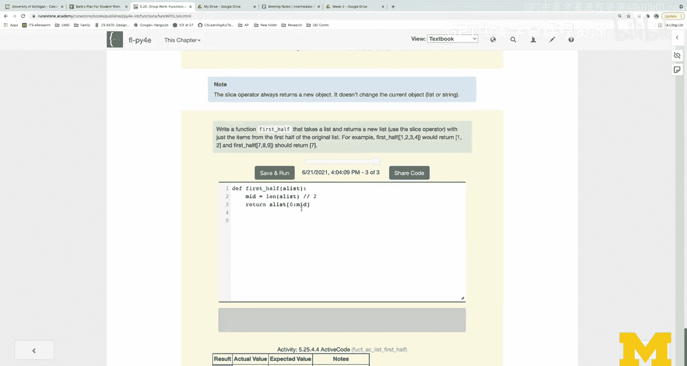

# 创造性编程：25：解决 `first_half` 问题 🧩


在本节课中，我们将学习如何编写一个名为 `first_half` 的函数。这个函数的目标是接收一个列表作为参数，并返回该列表的前半部分元素组成的新列表。我们将使用Python的切片操作符来实现这个功能，并确保它能正确处理包含偶数个和奇数个元素的列表。

## 函数目标与思路

上一节我们介绍了列表切片的基本概念。本节中，我们来看看如何应用切片来解决一个具体问题：获取列表的前半部分。

`first_half` 函数需要接收一个列表，并返回一个新列表，该新列表包含原列表从开头到中间位置的元素。例如：
*   输入 `[1, 2, 3, 4]`，应返回 `[1, 2]`。
*   输入 `[7, 8, 9]`，应返回 `[7]`。

为了实现这个功能，我们需要找到列表的“中点”索引。核心步骤是计算列表长度，然后通过整数除法找到中间位置。

## 实现步骤详解

以下是实现 `first_half` 函数的具体步骤。

首先，我们需要计算列表的长度以确定其中点。我们可以使用内置的 `len()` 函数来获取列表的长度。

```python
length = len(input_list)
```

接下来，我们需要找到切片的终点索引，即列表的“中点”。我们使用整数除法运算符 `//` 来计算。整数除法会丢弃结果的小数部分，只保留整数，这正好符合切片索引必须是整数的要求。

```python
mid = length // 2
```

现在，我们可以使用切片操作符来获取列表的前半部分。切片语法 `list[start:end]` 会返回从索引 `start` 到 `end-1` 的元素。由于我们需要从列表开头（索引0）切到中点 `mid`，所以可以这样写：

```python
return input_list[:mid]
```
这里，起始索引 `0` 被省略了，这是Python切片的默认行为。

## 代码验证与测试

让我们用之前的例子来验证这个逻辑是否正确。

对于列表 `[1, 2, 3, 4]`：
*   `length` 为 4。
*   `mid` 为 `4 // 2 = 2`。
*   切片 `[:2]` 返回索引 0 和 1 的元素，即 `[1, 2]`。✅ 正确。

对于列表 `[7, 8, 9]`：
*   `length` 为 3。
*   `mid` 为 `3 // 2 = 1`。
*   切片 `[:1]` 返回索引 0 的元素，即 `[7]`。✅ 正确。

因此，完整的函数实现如下：

```python
def first_half(input_list):
    mid = len(input_list) // 2
    return input_list[:mid]
```

运行包含测试用例的程序后，这个函数能够通过所有测试。



## 总结


本节课中我们一起学习了如何编写 `first_half` 函数。我们回顾了使用 `len()` 函数获取列表长度，并利用整数除法 `//` 计算中点索引。最关键的是，我们应用了列表切片操作 `list[:mid]` 来优雅地提取列表的前半部分元素。记住，合理利用这些内置函数和操作符可以让代码更简洁、高效。