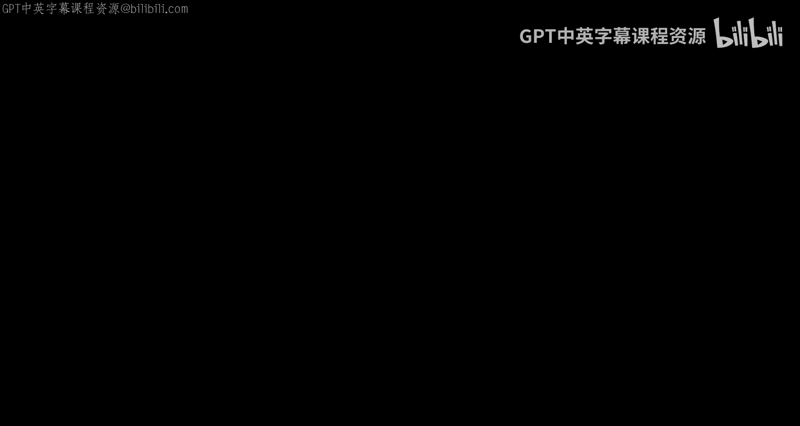
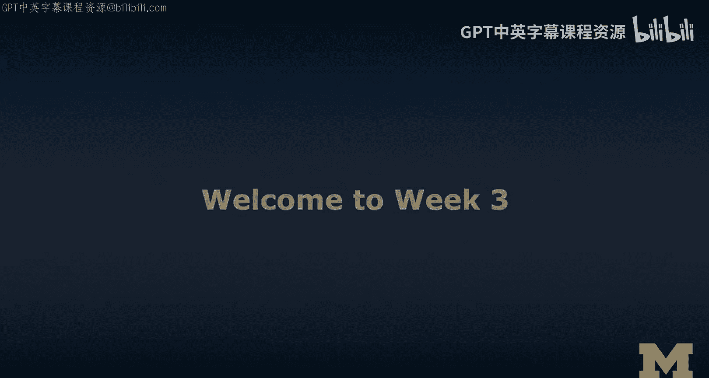
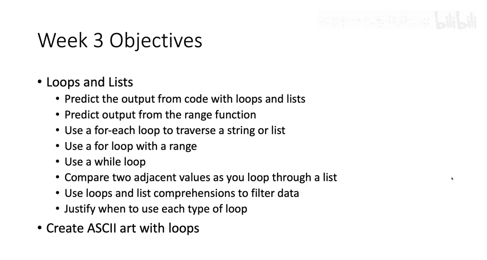
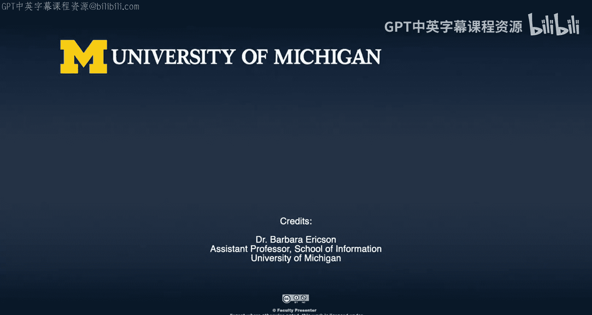

# 创造性编程：第三周：循环与列表入门 🚀

在本节课中，我们将要学习编程中的两个核心概念：**循环**和**列表**。你将学会如何预测包含循环和列表的代码输出，掌握多种循环的使用方法，并了解如何高效地处理和筛选数据。

---

## 循环与列表的核心概念 🔄

上一节我们介绍了本周的学习目标，本节中我们来看看具体要掌握哪些技能。

你将能够：
*   预测包含**循环**和**列表**的代码的输出。
*   在遍历对象时使用 **`range`** 函数。
*   使用 **`for each`** 循环来遍历字符串或列表。
*   使用带 **`range`** 的 **`for`** 循环或 **`while`** 循环。
*   在遍历列表时，比较两个相邻的值。

---

## 高效编程技巧 ⚡

在掌握了基础循环后，我们可以进一步提升代码效率。

我将向你展示如何使用**列表推导式**，这是一种能让代码更简洁、并能过滤数据的方法。

同时，你也需要学会在面对具体问题时，如何判断并选择使用哪种类型的循环。

---

## 本周实践任务 🎨

理论需要结合实践。为了巩固所学知识，本周的作业是**创作ASCII艺术**。

---

### 总结

本节课中我们一起学习了第三周的主要内容：**循环**与**列表**的各种操作，包括`for`循环、`while`循环、`range`函数以及高效的**列表推导式**。最后，我们知道了本周将通过创作ASCII艺术来应用这些新技能。

希望你本周学习愉快！