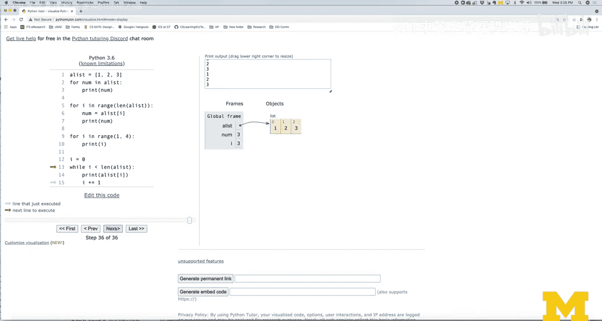
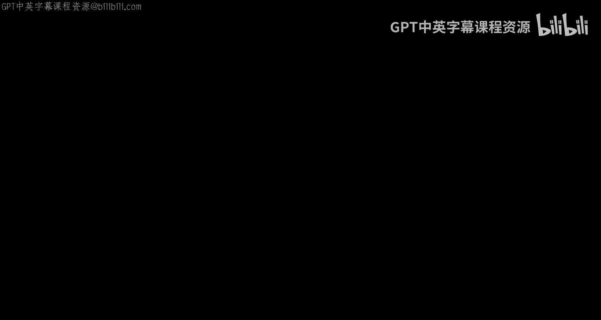

# 27：循环结构总览 🔄


在本节课中，我们将要学习Python编程中一个强大的功能：循环。循环允许我们重复执行一段代码，这对于处理数据集合或重复任务至关重要。我们将探讨三种主要的循环方式，并通过简单的示例理解它们的工作原理。

---

## 循环的基本概念

编程的强大特性之一是能够迭代或重复执行一条语句或一个语句块。在Python中，有多种方式可以实现循环。让我们通过一些代码来了解它们。

---

## 1. For Each 循环

首先，我们来看 **for each** 循环。这种循环会逐个遍历列表中的每个元素。

以下是其工作原理的代码示例：

```python
numbers = [1, 2, 3]
for num in numbers:
    print(num)
```

在这个例子中，变量 `num` 会依次取列表 `numbers` 中的每一个值（1， 2， 3），然后打印出来。这是一种直接遍历集合元素的方法。

---

## 2. 带 Range 的 For 循环

上一节我们介绍了直接遍历元素的循环，本节中我们来看看如何使用索引进行循环。**带 range 的 for 循环** 允许我们从某个起始索引开始，到某个结束索引为止进行循环。

以下是其工作原理的代码示例：

```python
numbers = [1, 2, 3]
for i in range(len(numbers)):
    print(numbers[i])
```

`range(len(numbers))` 会生成一个从 0 到 2（因为列表长度为3）的迭代器。变量 `i` 依次成为这些索引值（0， 1， 2），我们通过 `numbers[i]` 来访问列表中的对应元素并打印。

当你不想遍历整个列表，或者只想遍历列表的一部分时，这种方法非常有用。你也可以直接使用 `range` 函数指定一个固定的范围。

```python
for i in range(1, 4):
    print(i)
```

这段代码会打印数字 1， 2， 3。`range(1, 4)` 表示从 1 开始（包含），到 4 结束（不包含）。

---

## 3. While 循环

除了基于集合或固定次数的循环，我们还可以使用 **while 循环**。这种循环会在某个布尔表达式为 `True` 时持续执行。

以下是其工作原理的代码示例：

```python
numbers = [1, 2, 3]
i = 0
while i < len(numbers):
    print(numbers[i])
    i = i + 1
```

我们首先设置一个计数器 `i` 为 0。只要 `i` 小于列表长度（3），循环就会继续。在循环体内，我们打印 `numbers[i]` 的值，然后将 `i` 增加 1。这个过程会一直持续，直到 `i` 等于 3，此时条件 `i < 3` 不再为真，循环结束。

---

## 总结



本节课中我们一起学习了Python中三种主要的循环结构：
1.  **For Each 循环**：用于直接遍历序列（如列表）中的每个元素。
2.  **带 Range 的 For 循环**：通过索引或固定范围来控制循环次数。
3.  **While 循环**：在满足特定条件时重复执行代码块。



理解这些循环结构是掌握编程逻辑和高效处理重复任务的关键。你可以根据不同的场景选择最合适的循环方式。