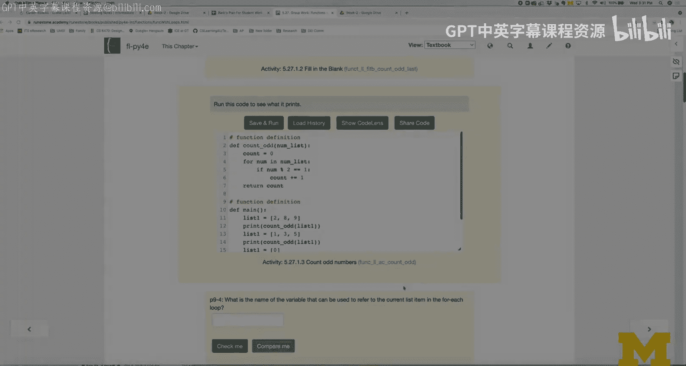
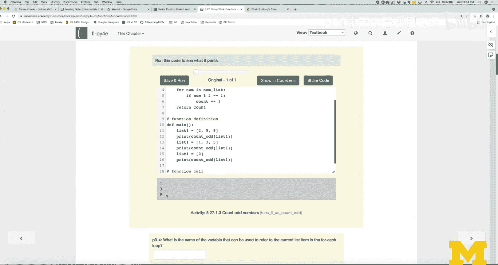

# 28：单步调试count_odd函数 🐛




在本节课中，我们将学习如何使用代码透镜（Code Lens）工具来单步调试一个名为 `count_odd` 的函数。通过逐行执行代码，我们可以清晰地观察程序的状态变化，这对于理解和调试程序逻辑至关重要。

## 概述

我们将分析一个计算列表中奇数个数的函数。通过单步调试，我们将观察变量如何被赋值、循环如何执行以及条件判断如何影响程序流程。

## 函数解析

首先，我们来看一下 `count_odd` 函数的定义。它的作用是遍历一个数字列表，并统计其中奇数的数量。

```python
def count_odd(num_list):
    count = 0
    for num in num_list:
        if num % 2 == 1:
            count += 1
    return count
```

**代码解释**：
*   `count = 0`：初始化计数器。
*   `for num in num_list:`：遍历列表中的每一个数字。
*   `if num % 2 == 1:`：使用取模运算符 `%` 判断数字是否为奇数。公式 **`num % 2 == 1`** 成立时，`num` 为奇数。
*   `count += 1`：如果数字是奇数，计数器加一。
*   `return count`：返回最终的计数结果。

## 使用代码透镜进行单步调试

上一节我们介绍了函数的基本逻辑，本节中我们来看看如何使用代码透镜工具来可视化执行过程。

点击“代码透镜”按钮后，工具会加载并显示代码。一条**红色高亮线**会指示即将执行的代码行。执行后，该行会变为**绿色**，表示已执行完毕。

以下是使用代码透镜调试的步骤：

1.  **定义函数**：首先，工具会高亮并执行函数定义部分，在内存中创建 `count_odd` 函数。
2.  **执行主程序**：接着，执行跳到主函数（`main`）的调用处。
3.  **创建列表**：执行 `list1 = [2, 8, 9]`，工具会可视化地展示这个列表及其索引。
4.  **调用函数**：执行 `print(count_odd(list1))`，程序进入 `count_odd` 函数内部。

## 深入函数内部执行过程

现在，我们进入 `count_odd` 函数，观察其内部的逐步执行。

1.  **初始化计数器**：首先执行 `count = 0`，变量 `count` 被创建并赋值为0。
2.  **开始循环**：`for num in num_list:` 开始执行。第一次循环，列表的第一个元素 `2` 被赋值给变量 `num`。
3.  **条件判断**：检查条件 `if num % 2 == 1`。计算 `2 % 2`，结果为0，不等于1。因此条件为假，不执行 `count += 1`。
4.  **继续循环**：回到循环开始，取下一个元素 `8` 赋值给 `num`。判断 `8 % 2 == 1`，结果为假，计数器仍未增加。
5.  **最后一次循环**：取最后一个元素 `9` 赋值给 `num`。判断 `9 % 2 == 1`，结果为真，因为9是奇数。于是执行 `count += 1`，计数器 `count` 的值从0变为1。
6.  **返回结果**：循环结束，执行 `return count`，将结果 `1` 返回给主调函数。
7.  **打印输出**：主函数接收到返回值 `1`，并通过 `print` 语句输出。

## 测试更多用例

单步调试完第一次调用后，我们可以继续观察函数如何处理不同的输入。

以下是后续的测试用例和结果：
*   当 `list1` 被重新赋值为 `[1, 3, 5]` 并调用 `count_odd` 时，函数返回 `3`，因为所有数字都是奇数。
*   当列表是 `[0, 2, 4]` 时，函数返回 `0`，因为其中没有奇数（0不被视为奇数）。

调试完成后，可以隐藏代码透镜视图，直接保存并运行代码以查看所有输出。



## 总结

本节课中我们一起学习了如何使用代码透镜进行单步调试。我们详细跟踪了 `count_odd` 函数的执行过程，观察了变量状态在循环和条件判断中的变化。记住，**`代码透镜（Code Lens）`** 是一个强大的调试工具，它可以帮助你直观地理解代码执行流程，从而更有效地发现和修复程序中的错误。