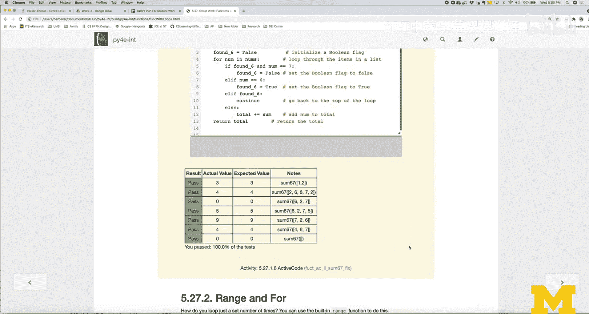

# 29：修复sum67函数 🔧


在本节课中，我们将学习如何修复一个名为 `sum67` 的函数。这个函数的目标是计算列表中所有数字的总和，但需要忽略所有介于数字6和7（包括6和7本身）之间的数字。我们将通过分析代码、识别错误并逐步修正来完成任务。

---

## 概述与问题定位

首先，我们来看一下需要修复的 `sum67` 函数。你可以随时运行代码来查看错误信息。错误提示指出第5行有“bad input”。如果你之前使用过其他编程语言，可能会遇到一个常见问题：Python使用关键字 `and` 进行逻辑“与”操作，而不是像Java或C++那样使用 `&&` 符号。这是第一个需要修正的问题。

此外，第7行应该使用双等号 `==` 来测试相等性，而不是单等号。单等号在Python中是赋值操作符。

修正了语法错误后，代码可以编译，但测试仍然失败。这表明逻辑上还存在问题。

---

## 分析函数逻辑

`sum67` 函数接收一个数字列表 `nums`，并返回列表中所有项目的总和，但需要忽略所有介于数字6和7（包括6和7本身）之间的数字。例如：
*   `sum67([1, 2, 3])` 应返回 `6`，因为列表中没有6或7。
*   `sum67([2, 6, 8, 7, 2])` 应返回 `4`，因为需要忽略从6到7之间的所有数字（即 `6, 8, 7`）。

函数定义如下，它接收一个数字列表。我们初始化总和 `total` 为0，并设置一个标志 `found6` 来追踪是否遇到了一个尚未配对的数字6。

```python
def sum67(nums):
    total = 0
    found6 = True  # 初始值可能有问题
    for num in nums:
        if found6 and num == 7:
            found6 = False
        elif num == 6:
            found6 = True
            continue
        if found6:
            continue
        else:
            total += num
    return total
```

---

## 逐步调试与修正

上一节我们介绍了函数的基本逻辑，本节中我们来看看具体的错误点并进行修正。

**1. 初始化标志 `found6`**
代码中 `found6` 的初始值被设置为 `True`。这不符合逻辑，因为在开始遍历列表时，我们还没有找到任何数字6。因此，我们应该将其初始值改为 `False`。

```python
found6 = False  # 修正：初始状态应为未找到6
```

**2. 调整条件判断顺序**
当前代码的逻辑是：如果 `found6` 为真且当前数字是7，则将标志置为 `False`。否则，如果数字是6，则将标志置为 `True` 并跳过后续操作。这个逻辑基本正确，但需要确保在遇到6时，6本身不被计入总和。

**3. 修复过早返回**
原代码中，`return total` 语句错误地缩进在了 `for` 循环内部。这会导致循环在第一次迭代后就提前返回，无法遍历整个列表。我们需要将其移到循环体外。

```python
def sum67(nums):
    total = 0
    found6 = False  # 修正1：初始化未找到6
    for num in nums:
        if found6 and num == 7:
            found6 = False
        elif num == 6:
            found6 = True
        elif not found6:  # 如果不在6和7之间，则累加
            total += num
    return total  # 修正2：在循环结束后返回
```

**4. 逻辑梳理**
修正后的逻辑流程如下：
*   如果 `found6` 为真且当前数字是 `7`：关闭忽略区间标志（`found6 = False`）。
*   否则，如果当前数字是 `6`：开启忽略区间标志（`found6 = True`）。
*   否则，如果 `found6` 为假（即不在忽略区间内）：将当前数字加入总和 `total`。

---

## 修正后的完整代码

以下是经过所有修正后的 `sum67` 函数代码：

```python
def sum67(nums):
    total = 0
    found6 = False
    for num in nums:
        if found6 and num == 7:
            found6 = False
        elif num == 6:
            found6 = True
        elif not found6:
            total += num
    return total
```

---

## 总结



本节课中我们一起学习了如何修复 `sum67` 函数。我们主要完成了以下工作：
1.  识别并修正了Python语法上的常见错误，如使用 `and` 而非 `&&`，以及使用 `==` 进行相等比较。
2.  修正了逻辑标志 `found6` 的错误初始值。
3.  确保了函数在遍历完整个列表后才返回结果，而不是提前返回。
4.  梳理了函数的核心逻辑：使用一个布尔标志来跟踪是否处于应被忽略的“6到7”区间内，并据此决定是否将数字累加到总和中。


通过这个练习，你不仅修复了一个具体的函数，也加强了对条件逻辑、循环控制和调试技巧的理解。