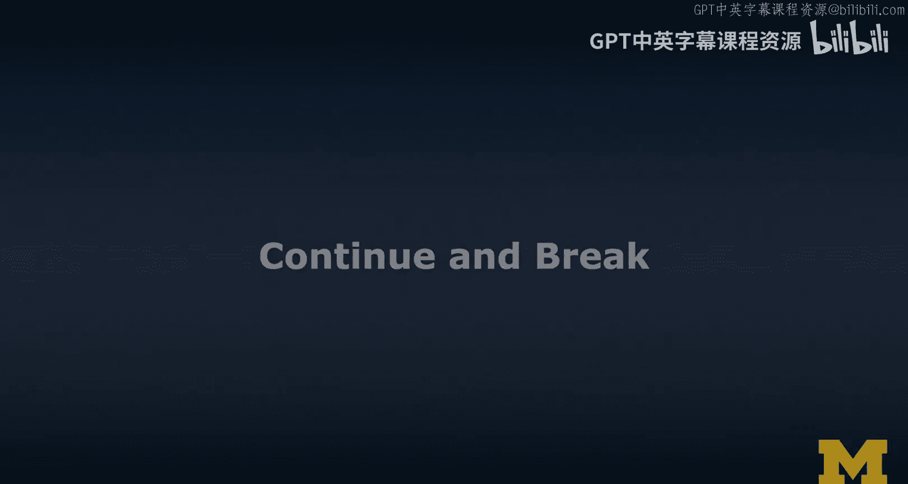
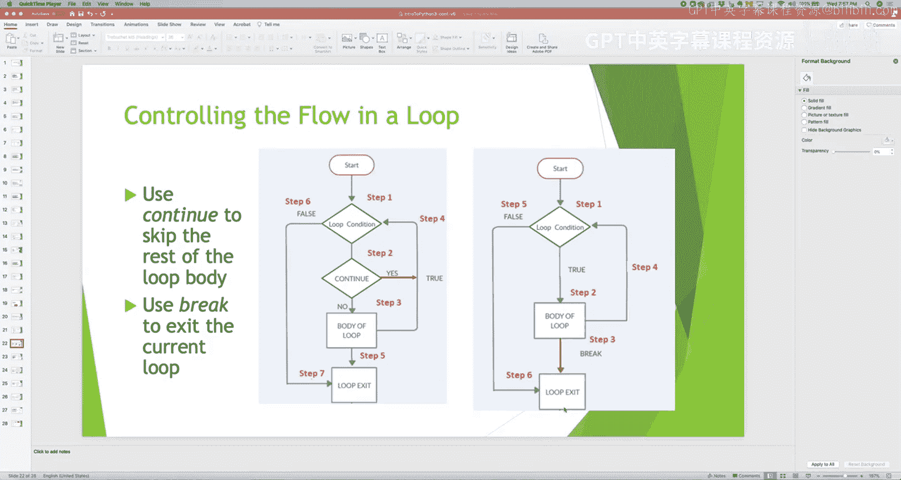
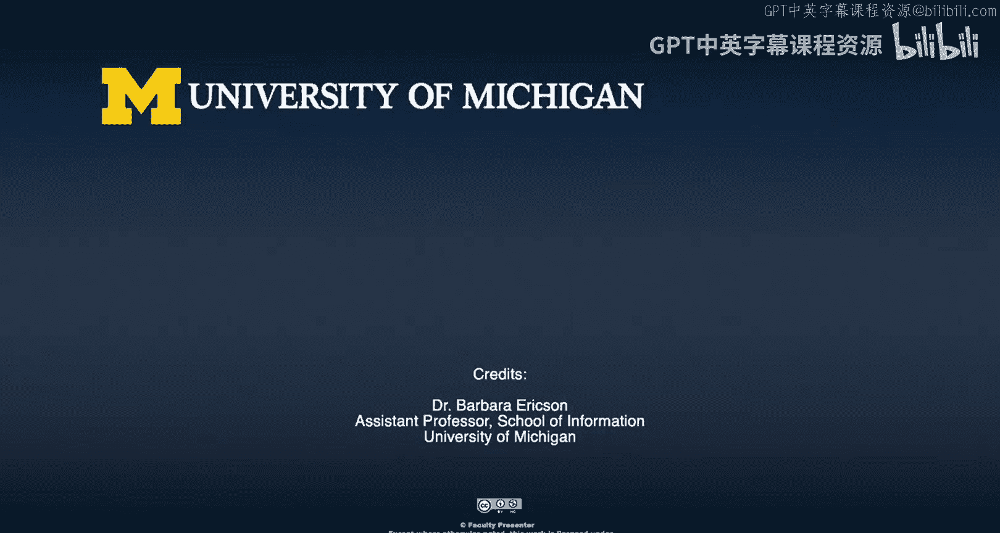

# 30：循环进阶技巧 🔄




在本节课中，我们将学习如何改变循环的控制流程，具体介绍 `continue` 和 `break` 这两个关键语句的用法。它们能让我们更灵活地控制循环的执行路径。

## 理解循环控制流

上一节我们介绍了循环的基本结构。本节中，我们来看看如何通过特定语句来干预循环的执行过程。

循环通常从检查条件开始。只要条件为真，就会执行循环体。然而，有时我们希望在循环体执行到一半时，根据特定情况跳过剩余部分或直接终止整个循环。

## 使用 `continue` 语句

`continue` 语句用于跳过当前循环迭代中剩余的代码，并立即返回到循环条件检查处。

其工作流程可以概括为以下伪代码：
```
while 条件:
    # 执行部分代码...
    if 某个特定条件:
        continue  # 跳过后面的代码，回到 `while 条件:` 处
    # 如果执行了continue，这部分代码将被跳过...
```
当在循环体内遇到 `continue` 时，程序会忽略 `continue` 之后的所有语句，直接跳转回循环的开头，重新评估循环条件。如果条件仍然为真，则开始下一次迭代。

## 使用 `break` 语句

`break` 语句用于立即终止当前所在的整个循环。

其工作流程可以概括为以下伪代码：
```
while 条件:
    # 执行部分代码...
    if 某个特定条件:
        break  # 立即退出整个循环
    # 如果执行了break，循环结束，这部分代码不会执行...
```
当在循环体内遇到 `break` 时，无论循环条件当前是否为真，程序都会立即退出该循环，继续执行循环之后的代码。一个常见的用法是配合 `while True:` 创建“无限循环”，然后在满足某个条件时用 `break` 安全退出。

## `continue` 与 `break` 的作用范围

以下是关于这两个语句作用范围的重要说明：
*   `continue` 和 `break` 只影响它们所在的、最内层的那个循环。
*   如果循环是嵌套的（即一个循环 inside 另一个循环），`break` 只会退出它所在的那一层循环，外层的循环会继续执行。



## 总结




本节课中我们一起学习了循环的两个进阶控制语句。`continue` 让我们能够跳过当前迭代的剩余部分，直接开始下一次循环。而 `break` 则允许我们在满足特定条件时，立即终止整个循环。合理运用这两个工具，可以让你编写的循环逻辑更加清晰和强大。