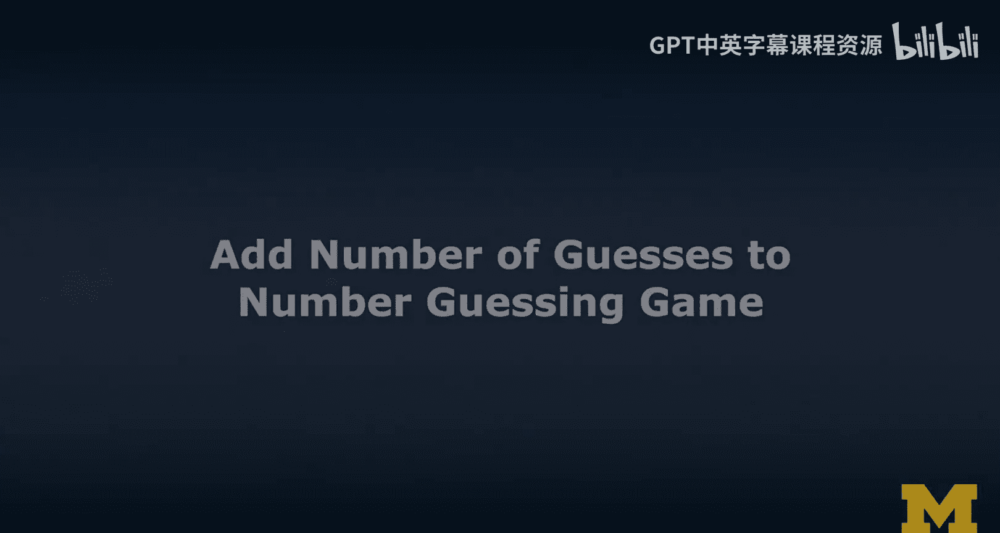
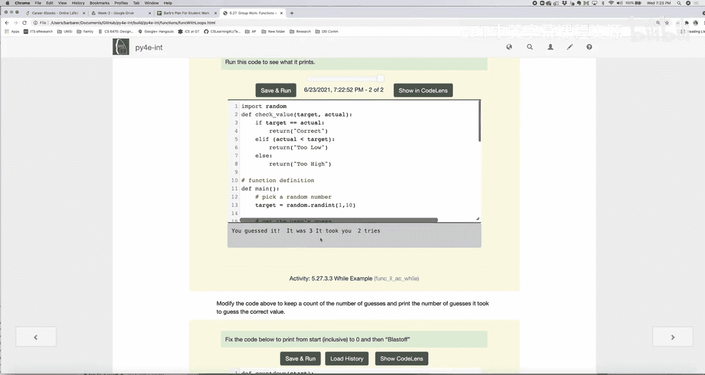

# 创造性编程：1.30：为猜数游戏添加尝试计数 🎮




在本节课中，我们将学习如何在一个简单的猜数字游戏中，使用 `while` 循环来追踪玩家的尝试次数。我们将通过修改代码，添加一个计数器来实现这一功能。

---

## 概述

`while` 循环的一个绝佳应用场景是当你不知道需要多少次迭代时。例如，在一个游戏中，你无法预知玩家何时会获胜。我们将以一个简单的猜数字游戏为例，玩家需要猜测一个1到10之间的数字，并会收到“正确”、“过低”或“过高”的反馈。我们将使用 `while` 循环来持续游戏，直到玩家猜中为止，并在此过程中记录猜测的次数。

## 代码解析

首先，我们来看一下基础的游戏代码结构。

```python
import random

def check_value(target, actual):
    if actual == target:
        return "correct"
    elif actual < target:
        return "too low"
    else:
        return "too high"

def main():
    target = random.randint(1, 10)
    guess = int(input("Enter a number between 1 and 10 inclusive: "))
    result = check_value(target, guess)

    while result != "correct":
        print(result)
        guess = int(input("Enter another number: "))
        result = check_value(target, guess)

    print("You guessed it! It was", target)

if __name__ == "__main__":
    main()
```

这段代码首先导入 `random` 模块来生成随机目标数字。`check_value` 函数用于比较猜测值与目标值，并返回相应的提示字符串。在 `main` 函数中，程序会持续循环，直到玩家猜中数字为止。

## 添加尝试计数器

上一节我们介绍了游戏的基本循环逻辑。本节中，我们来看看如何修改代码以追踪玩家的猜测次数。

我们需要在 `main` 函数中初始化一个计数器变量，并在每次玩家进行错误猜测时递增它。以下是具体的修改步骤：

1.  **初始化计数器**：在获取第一次猜测之前，我们将计数器初始化为 `1`。这是因为玩家在进入循环前已经进行了一次猜测。
2.  **递增计数器**：在 `while` 循环内部，每次玩家猜错并需要再次尝试时，我们将计数器加一。
3.  **显示结果**：在游戏结束时，我们不仅打印出目标数字，还打印出玩家总共尝试的次数。

以下是修改后的 `main` 函数代码：

```python
def main():
    target = random.randint(1, 10)
    num_guesses = 1  # 初始化计数器为1
    guess = int(input("Enter a number between 1 and 10 inclusive: "))
    result = check_value(target, guess)

    while result != "correct":
        print(result)
        num_guesses += 1  # 每次错误猜测后递增计数器
        guess = int(input("Enter another number: "))
        result = check_value(target, guess)

    print("You guessed it! It was", target, "in", num_guesses, "tries.")
```

## 代码运行示例

让我们运行修改后的代码，看看它是如何工作的。

假设程序随机选择了数字 `3`。
*   玩家第一次猜测 `5`，程序提示“too high”，计数器仍为1（因为这是第一次猜测，尚未在循环内递增）。
*   玩家第二次猜测 `3`，程序提示“correct”，循环结束。
*   程序最终输出：`You guessed it! It was 3 in 2 tries.`

这准确地反映了玩家进行了两次尝试。

## 总结




本节课中我们一起学习了如何为猜数字游戏添加尝试计数功能。我们通过引入一个计数器变量 `num_guesses`，并在 `while` 循环中巧妙地管理它的初始化和递增，实现了对玩家游戏过程的追踪。这个例子很好地展示了 `while` 循环在处理未知迭代次数任务时的实用性，以及如何通过简单的变量操作来增强程序的功能。