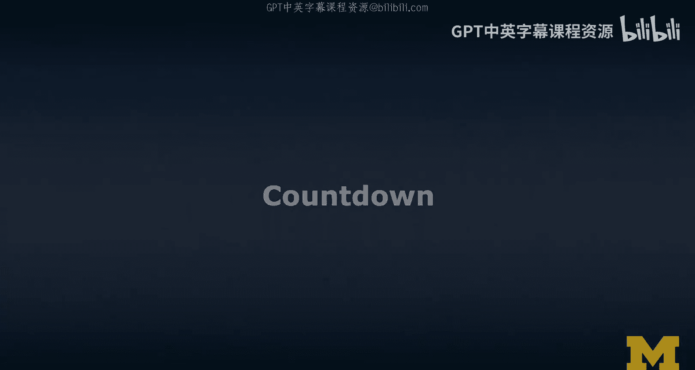
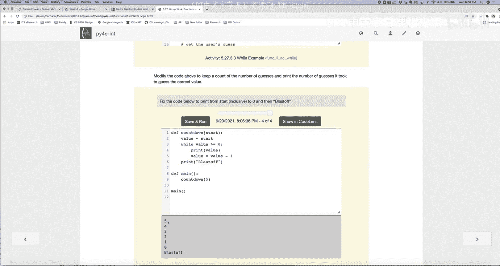

# 32：修复倒计时程序 🔧




在本节课中，我们将学习如何诊断并修复一个存在问题的倒计时程序。我们将重点关注无限循环的成因、如何正确使用`while`循环，以及如何确保程序按预期执行。

---

## 分析倒计时函数

首先，我们来看一下原始的倒计时函数。以下是其代码：

```python
def countdown(start):
    value = start
    while value > 0:
        print(value)
        print(blast off)
```

这个函数接收一个起始值`start`，并将其赋值给变量`value`。只要`value`大于0，循环就会继续执行，打印当前值并试图打印“blast off”。

## 识别问题

上一节我们分析了代码结构，本节中我们来看看运行它时会出现什么问题。

如果尝试运行这段代码，会发现程序似乎没有任何输出。这主要有两个原因：
1.  我们定义了两个函数（`countdown`和`main`），但从未调用它们。
2.  即使调用了函数，`while`循环的条件`value > 0`会永远为真，因为循环内部没有修改`value`的值，这导致了**无限循环**。

无限循环是使用`while`循环时一个非常常见的错误，它会使程序卡住，无法继续执行后续代码。

## 修复步骤

以下是修复这个倒计时程序需要进行的几个关键步骤：

1.  **确保函数被调用**：在脚本末尾添加对`main()`函数的调用。
2.  **修改循环变量**：在`while`循环内部，每次迭代后需要减少`value`的值，否则循环永远不会结束。
3.  **修正字符串语法**：`print(blast off)`中的`blast off`是一个字符串，需要用引号包裹。
4.  **调整循环条件**：为了能从起始值倒数到0，循环条件应改为`value >= 0`。

让我们应用这些修复。修改后的代码如下：

```python
def countdown(start):
    value = start
    while value >= 0:  # 修改条件，包含0
        print(value)
        value = value - 1  # 每次循环减少value的值
    print("blast off")  # 修正字符串语法

def main():
    countdown(5)

# 调用main函数，启动程序
main()
```

运行修复后的代码，程序将能够顺利地从5倒数到0，然后打印出“blast off”。



---


本节课中我们一起学习了如何诊断和修复一个存在无限循环和语法错误的倒计时程序。核心要点包括：理解`while`循环的执行逻辑、避免无限循环的关键在于在循环体内修改条件变量、以及确保正确的函数调用和语法。掌握这些调试技巧对编程至关重要。