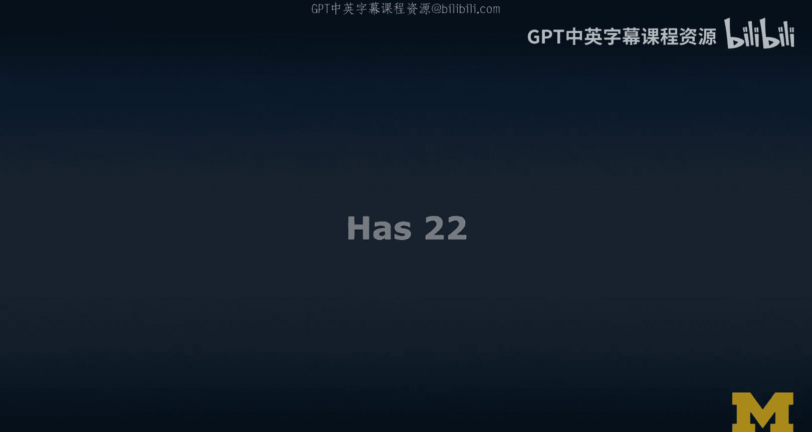
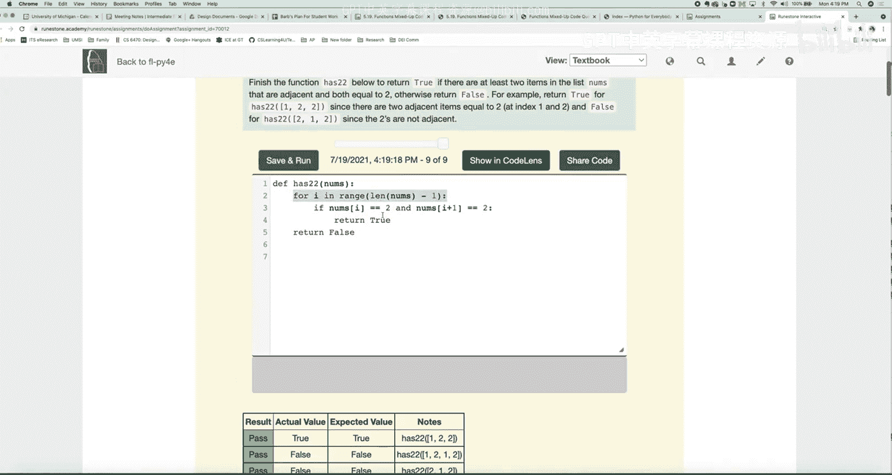

# 创造性编程：33：列表相邻值比较方法




在本节课中，我们将要学习如何在遍历列表时，比较相邻的两个元素。这是一个常见的编程任务，例如检查列表中是否存在连续重复的元素。我们将通过一个具体的例子来掌握这种方法。

## 概述

遍历列表时，有时我们需要比较当前元素与其相邻的下一个元素。直接使用 `for item in list` 这种循环方式无法方便地获取当前元素的索引，从而难以访问其相邻元素。因此，我们需要一种能够获取索引的遍历方法。

上一节我们介绍了基本的列表遍历，本节中我们来看看如何通过索引来比较相邻元素。

## 核心方法：使用索引遍历

为了比较列表中的相邻元素，我们可以使用 `for` 循环配合 `range()` 函数来遍历列表的索引。这样，在每次循环中，我们不仅知道当前元素 `nums[i]`，还能通过 `i+1` 访问到它的下一个元素 `nums[i+1]`。

以下是实现这一思路的关键步骤：

1.  使用 `range(len(nums))` 生成从 `0` 到 `len(nums)-1` 的索引序列。
2.  在循环体内，通过 `nums[i]` 和 `nums[i+1]` 访问相邻元素并进行比较。

**注意**：当我们访问 `nums[i+1]` 时，必须确保 `i+1` 是一个有效的索引，不会超出列表范围。这意味着我们的循环不能一直进行到最后一个索引，而应该在倒数第二个索引处停止。

因此，正确的循环范围是 `range(len(nums) - 1)`。这样，`i` 的最大值就是 `len(nums)-2`，而 `i+1` 就是最后一个元素的索引 `len(nums)-1`，从而避免了 `IndexError`。

## 实践案例：检查相邻的2

让我们通过一个具体的函数来实践这个方法。函数 `has22(nums)` 的目标是：如果列表 `nums` 中至少有一对相邻的元素都等于 `2`，则返回 `True`；否则返回 `False`。

例如：
*   `has22([1, 2, 2])` 应返回 `True`，因为索引1和2的元素都是2。
*   `has22([2, 1, 2])` 应返回 `False`，因为两个2并不相邻。

以下是该函数的实现代码：

```python
def has22(nums):
    for i in range(len(nums) - 1):
        if nums[i] == 2 and nums[i + 1] == 2:
            return True
    return False
```

代码解释：
1.  `for i in range(len(nums) - 1):` 这行代码确保我们遍历从0到倒数第二个索引的所有位置。
2.  `if nums[i] == 2 and nums[i + 1] == 2:` 在循环中，检查当前元素和下一个元素是否都等于2。
3.  如果找到这样一对相邻的2，函数立即返回 `True`。
4.  如果循环结束都没有找到，则执行最后的 `return False` 语句。

**注意**：函数末尾的 `return False` 前面不需要加 `else`。因为如果条件满足，函数会在循环内部的 `return True` 处提前返回。只有当循环完整执行完毕都未返回时，才会执行到最后的 `return False`。



## 总结


本节课中我们一起学习了如何在Python中比较列表的相邻元素。核心要点是使用索引进行遍历，并特别注意循环的边界条件，防止访问越界。这种方法适用于任何需要比较列表中连续元素对的场景，是处理序列数据的一项基础且重要的技能。