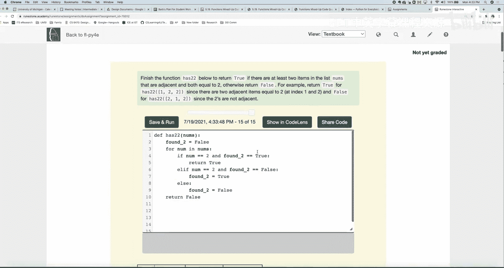

# 34：相邻值比较替代方案 🔄


在本节课中，我们将学习解决“检查列表中是否存在连续两个相同数字”问题的另一种方法。我们将使用一个布尔标志变量，通过简单的 `for` 循环来追踪状态，而不必直接操作列表索引。

上一节我们介绍了通过索引遍历列表来比较相邻元素的方法。本节中我们来看看如何不依赖索引，仅通过一个标志变量和 `for` 循环来实现相同的功能。

## 核心思路概述 💡

该方法的核心是使用一个名为 `found_two` 的布尔变量作为“状态记录器”。它的初始值为 `False`，表示尚未遇到数字 `2`。当我们遍历列表时，根据当前数字和 `found_two` 的状态来更新这个标志，并判断是否找到了连续的两个 `2`。

## 算法步骤详解 🛠️

以下是使用布尔标志变量实现 `has22` 函数的具体步骤：

1.  **初始化标志变量**：创建一个布尔变量 `found_two` 并将其初始值设为 `False`。在 Python 中，布尔值 `True` 和 `False` 的首字母必须大写。
    ```python
    found_two = False
    ```

2.  **遍历列表元素**：使用 `for` 循环遍历列表中的每一个数字。
    ```python
    for num in nums:
    ```

3.  **判断与状态更新**：在循环内部，根据当前数字 `num` 和 `found_two` 的状态进行条件判断：
    *   **情况一**：如果当前数字是 `2` **并且** `found_two` 已经是 `True`，这意味着我们刚刚遇到过一个 `2`，现在又遇到了一个 `2`，即找到了连续的两个 `2`。此时函数可以直接返回 `True`。
        ```python
        if num == 2 and found_two == True:
            return True
        ```
    *   **情况二**：如果当前数字是 `2` **但是** `found_two` 是 `False`，这意味着我们遇到了一个 `2`，但前一个数字不是 `2`。此时我们将 `found_two` 设置为 `True`，记录“刚刚遇到一个 `2`”这个状态。
        ```python
        elif num == 2 and found_two == False:
            found_two = True
        ```
    *   **情况三**：如果当前数字不是 `2`，则无论之前的状态如何，都需要将 `found_two` 重置为 `False`，因为连续状态已被打断。
        ```python
        else:
            found_two = False
        ```

4.  **循环结束处理**：如果完整遍历了整个列表，都没有触发返回 `True` 的条件，则说明列表中不存在连续的两个 `2`，函数最终返回 `False`。
    ```python
    return False
    ```

## 方法总结 📝



本节课中我们一起学习了解决“检查连续两个相同数字”问题的替代方案。这种方法利用一个布尔变量来记忆前一个元素是否为目标值（如 `2`），从而在遍历过程中动态判断连续性。它避免了直接使用索引，逻辑清晰，是处理此类“状态依赖”型问题的有效模式。


通过对比两种方法，你可以根据实际情况选择使用索引遍历，或是使用这种基于状态标志的循环策略。