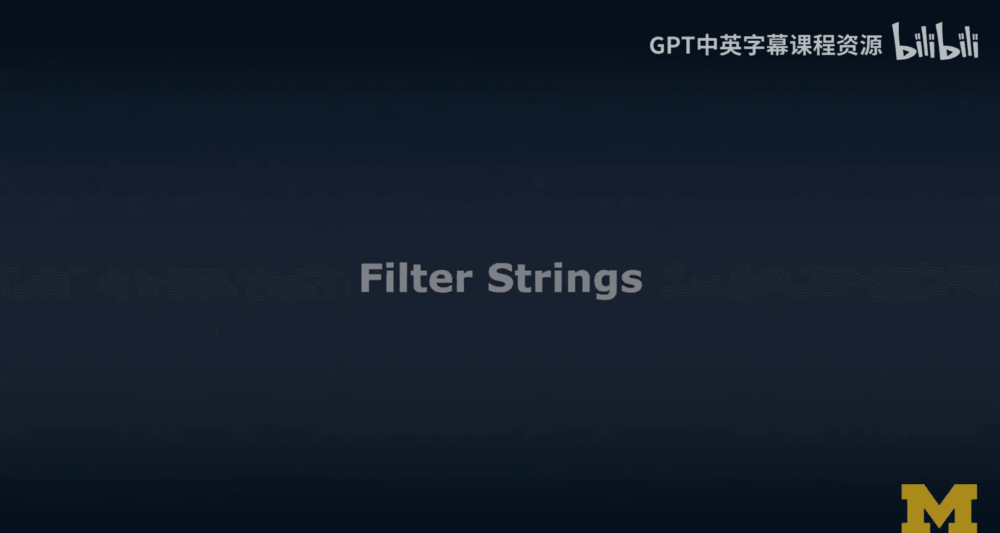
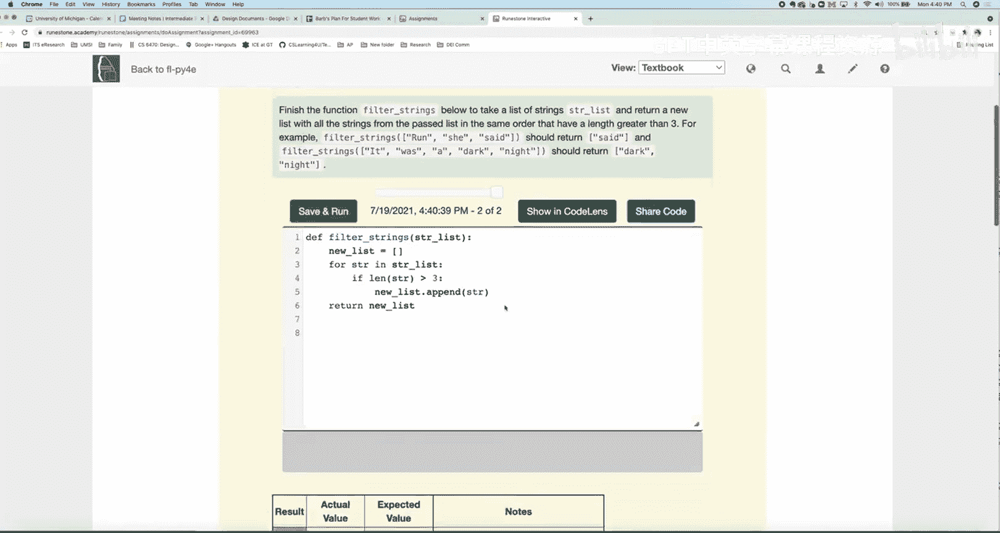
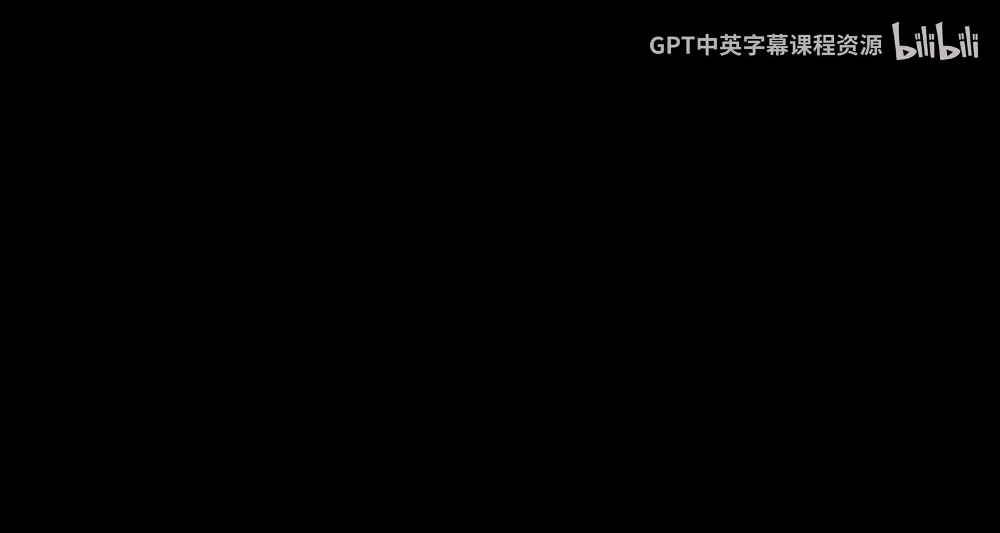

# 35：循环数据过滤技术 🔄




在本节课中，我们将学习一种处理列表的实用技术：遍历列表并过滤出符合特定条件的元素。具体来说，我们将通过一个示例，学习如何从一个原始列表中筛选出满足条件的元素，并创建一个包含这些元素的新列表。

---

上一节我们介绍了列表的基本操作，本节中我们来看看如何通过循环来过滤列表中的数据。

列表的一个常见用途是遍历其中的元素，并根据特定条件筛选出部分元素，从而创建一个新的列表。让我们通过一个例子来理解这个过程。

我们将完成一个名为 `filter_strings` 的函数。这个函数接收一个名为 `string_list` 的字符串列表，并返回一个新的列表。新列表将按原始顺序包含所有长度大于3的字符串。

例如，用列表 `["run", "she", "said"]` 调用 `filter_strings` 函数，应该只返回 `["said"]`，因为只有它的长度大于3。

以下是实现这个函数的步骤：

1.  首先，创建一个新的空列表，用于存放结果。
2.  然后，使用 `for` 循环遍历原始列表中的每一个字符串。
3.  在循环内部，检查当前字符串的长度是否大于3。
4.  如果条件满足，就将这个字符串添加到新列表中。
5.  循环结束后，返回这个新列表。

让我们尝试实现它。我们可以这样开始：

```python
def filter_strings(string_list):
    new_list = []  # 创建一个新的空列表
    for s in string_list:  # 遍历原始列表中的每个字符串
        if len(s) > 3:  # 检查字符串长度是否大于3
            new_list.append(s)  # 如果条件满足，将其添加到新列表末尾
    return new_list  # 返回新列表
```

请注意，必须确保函数最后返回了 `new_list`，否则函数将不会输出任何结果。

这就是过滤列表的一种方法：遍历列表中的每个元素，如果它符合你的筛选条件，就将其添加到一个新列表中，最后返回这个新列表。



---




本节课中我们一起学习了如何使用循环来过滤列表数据。我们创建了一个函数，它遍历输入的字符串列表，检查每个元素的长度，并将长度大于3的字符串收集到一个新列表中。这是一种基础但强大的数据处理技术，在后续处理集合数据时会经常用到。