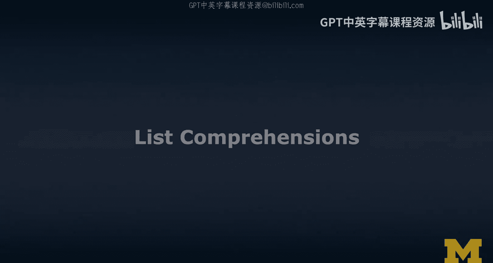
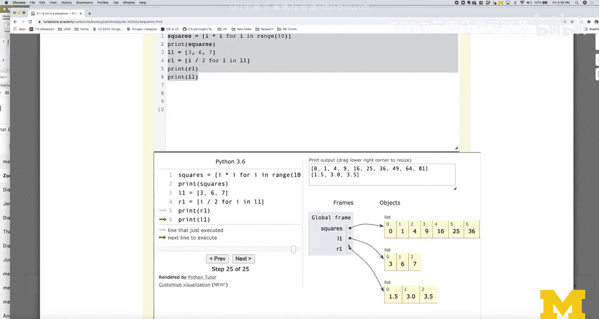

# Python 编程：第 36 章：列表推导式解析 📝




在本节课中，我们将要学习 Python 中一个非常有趣且强大的特性——列表推导式。这是一种创建或修改列表的简洁方法，能让代码更易读、更高效。

## 什么是列表推导式？ 🤔

列表推导式提供了一种优雅的方式来生成新列表。其核心思想是，通过对一个可迭代对象中的每个元素应用一个表达式，来构建一个新的列表。

上一节我们介绍了列表的基本操作，本节中我们来看看如何使用列表推导式来简化代码。

## 列表推导式的语法 📖

列表推导式的基本语法结构如下：

```python
new_list = [expression for member in iterable]
```

其中：
*   `new_list` 是生成的新列表的名称。
*   `expression` 是一个表达式，用于计算新列表中每个元素的值。
*   `member` 是每次迭代时，从 `iterable` 中取出的一个元素。
*   `iterable` 是一个可迭代对象，例如列表、元组、字符串或 `range` 对象。

可迭代对象指的是任何你可以遍历或循环处理的对象。例如，`range(10)` 会返回一个可以迭代的对象，你可以从中依次获取 0 到 9 这些值。

## 创建新列表的示例 🔢

让我们通过一个具体的例子来理解。假设我们想创建一个包含 0 到 9 的平方数的列表。

以下是使用列表推导式的方法：

```python
squares = [i * i for i in range(10)]
print(squares)
```

代码执行过程如下：
1.  `range(10)` 生成一个可迭代对象，包含数字 0 到 9。
2.  对于这个范围中的每个值 `i`（先是 0，然后是 1，依此类推，直到 9），计算表达式 `i * i`。
3.  将每次计算的结果（0, 1, 4, 9, ...）依次放入新列表 `squares` 中。
4.  最后打印这个列表，输出结果为 `[0, 1, 4, 9, 16, 25, 36, 49, 64, 81]`。

## 基于现有列表生成新列表 🔄

列表推导式不仅可以创建全新的列表，还可以基于现有列表生成一个经过转换的新列表。请注意，原始列表本身不会被修改。

以下是基于现有列表生成新列表的步骤：

假设我们有一个列表 `L1 = [3, 6, 7]`，我们想创建一个新列表，其中的每个元素都是 `L1` 中对应元素的一半。

```python
L1 = [3, 6, 7]
R1 = [i / 2 for i in L1]
print(R1)
print(L1)
```

代码执行过程如下：
1.  遍历列表 `L1` 中的每个元素 `i`（先是 3，然后是 6，最后是 7）。
2.  对每个 `i` 计算表达式 `i / 2`（得到 1.5, 3.0, 3.5）。
3.  将这些结果组成新列表 `R1`。
4.  打印 `R1` 会输出 `[1.5, 3.0, 3.5]`。
5.  打印原始的 `L1`，会发现它仍然是 `[3, 6, 7]`，没有被改变。这清楚地表明 `R1` 和 `L1` 是两个不同的列表对象。



## 总结 📚


本节课中我们一起学习了 Python 的列表推导式。我们了解到：
*   列表推导式是一种通过 `[expression for member in iterable]` 语法快速创建或转换列表的方法。
*   它可以用于从零开始生成新列表（如计算平方数）。
*   它也可以用于基于现有列表生成一个元素经过处理的新列表，而不会改变原列表。
*   掌握列表推导式能让你的代码更加简洁和 Pythonic。