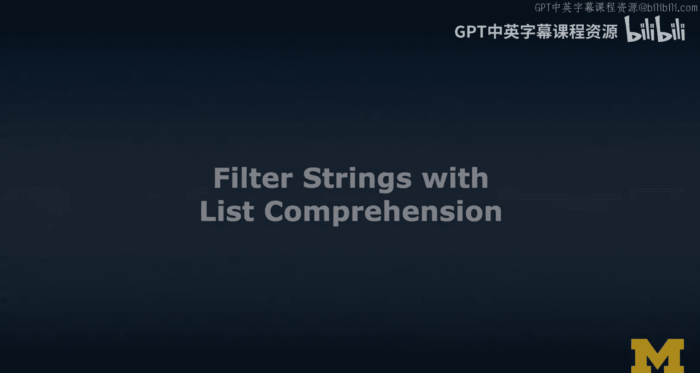
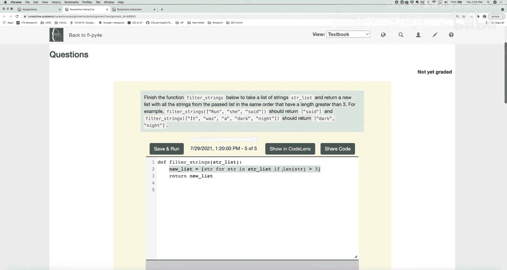

# 37：列表推导式数据过滤 📋




在本节课中，我们将学习如何使用列表推导式来简化数据过滤的代码。我们将从一个传统的循环方法开始，然后将其转换为更简洁、更高效的列表推导式。

## 概述

上一节我们介绍了使用 `for` 循环和条件判断来过滤列表中的字符串。本节中，我们来看看如何使用列表推导式实现相同的功能，并大幅减少代码量。

## 传统过滤方法回顾

我们之前解决字符串过滤问题的方法是：创建一个新的空列表，然后使用 `for` 循环遍历传入的字符串列表中的每一个字符串。如果该字符串的长度大于三，我们就将其追加到新列表中，最后返回这个新列表。

以下是该方法的代码表示：
```python
def filter_strings(str_list):
    new_list = []
    for s in str_list:
        if len(s) > 3:
            new_list.append(s)
    return new_list
```

## 引入列表推导式

列表推导式提供了一种更简洁的方式来创建列表。其核心思想是将循环和条件判断整合在一行代码中。

以下是使用列表推导式实现相同过滤功能的代码：
```python
def filter_strings(str_list):
    new_list = [s for s in str_list if len(s) > 3]
    return new_list
```

在这个列表推导式中：
*   `s for s in str_list` 是一个循环，它遍历 `str_list` 中的每个元素。
*   `if len(s) > 3` 是一个条件，只有满足该条件的元素才会被包含在新列表中。

## 列表推导式详解

列表推导式的基本结构可以概括为以下公式：
`新列表 = [表达式 for 变量 in 可迭代对象 if 条件]`

*   **表达式**：通常是对循环变量的操作或直接使用变量本身。
*   **for 变量 in 可迭代对象**：循环部分，用于遍历原始数据。
*   **if 条件**：可选部分，用于过滤元素。

在我们的例子中：
*   **表达式** 是 `s`（直接使用字符串本身）。
*   **循环** 是 `for s in str_list`。
*   **条件** 是 `if len(s) > 3`。

## 优势总结

使用列表推导式的主要优势在于：
*   **代码简洁**：将多行循环和条件判断压缩为一行。
*   **可读性高**：对于熟悉该语法的开发者，意图一目了然。
*   **效率相当**：在大多数情况下，其执行效率与传统的循环方法相同。




## 总结


本节课中我们一起学习了列表推导式在数据过滤中的应用。我们首先回顾了使用传统 `for` 循环和 `append` 方法进行过滤的步骤，然后引入了列表推导式这一更简洁的语法。通过对比，我们了解到列表推导式如何将循环、条件判断和列表创建合并为一行清晰的代码，从而让程序更加简洁易读。