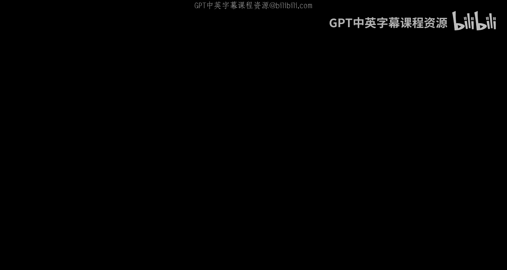
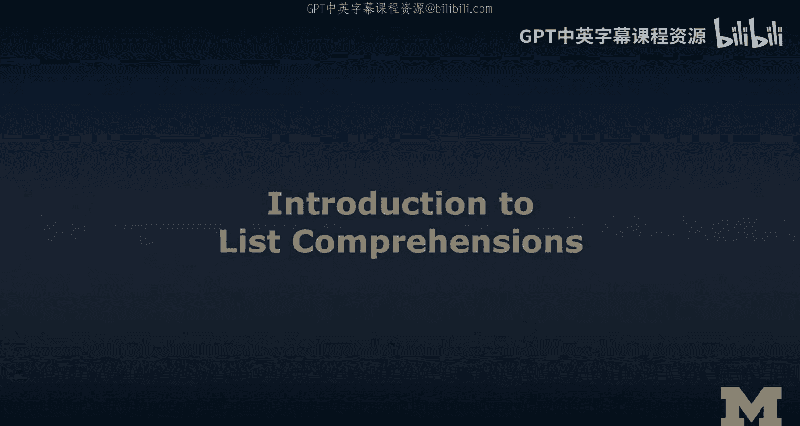
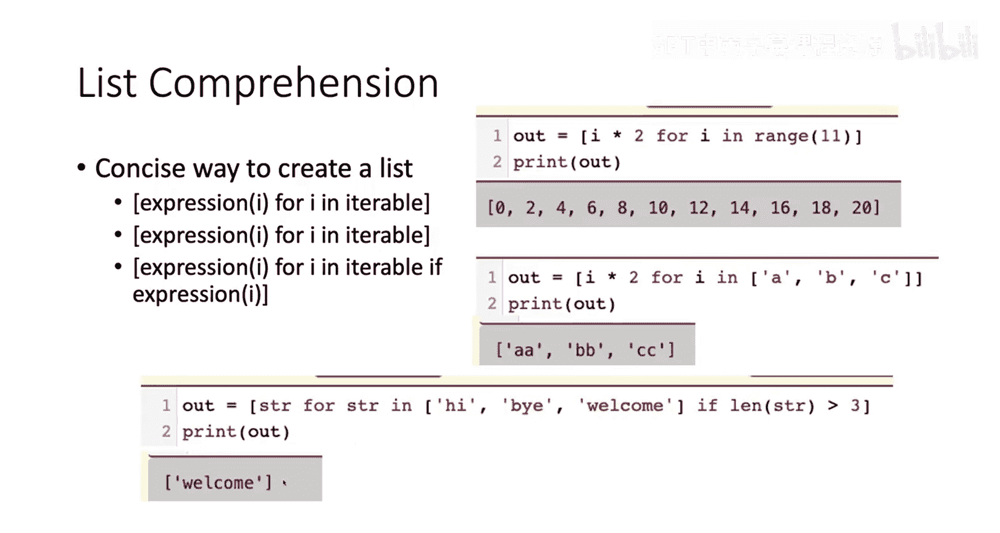

# 创造性编程：38：列表推导式进阶应用 🚀





在本节课中，我们将深入学习列表推导式。列表推导式是一种简洁的创建列表的方法，它允许你通过一个表达式和一个可迭代对象来生成新列表。我们将通过几个例子来理解其基本结构和高级用法。

## 列表推导式基础

上一节我们介绍了列表推导式的概念，本节中我们来看看它的具体语法。列表推导式的基本结构是：`[表达式 for 变量 in 可迭代对象]`。它会遍历可迭代对象中的每个元素，对每个元素执行表达式，并将结果收集到一个新列表中。

让我们看一个例子。

```python
out = [i * 2 for i in range(11)]
print(out)
```

这段代码会输出一个列表：`[0, 2, 4, 6, 8, 10, 12, 14, 16, 18, 20]`。`range(11)` 生成从 0 到 10 的数字序列。对于序列中的每个数字 `i`，表达式 `i * 2` 会计算其两倍的值，并放入新列表。

## 使用列表作为可迭代对象

除了 `range`，我们也可以直接使用一个列表作为可迭代对象。

以下是另一个例子，它使用字符串列表作为输入。

```python
out = [i * 2 for i in [“A”, “B”, “C”]]
print(out)
```

这段代码会输出：`[‘AA’, ‘BB’, ‘CC’]`。这里，对于列表中的每个字符串 `i`，表达式 `i * 2` 会将该字符串重复一次。

## 在列表推导式中使用条件过滤

列表推导式的一个强大功能是可以在其中加入条件语句进行过滤。

以下是如何在列表推导式中使用 `if` 条件。

```python
strings = [“apple”, “bat”, “car”, “dragon”]
out = [string for string in strings if len(string) > 3]
print(out)
```



这段代码会输出：`[‘apple’, ‘dragon’]`。它遍历 `strings` 列表中的每个元素，但只有当字符串的长度大于 3 时，才会将该字符串包含在新列表 `out` 中。


## 总结


本节课中我们一起学习了列表推导式的进阶应用。我们回顾了其基础语法 `[表达式 for 变量 in 可迭代对象]`，并学习了如何使用实际的列表作为输入源，以及如何通过添加 `if` 条件来过滤元素，从而生成更符合需求的新列表。列表推导式是编写简洁、高效Python代码的重要工具。