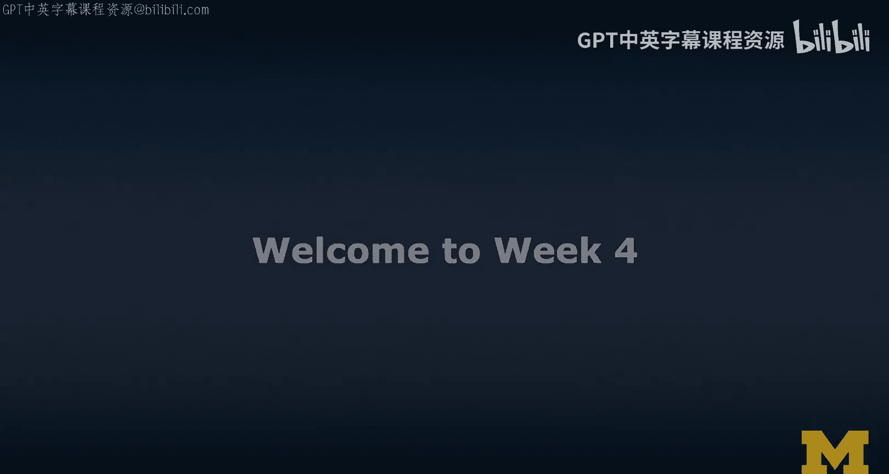
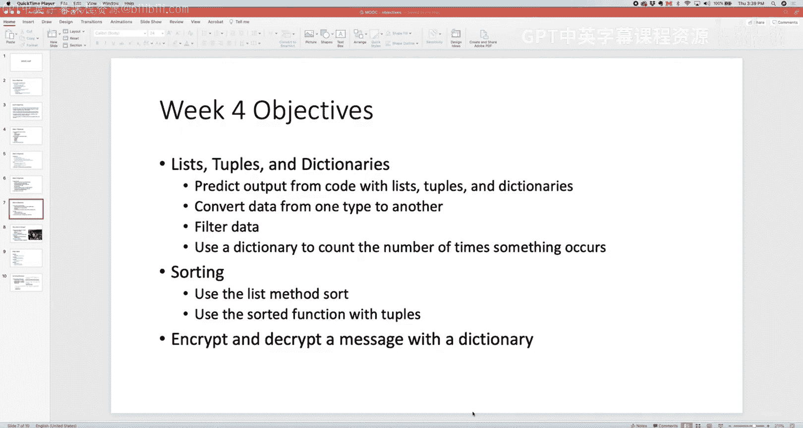
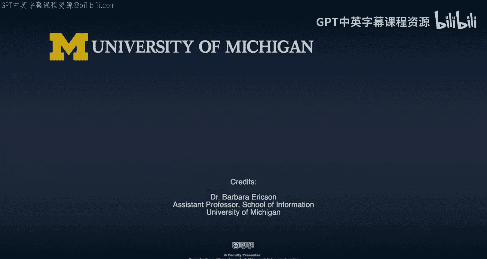

# 创造性编程：第四周：Python基础数据结构入门 🐍

在本节课中，我们将要学习Python中的三种基础数据结构：列表、元组和字典。这些结构是组织和处理数据的基础，对于数据科学和数据分析至关重要。

---

## 第四周课程概述 📋

本周是本课程的最后一周。我们将专注于Python中的基础数据结构，即列表、元组和字典。

上一节我们介绍了本周的学习主题，本节中我们来看看本周的具体学习目标。

以下是本周你将学习的内容：
*   学习如何预测列表、元组和字典的输出。
*   学习如何在不同数据类型之间进行转换。
*   学习如何过滤数据，这是数据科学或数据分析中数据清洗的一部分。
*   学习使用字典来统计事物出现的次数。
*   学习如何进行排序。在数据科学或数据分析中，我们常常需要找出排名靠前或靠后的项目，排序是解决此类问题的好方法。

---

## 核心学习内容详解 🔍

### 预测输出与类型转换

我们将讨论如何预测来自列表、元组和字典的输出，以及如何将数据从一种类型转换为另一种类型。

### 数据过滤

数据过滤是数据清洗的关键环节。我们将学习如何从数据集中筛选出需要的信息。

### 使用字典进行计数

字典是进行频率统计的强大工具。我们将学习如何使用字典来统计事物出现的次数。

### 排序操作

为了找出“最佳”或“最差”的项目，排序功能必不可少。我们将学习两种排序方法：
*   使用列表内置的 **`sort()`** 方法。
*   使用内置的 **`sorted()`** 函数，该函数也适用于元组和字典。你可以从字典的键值对（通过 **`.items()`** 获取）中得到一个元组列表，然后对其进行排序。

---

## 本周作业：消息加密与解密 🔐

在你的作业中，你将运用所学的字典知识，完成一个消息的加密和解密任务。

---

## 课程总结 🎯

本节课中我们一起学习了Python的三大基础数据结构：列表、元组和字典。我们探讨了如何预测它们的输出、进行类型转换、过滤数据、利用字典计数以及执行排序操作。这些技能是进行更复杂数据操作和分析的基石。请享受编程的乐趣，祝你学习愉快！