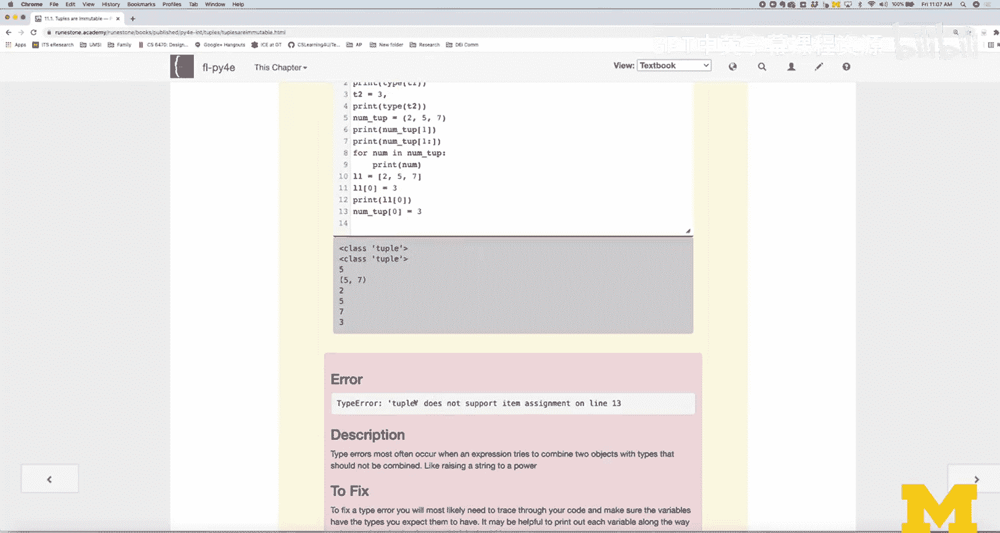

# 40：元组综合解析 📚


在本节课中，我们将要学习一种与列表非常相似的数据结构——元组。我们将探讨元组的基本概念、它与列表的相似之处以及关键区别，并通过代码示例来加深理解。

## 元组的基本概念

上一节我们介绍了列表，它是一种有序存储元素的数据结构。本节中我们来看看元组。元组同样用于有序地存储元素，它通常是由逗号分隔的一系列元素组成的集合。

以下是元组的基本创建方式：

```python
# 声明一个只包含一个元素的元组
tuple_one = (1,)
print(type(tuple_one))  # 输出: <class 'tuple'>

# 不使用括号创建元组
tuple_two = 1,
print(type(tuple_two))  # 输出: <class 'tuple'>

# 创建包含多个元素的元组
tuple_three = (2, 5, 7)
print(tuple_three)  # 输出: (2, 5, 7)
```

请注意，即使元组只包含一个元素，也必须在其后加上逗号。括号是可选的，但逗号是必需的。

## 元组与列表的相似之处

元组与列表在许多操作上非常相似。例如，它们都支持索引访问和切片操作。

以下是元组的一些常见操作：

```python
# 索引访问（索引从0开始）
print(tuple_three[1])  # 输出: 5

# 切片操作（创建新元组，不修改原元组）
print(tuple_three[1:])  # 输出: (5, 7)

# 遍历元组中的所有元素
for item in tuple_three:
    print(item)
# 输出:
# 2
# 5
# 7
```

## 元组与列表的关键区别

既然元组和列表如此相似，为什么我们需要另一种数据结构呢？主要区别在于元组是不可变的，而列表是可变的。

以下是列表的可变性示例：

```python
# 列表是可变的
list_one = [2, 5, 7]
list_one[0] = 3
print(list_one[0])  # 输出: 3
```

然而，尝试修改元组会导致错误：

```python
# 尝试修改元组（会导致错误）
tuple_three[0] = 3  # 这会引发 TypeError
```

元组就像字符串一样是不可变的。对字符串进行的任何修改（如转换为大写或小写）实际上都会创建一个新的字符串。而元组则完全不允许修改，也不能进行追加等操作。它们是与列表不同的数据结构。



## 总结


本节课中我们一起学习了元组的基本概念和操作。我们了解到元组是一种有序的、不可变的数据结构，与列表在索引访问、切片和遍历等方面相似，但关键区别在于其不可变性。理解元组的这一特性对于在编程中选择合适的数据结构非常重要。