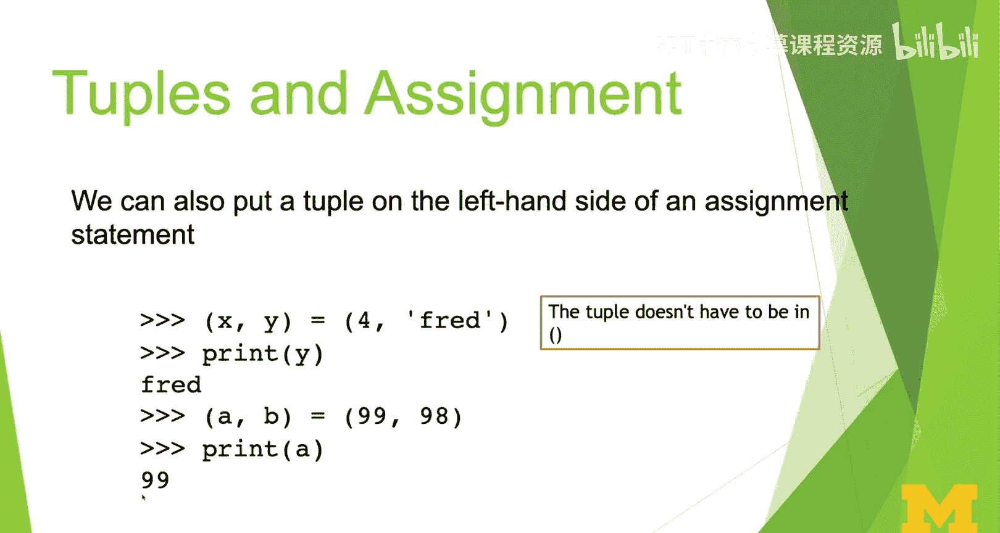

# 41：元组使用场景 🧩


在本节课中，我们将要学习元组（Tuple）的核心使用场景。元组与列表（List）非常相似，但它是不可变的。我们将探讨为何以及何时应该选择使用元组，而不是列表。

## 元组与列表的核心区别

上一节我们介绍了元组的基本概念，本节中我们来看看元组存在的意义。既然元组很像列表，但不可更改，那么它的用途是什么？

关键在于元组的效率更高。当你需要从函数返回多个值时，Python有一个很好的特性，这是许多其他语言不具备的：**可以返回一个包含多个项目的元组**。这样，你就不必只返回一个值。

## 元组的主要使用场景

以下是元组的几个典型应用场景：

1.  **函数返回多个值**
    因为你不希望任何人修改或改变返回的数据，所以它不必是一个列表，可以只是一个元组。这使得操作更高效。

2.  **从字典中获取键值对**
    当我们处理字典并希望获取键值对时，同样不希望数据被随意改动，因为它是从字典中获取的。使用元组可以确保数据的完整性。

3.  **元组解包赋值**
    另一个需要注意的特性是，你可以在赋值语句的左侧使用元组，右侧对应多个值。如果一个函数返回多个值，你可以在左侧用一个包含多个变量的元组来接收它们。这样，每个变量都会获得正确的值。这是一个非常方便的特性。

## 元组解包示例

当然，元组不一定需要用括号括起来。请看以下示例：

```python
# 示例 1：基本解包
x, y = (4, "Fred")
print(y)  # 输出：Fred
print(x)  # 输出：4

# 示例 2：省略括号的解包
a, b = 99, 98
print(a)  # 输出：99
print(b)  # 输出：98
```

在第一个例子中，元组 `(4, "Fred")` 被解包并赋值给变量 `x` 和 `y`。在第二个例子中，我们甚至省略了括号，直接进行赋值，这同样是有效的元组解包操作。



## 总结


本节课中我们一起学习了元组的关键使用场景。我们了解到，元组因其**不可变性**而比列表更高效，常用于**函数返回多个值**、**保护从字典等数据结构中获取的数据**，以及利用**元组解包**特性来简化多变量赋值操作。记住，在不需要修改数据集合时，使用元组是一个更优的选择。