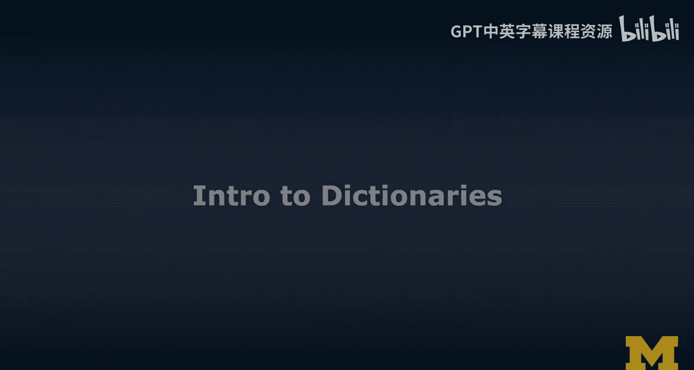
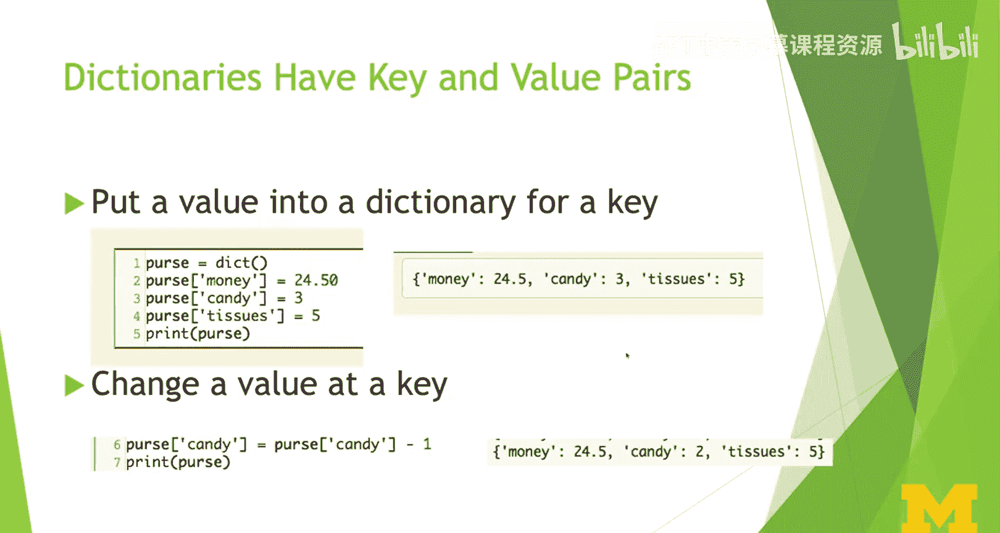
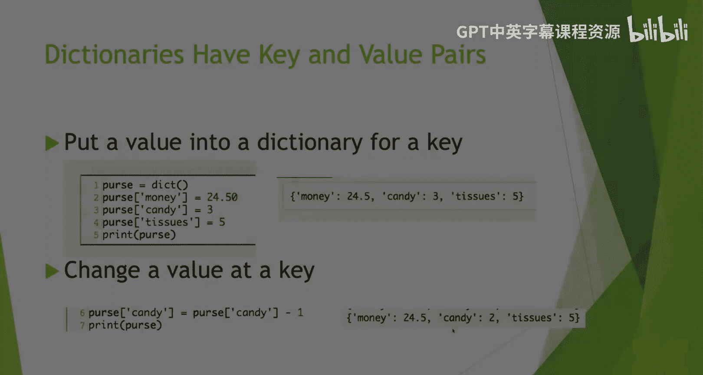

# 创造性编程：42：字典基础教程 📚




在本节课中，我们将要学习Python中一个非常强大且灵活的数据结构——字典。我们将了解字典是什么，它与之前学过的列表和元组有何不同，以及如何创建和使用字典。

## 概述

我们已经讨论了列表，它按顺序存储项目并且是可变的。我们也讨论了元组，它同样按顺序存储项目，但它是不可变的，无法更改。本节中，我们将介绍另一种主要的数据结构——字典。这是一种相当不同的数据结构。

## 什么是字典？ 🗂️

列表是一种集合，它允许我们将多个事物用一个名字来指代，并按顺序存储这些项目。字典也是一种集合，同样允许我们用一个名字指代大量事物。但它的核心机制是存储**键值对**。

你可以将字典想象成一个带标签的储物柜。给定一个“钥匙”（键），你可以往对应的“柜子”里放入一样东西（值），也可以根据这个“钥匙”取出里面的东西。这个“东西”本身也可以是一个集合（如另一个列表或字典），这使得字典成为Python中最强大的数据集合类型。

字典在其他编程语言中也有类似的概念，例如映射、哈希映射或C#中的属性包。

## 创建与访问字典

以下是创建和使用字典的基本方法。

### 创建一个空字典
你可以使用花括号 `{}` 或 `dict()` 函数来创建一个空字典。
```python
purse = dict()
# 或
purse = {}
```

### 为字典添加键值对
创建字典后，你可以通过指定键来设置对应的值。
```python
purse['money'] = 24.50
purse['candy'] = 3
purse['tissues'] = 5
```
执行 `print(purse)` 会输出类似 `{'money': 24.50, 'candy': 3, 'tissues': 5}` 的内容。请注意，字典使用**花括号** `{}` 包围，这与列表的方括号 `[]` 和元组的圆括号 `()` 不同。

### 更新字典中的值
如果你已经拥有某个键，你可以直接更新它对应的值。
```python
purse['candy'] = purse['candy'] - 1
# 执行后，'candy' 对应的值会从 3 变为 2。
```

## 总结






本节课中，我们一起学习了字典的基础知识。我们了解到字典是一种存储**键值对**的集合，它使用花括号 `{}` 表示，并且通过键来访问和修改对应的值。与列表和元组不同，字典不强调顺序，而是强调键与值之间的映射关系，这使其在处理需要快速查找的数据时非常高效。在接下来的课程中，我们将进一步探索字典的更多高级用法。