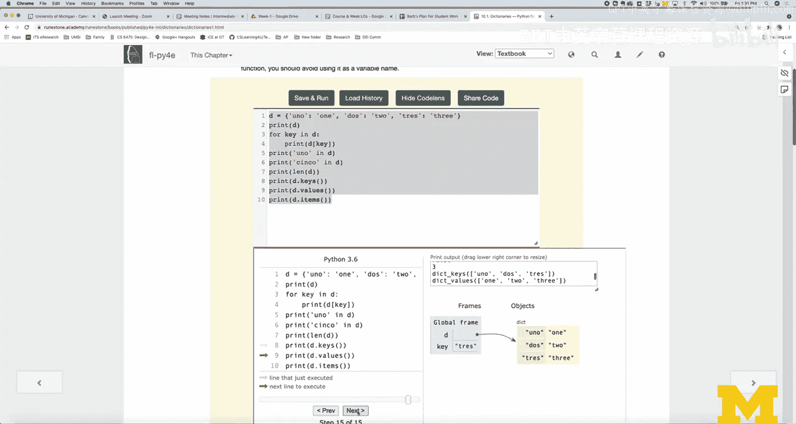

# 创造性编程：43：字典进阶操作 📚


在本节课中，我们将深入学习Python字典的更多高级操作。我们将探讨字典的常见用途，例如计数和映射，并学习如何遍历字典、检查键是否存在以及获取字典的各种视图。

---

## 字典的常见用途

上一节我们介绍了字典的基本概念。本节中我们来看看字典的两个核心用途：**计数**和**映射**。

*   **计数**：我们经常使用字典来统计某个键出现的次数。对于特定的键，我们记录它被看到的次数。
*   **映射**：字典可以用来将一个事物映射到另一个事物。例如，你可以使用字典来查找给定一个西班牙语单词，其对应的英语单词是什么。

以下是一个映射的示例：

```python
D = {'uno': 'one', 'dos': 'two', 'tres': 'three'}
```

在这个字典中，键是西班牙语单词，值是对应的英语单词。例如，`'uno'` 映射到 `'one'`。

---

## 遍历与操作字典

让我们通过Python可视化工具来逐步分析以下代码，了解如何操作字典。

```python
D = {'uno': 'one', 'dos': 'two', 'tres': 'three'}
print(D)
for key in D:
    print(D[key])
print('uno' in D)
print('seis' in D)
print(len(D))
print(list(D.keys()))
print(list(D.values()))
print(list(D.items()))
```

**代码逐步解析：**

1.  首先，字典 `D` 被创建，其中包含了键到值的映射。
2.  打印整个字典。注意输出被花括号 `{}` 包围，这是识别字典的一个标志。
3.  使用 `for key in D:` 循环遍历字典。对于字典，这种迭代会返回一个键的列表。循环会依次处理每个键。
4.  在循环内，打印当前键对应的值。因此，程序会依次打印 `'one'`、`'two'`、`'three'`。
5.  使用 `in` 操作符检查键 `'uno'` 是否在字典中，结果为 `True`。
6.  检查键 `'seis'` 是否在字典中，结果为 `False`，因为它不在字典中。
7.  打印字典的长度，即它包含的键值对数量。
8.  打印仅包含键的列表。注意输出是列表格式，使用方括号 `[]`。
9.  打印仅包含值的列表。
10. 打印包含键值对的元组列表。

以下是你可以对字典执行的一些操作总结：

*   使用 `in` 操作符检查一个键是否存在于字典中。
*   使用 `len()` 函数获取字典中键值对的数量。
*   使用 `.keys()` 方法获取所有键的视图。
*   使用 `.values()` 方法获取所有值的视图。
*   使用 `.items()` 方法获取所有键值对（以元组形式）的视图。

---



## 总结


本节课中我们一起学习了字典的进阶操作。我们了解了字典在计数和映射方面的实际应用，并通过示例代码掌握了如何遍历字典、检查成员资格、获取字典长度以及提取键、值或键值对列表。这些操作是有效使用Python字典进行数据组织和处理的基础。