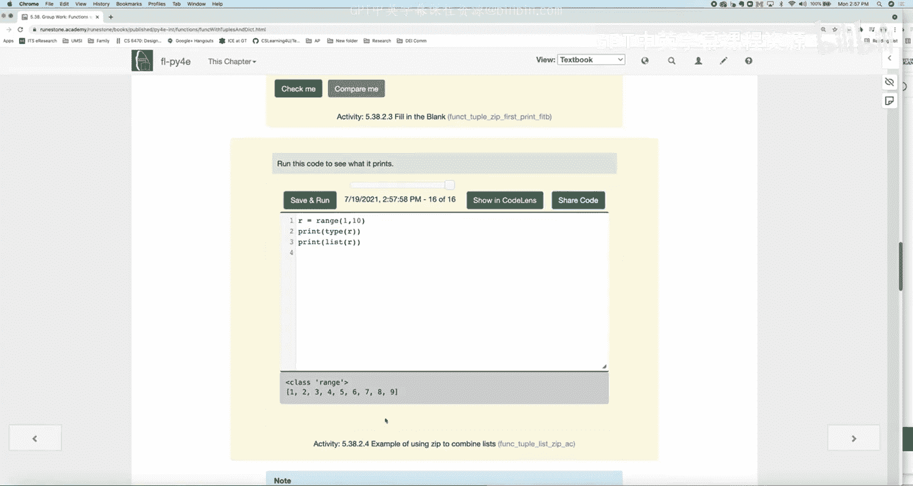

# 44：zip函数功能解析 🧵


在本节课中，我们将要学习Python中一个非常实用的内置函数——`zip`。这个函数能够将多个可迭代对象（如列表）的元素“配对”组合起来，形成一个新的迭代器。理解`zip`函数对于处理并行数据、简化循环逻辑非常有帮助。

## 什么是zip函数？ 🤔

`zip`函数的作用是将多个可迭代对象中对应的元素打包成一个个元组，然后返回由这些元组组成的迭代器。我们可以形象地将其理解为“拉链”，就像将两片布料用拉链连接在一起。

以下是`zip`函数的基本用法示例：

```python
list1 = [1, 2]
list2 = ['a', 'b']
result = zip(list1, list2)
```

在这个例子中，我们有两个列表，每个列表包含两个元素。`zip`函数会将这两个列表“拉”在一起，创建一个新的迭代器。

## zip函数如何工作？ ⚙️

上一节我们介绍了`zip`函数的基本概念，本节中我们来看看它的具体工作过程。

当我们运行上述代码并查看结果时，会发现`result`是一个由元组组成的列表。第一个元组包含第一个列表的第一个元素和第二个列表的第一个元素，第二个元组则包含两个列表的第二个元素。

```python
# 运行结果类似于：
# [(1, 'a'), (2, 'b')]
```

这个过程就是依次从每个可迭代对象中取出一个元素，组合成一个元组。

## zip对象的类型与迭代器 🔄

`zip`函数返回的并不是一个直接的列表，而是一个`zip`对象。为了理解我们实际得到的是什么，我们可以使用`type()`函数来查看其类型。

```python
print(type(result))  # 输出: <class 'zip'>
```

`zip`类是一种迭代器。迭代器是一种可以逐个返回元素的对象，我们可以使用`for`循环来遍历它。

以下是遍历`zip`对象的示例：

```python
for item in result:
    print(item)
```

## 将zip对象转换为列表 📋

由于`zip`函数返回的是一个迭代器，如果我们想直接查看或使用一个完整的列表，需要将其转换为列表。

我们可以使用`list()`函数来完成这个转换：

```python
list_result = list(zip(list1, list2))
print(list_result)  # 输出: [(1, 'a'), (2, 'b')]
```

这与处理`range`对象类似。`range`函数也返回一个迭代器（`range`对象），我们可以通过`list()`函数将其转换为列表。

```python
r = range(1, 10)
print(type(r))      # 输出: <class 'range'>
list_r = list(r)
print(list_r)       # 输出: [1, 2, 3, 4, 5, 6, 7, 8, 9]
```

字符串、列表和`range`对象都是我们可以迭代遍历的对象。



## 总结 📝


本节课中我们一起学习了Python的`zip`函数。我们了解到`zip`函数可以将多个可迭代对象的对应元素组合成元组，并返回一个`zip`迭代器。我们学习了如何查看其类型、使用`for`循环进行遍历，以及如何通过`list()`函数将其转换为列表以便直接查看。`zip`函数是处理并行数据的强大工具，能够使代码更加简洁高效。