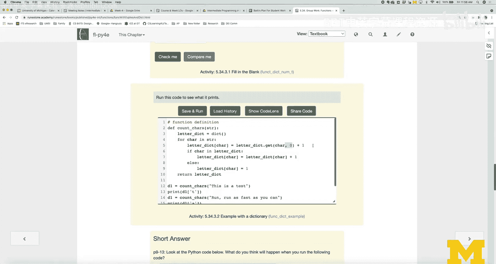

# 创造性编程：45：字典计数优化方法


在本节课中，我们将学习如何优化使用字典进行字符计数的代码。我们将重点介绍一种更简洁、更安全的方法来避免访问字典中不存在的键时可能引发的错误，并学习如何使用 `.get()` 方法来实现这一目标。

---

## 字典访问的潜在问题

在使用字典时，需要特别注意的一个问题是，当你尝试访问一个字典中不存在的键时，程序会引发一个 `KeyError` 错误。这可能导致程序意外终止。

让我们先看一段基础的字符计数代码：

```python
def count_characters_in_string(s):
    letter_dictionary = {}
    for char in s:
        if char in letter_dictionary:
            letter_dictionary[char] = letter_dictionary[char] + 1
        else:
            letter_dictionary[char] = 1
    return letter_dictionary
```

这段代码的逻辑是：创建一个空字典，遍历字符串中的每个字符。如果字符已经是字典的键，则将其对应的值加一；否则，将该字符作为新键加入字典，并将其值初始化为1。

---

## 使用 `.get()` 方法进行优化

上一节我们介绍了基础但略显冗长的字典计数方法。本节中，我们来看看如何使用字典的 `.get()` 方法，将上述四行逻辑合并为一行，实现相同的功能，同时避免潜在的 `KeyError` 错误。

`.get()` 方法的语法是：`字典.get(键, 默认值)`。它的作用是尝试获取指定键的值。如果键存在，则返回其值；如果键不存在，则返回你提供的默认值，而不会引发错误。

我们可以将循环体内的代码优化如下：

```python
def count_characters_in_string_optimized(s):
    letter_dictionary = {}
    for char in s:
        letter_dictionary[char] = letter_dictionary.get(char, 0) + 1
    return letter_dictionary
```

以下是这行代码的工作原理：
*   `letter_dictionary.get(char, 0)` 会检查字符 `char` 是否是字典的键。
*   如果是，则返回该键当前的值（即该字符已出现的次数）。
*   如果不是，则返回我们指定的默认值 `0`。
*   然后，无论哪种情况，我们都对这个结果加 `1`，并将新值赋回给 `letter_dictionary[char]`。

这种方法与原始的四行代码效果完全相同，但更加简洁和高效。



---


本节课中，我们一起学习了字典计数的一种优化方法。通过使用 `.get(键, 默认值)` 方法，我们可以用一行代码安全地实现键值的递增操作，这比传统的“检查-判断”模式更简洁，并能有效避免因访问不存在的键而导致的程序错误。