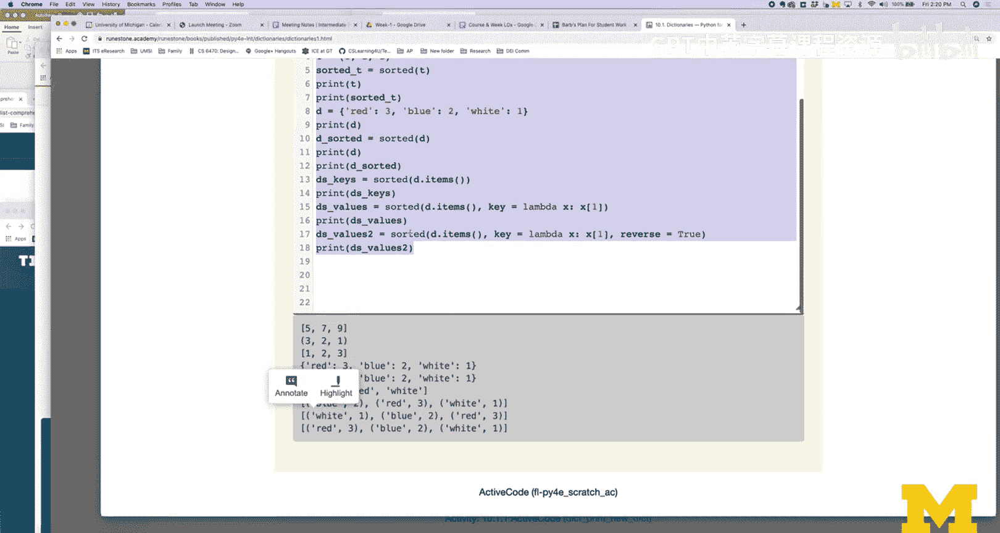

# 46：列表、元组、字典排序技巧 📊


在本节课中，我们将要学习如何对Python中的列表、元组和字典进行排序。排序是数据处理中的常见需求，例如，在列表中查找元素时，有序列表能提高搜索效率；在字典中，我们可能需要根据值来排序，以找出出现频率最高或最低的项目。本节将详细介绍各种数据结构的排序方法。


---

## 列表排序

首先，我们来看如何对列表进行排序。列表本身提供了一个 `sort` 方法，它会直接修改原列表。

以下是列表排序的示例代码：

```python
my_list = [3, 1, 4, 1, 5, 9, 2, 6]
my_list.sort()
print(my_list)  # 输出：[1, 1, 2, 3, 4, 5, 6, 9]
```

使用 `sort` 方法后，列表 `my_list` 本身被改变，元素按升序排列。需要注意的是，`sort` 方法仅适用于列表，因为列表是可变的。

---

## 元组排序

上一节我们介绍了列表的排序，本节中我们来看看元组。元组是不可变的，因此不能使用 `sort` 方法直接修改它。但我们可以使用内置的 `sorted` 函数，它会返回一个新的已排序列表。

以下是元组排序的示例：

```python
my_tuple = (3, 1, 4, 1, 5, 9, 2, 6)
sorted_list = sorted(my_tuple)
print(sorted_list)  # 输出：[1, 1, 2, 3, 4, 5, 6, 9]
print(my_tuple)     # 输出原元组：(3, 1, 4, 1, 5, 9, 2, 6)
```

`sorted` 函数不会改变原始元组，而是返回一个新的列表。如果你需要元组形式的结果，可以将其转换回元组：`sorted_tuple = tuple(sorted(my_tuple))`。

---

## 字典排序

现在，我们来看看字典的排序。字典由键值对组成，排序时可能需要根据键或值进行。

### 按键排序

直接对字典使用 `sorted` 函数，默认会返回一个按键排序的键列表。

以下是按键排序的示例：

```python
my_dict = {'banana': 3, 'apple': 4, 'pear': 1, 'orange': 2}
sorted_keys = sorted(my_dict)
print(sorted_keys)  # 输出：['apple', 'banana', 'orange', 'pear']
```

这返回的是排序后的键列表，而不是完整的键值对。

### 获取键值对列表并排序

为了获取排序后的键值对，我们可以先使用 `items` 方法获取键值对列表，然后对其进行排序。

以下是获取并排序键值对列表的示例：

```python
items_list = list(my_dict.items())
print(items_list)  # 输出：[('banana', 3), ('apple', 4), ('pear', 1), ('orange', 2)]

sorted_items = sorted(items_list)
print(sorted_items)  # 输出：[('apple', 4), ('banana', 3), ('orange', 2), ('pear', 1)]
```

默认情况下，排序依据是每个元组的第一个元素，即键。

### 按值排序

如果我们希望根据字典的值进行排序，可以使用 `sorted` 函数的 `key` 参数，并配合 `lambda` 函数。

以下是按值排序的示例：

```python
sorted_by_value = sorted(my_dict.items(), key=lambda x: x[1])
print(sorted_by_value)  # 输出：[('pear', 1), ('orange', 2), ('banana', 3), ('apple', 4)]
```

这里，`lambda x: x[1]` 是一个匿名函数，它指定排序依据为每个元组的第二个元素，即值。

### 降序排序

如果需要降序排列，可以添加 `reverse=True` 参数。

以下是降序排序的示例：

```python
sorted_desc = sorted(my_dict.items(), key=lambda x: x[1], reverse=True)
print(sorted_desc)  # 输出：[('apple', 4), ('banana', 3), ('orange', 2), ('pear', 1)]
```

这样，值最大的项会排在前面。



---

## 总结

本节课中我们一起学习了Python中列表、元组和字典的排序技巧。

*   对**列表**，可以使用 `list.sort()` 方法进行原地排序。
*   对**元组**，需使用 `sorted()` 函数，它会返回一个新的排序列表。
*   对**字典**，`sorted()` 默认按键排序。要按值排序或获取排序后的键值对，需结合 `items()` 方法和 `key=lambda` 参数。


记住这些方法，你就能灵活地根据需求对各种数据结构进行排序了。