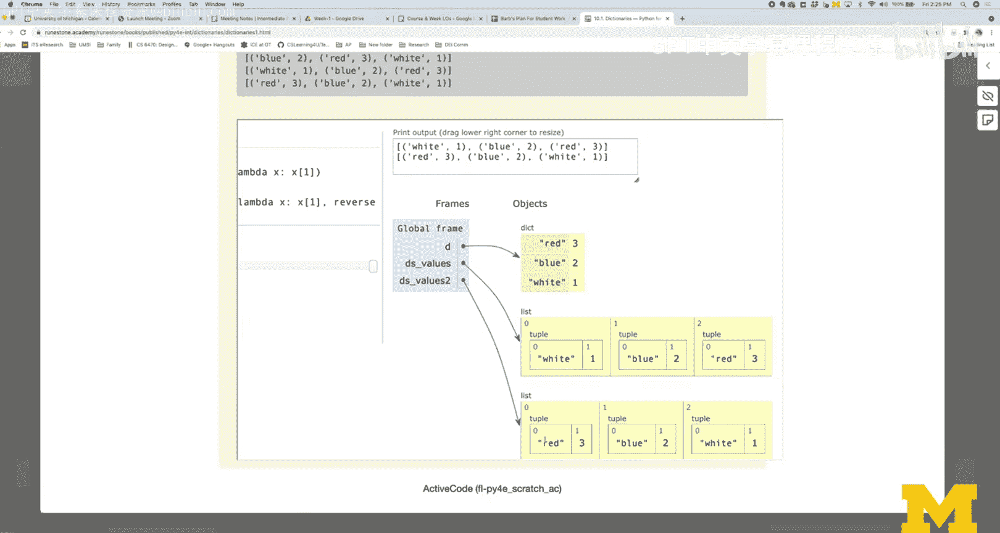

# 47：使用lambda函数进行排序 🔢


在本节课中，我们将深入探讨在使用`sorted`函数时，如何结合匿名函数（即lambda函数）来对数据进行排序。我们将通过一个具体的字典排序示例，详细解析lambda函数的工作原理和排序过程。


---

## 概述

我们将学习如何使用Python的`sorted`函数配合lambda表达式，对一个字典的键值对进行排序。核心在于理解lambda函数如何作为`key`参数，临时定义排序规则，从而影响最终的排序结果。

## 详细解析

上一节我们介绍了`sorted`函数的基本用法，本节中我们来看看如何结合lambda函数实现更灵活的排序。

我们首先创建一个字典：
```python
d = {'red': 3, 'blue': 2, 'white': 1}
```

接下来，我们使用`sorted`函数对这个字典的项（即键值对组成的元组列表）进行排序。代码如下：
```python
ds = sorted(d.items(), key=lambda x: x[1])
```

在这行代码中，`key=lambda x: x[1]`是关键部分。让我们分解它的工作流程：

1.  `d.items()`返回一个视图对象，包含`('red', 3)`, `('blue', 2)`, `('white', 1)`这样的元组。
2.  `sorted()`函数开始排序时，会依次将每个元组传递给`key`参数指定的lambda函数。
3.  lambda函数`lambda x: x[1]`是一个匿名函数。参数`x`代表每次传入的元组。
4.  该函数体`x[1]`表示返回元组中索引为1的元素，即字典的值。

以下是lambda函数处理每个元组的具体过程：

*   第一个元组`('red', 3)`传入，`x[1]`返回`3`。
*   第二个元组`('blue', 2)`传入，`x[1]`返回`2`。
*   第三个元组`('white', 1)`传入，`x[1]`返回`1`。

`sorted`函数根据这些返回值`3`, `2`, `1`进行升序排序。排序后的顺序基于值`1`, `2`, `3`。因此，最终的排序结果是元组列表按照字典的值升序排列：
```
[('white', 1), ('blue', 2), ('red', 3)]
```
可以看到，键`'white'`, `'blue'`, `'red'`被重新组织，以匹配其对应值`1`, `2`, `3`的升序顺序。

## 进行降序排序

如果我们希望按照值进行降序排序，只需在`sorted`函数中添加`reverse=True`参数。

代码如下：
```python
ds_desc = sorted(d.items(), key=lambda x: x[1], reverse=True)
```

其过程与升序排序类似：
1.  lambda函数依然依次处理每个元组，并返回值。
2.  对于`('red', 3)`，返回`3`；对于`('blue', 2)`，返回`2`；对于`('white', 1)`，返回`1`。
3.  由于设置了`reverse=True`，`sorted`函数会按照返回值`3`, `2`, `1`进行降序排序。

因此，得到的结果是：
```
[('red', 3), ('blue', 2), ('white', 1)]
```
此时，列表按照字典值的降序（3, 2, 1）排列。

---



## 总结


本节课中我们一起学习了lambda函数在排序中的应用。我们了解到，通过`key=lambda x: x[1]`，可以指示`sorted`函数根据字典的值进行排序。通过控制`reverse`参数，可以轻松实现升序或降序排列。这种方法简洁高效，是处理自定义排序规则的常用技巧。