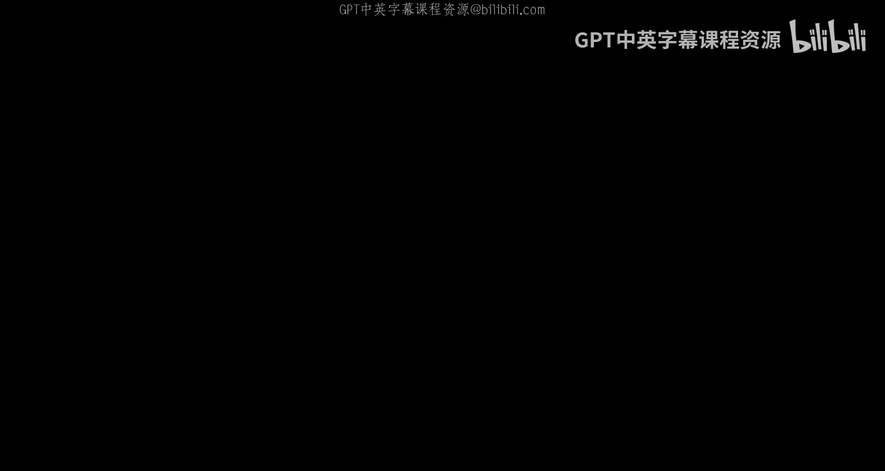
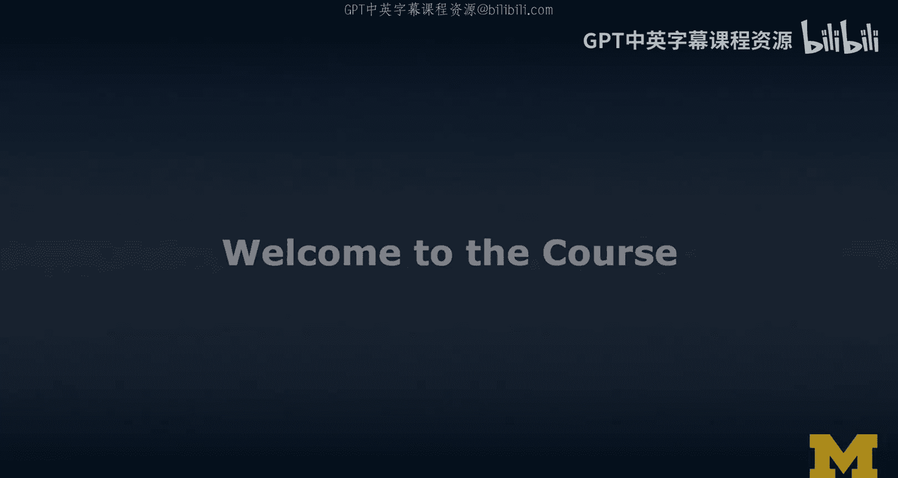
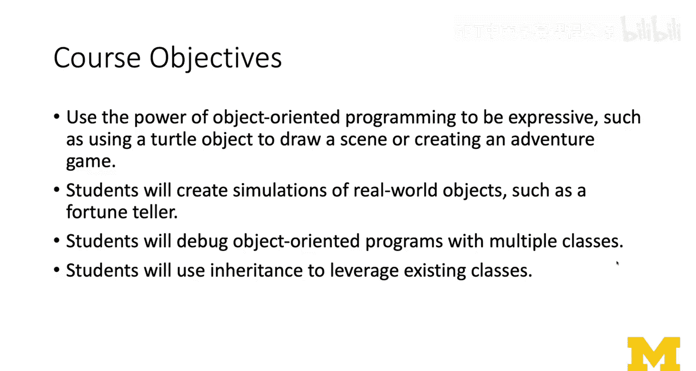
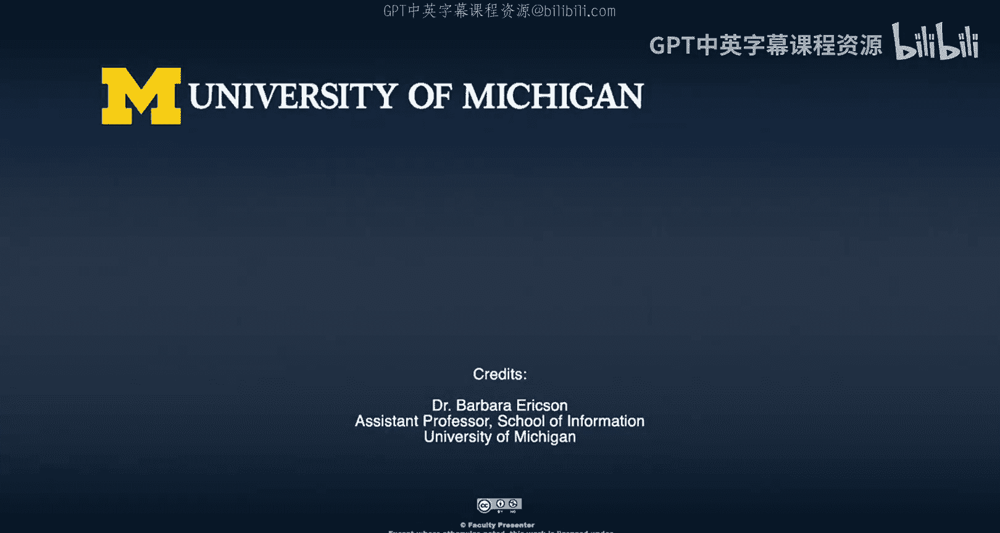
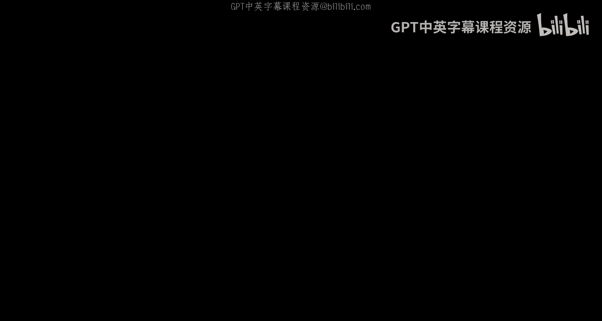

# 创造性编程：0：遇见Barb Ericson博士 👩‍🏫

在本课程中，我们将学习如何利用面向对象编程的力量进行创造性表达。我们将从理解对象和类的基本概念开始，学习如何编写和使用它们，并最终创建自己的模拟程序和游戏。

面向对象编程是自计算早期以来最重要的变革之一。理解什么是对象、什么是类，以及如何在代码中使用它们，对于现代编程至关重要。本课程将聚焦于此，帮助你掌握这些核心技能。

## 什么是面向对象编程？🤔

上一节我们介绍了课程的整体目标，本节中我们来看看面向对象编程的核心概念。

面向对象编程是一种编程范式，它将数据和操作数据的方法组织成“对象”。每个对象都是某个“类”的实例。类定义了对象的蓝图或模板，而对象则是根据这个模板创建的具体实体。

以下是理解面向对象编程的几个关键点：
*   **对象**：是拥有状态（属性）和行为（方法）的实体。例如，一个“乌龟”对象可能有“位置”和“颜色”属性，以及“前进”和“转向”等方法。
*   **类**：是创建对象的蓝图。它定义了对象将拥有哪些属性和方法。代码 `class Turtle:` 就是定义一个乌龟类。
*   **实例化**：根据类创建具体对象的过程。代码 `my_turtle = Turtle()` 就是创建了一个乌龟类的实例。

## 本课程你将学到什么？🎯

理解了基本概念后，本节中我们来看看在本课程中你将具体实践哪些内容。

你将运用面向对象编程的力量进行创造性表达。例如，使用一个像小机器人一样的乌龟对象（它内部有一支笔）来绘制一幅场景，或者创建一个文字冒险游戏。

学生们将创建模拟现实世界对象的程序。例如，一个算命程序。这正是面向对象编程的强大之处之一——你可以模拟现实世界的对象。

学生们将调试包含多个类的面向对象程序。大多数真实的程序都会包含多个类。

学生们将使用继承来利用现有的类。继承允许你在现有事物的基础上进行构建和扩展。

## 总结 📝

本节课中我们一起学习了面向对象编程的引入。我们了解到，本课程将引导你掌握对象和类的概念，并利用它们进行创造性编码，例如绘制图形和创建游戏。你还将学习如何模拟现实对象、调试多类程序以及通过继承复用代码。希望你能享受这段学习旅程。