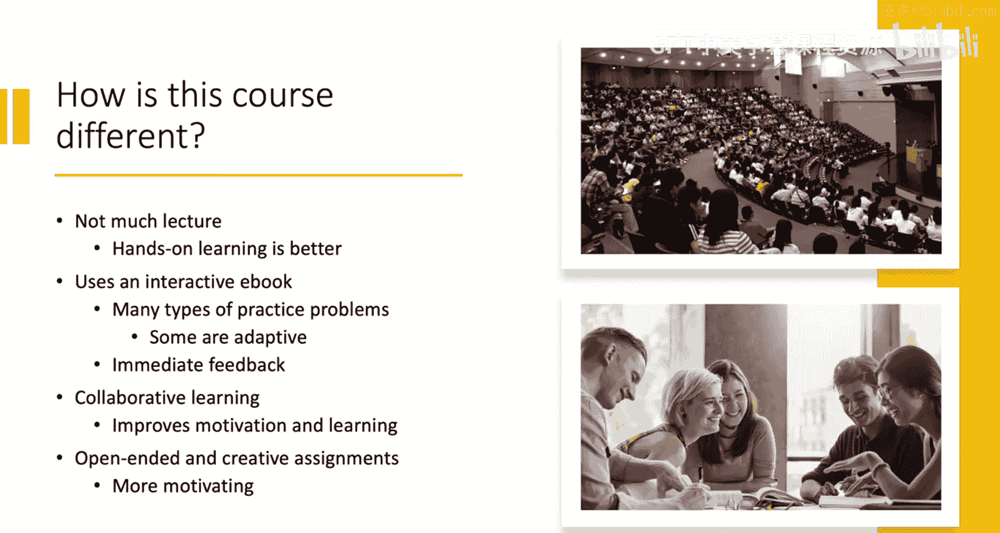
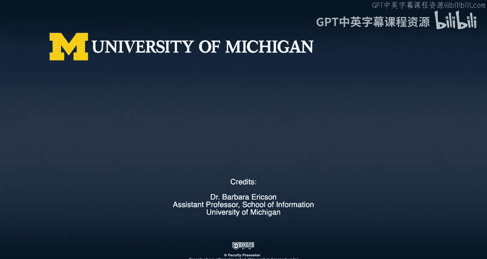

# 密歇根大学《创造性编程》：1：本课程的独特之处 🎨

在本节课中，我们将要了解这门《创造性编程》课程与其他在线课程的不同之处，以及它如何通过实践、协作和创意项目来帮助你学习。

欢迎来到这门课程。它与许多在线课程不同，不会包含大量讲座，而是更侧重于动手实践学习。

我们将鼓励你与他人合作，以小组形式学习，因为这能提升你的学习效果和动力。人类是社会性生物，我们可以通过观察他人和与他人讨论来学习。

## 互动练习与自适应学习 📚

上一节我们提到了课程的实践性，本节中我们来看看具体的练习形式。

电子书中包含大量互动练习。如果你需要复习，可以随时返回前面的章节或完成更多练习题。

以下是练习的一些特点：
*   部分练习题是**自适应**的，这意味着它们会帮助你逐步找到正确的解决方案。

## 开放、编辑与创意任务 🎭

除了常规练习，课程的核心在于创意实践。

课程还包含开放编辑和创意任务。与许多编程入门课程中常见的练习（例如计算销售税或转换摄氏与华氏温度）不同，你将进行绘画创作或编写个性化故事。

希望这些内容对你来说会更有趣，也更能激发你的学习动力。

本节课中我们一起学习了这门《创造性编程》课程的独特之处：它强调动手实践、鼓励小组协作、提供互动与自适应的练习，并最终通过开放式的创意项目（如绘画和故事创作）来应用所学知识，让编程学习过程变得更具吸引力和动力。