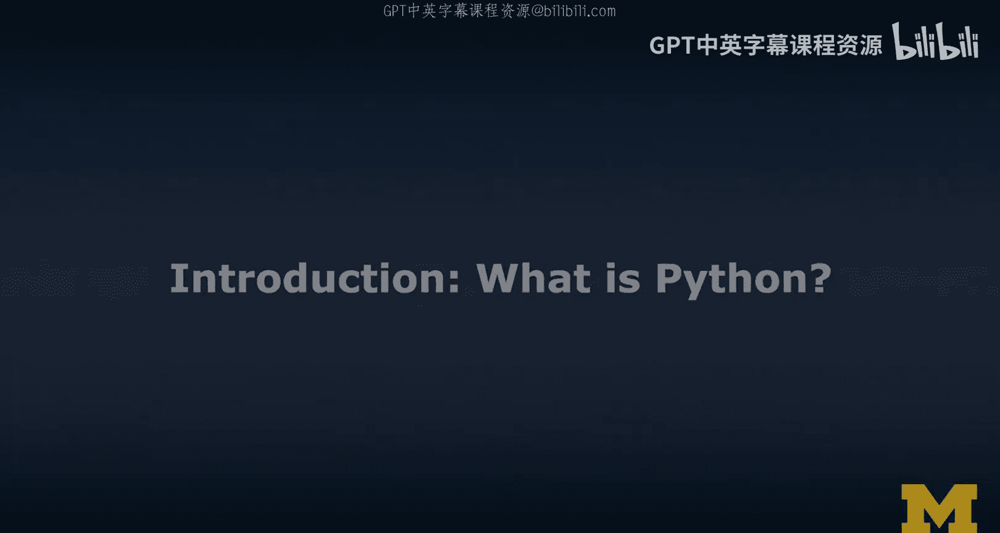
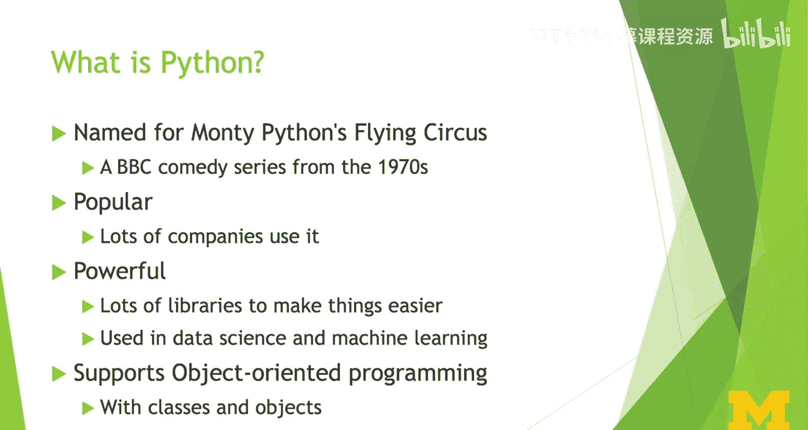
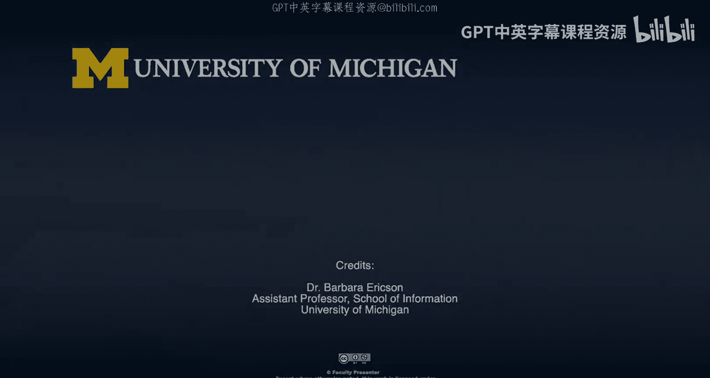

# 2：Python是什么 🐍




在本节课中，我们将要学习Python编程语言的基本概念，了解它的起源、特点以及为什么它在当今编程世界中如此流行。

大家好，我是Barbar Erickson。我是信息学院的助理教授。我很高兴能带领大家踏上学习Python的旅程。那么，Python到底是什么呢？它是一条巨蟒吗？不，Python是以《蒙提·派森的飞行马戏团》命名的，这是一部20世纪70年代的BBC喜剧系列。如果你没看过，可以去看看。😊

它是一种非常流行的编程语言，许多公司都在使用它。它之所以流行，部分原因在于它非常强大。有大量的库可以让事情变得更简单，并且它被广泛应用于数据科学和机器学习领域。与许多其他文本型语言相比，它也相对容易学习一些。它还支持**面向对象编程**，这是当今人们开发程序最常用的方式。这意味着它支持**类**（事物的分类）和实际执行程序工作的**对象**。

上一节我们介绍了Python的起源和基本定位，本节中我们来看看Python的一些核心特性。

以下是Python的几个关键特点：

*   **强大且功能丰富**：拥有庞大的第三方库生态系统，例如用于数据处理的`pandas`库和用于机器学习的`scikit-learn`库。
*   **易于学习**：语法清晰简洁，接近自然语言，降低了初学者的入门门槛。
*   **支持面向对象编程（OOP）**：允许使用`class`关键字定义类，并通过创建对象来组织和管理代码。

例如，一个简单的Python类和对象创建代码如下：
```python
# 定义一个‘Dog’类
class Dog:
    def __init__(self, name):
        self.name = name

    def bark(self):
        return "Woof!"

# 创建一个Dog类的对象
my_dog = Dog("Buddy")
print(my_dog.bark())  # 输出：Woof!
```



此外，Python在数据科学和人工智能等前沿领域扮演着重要角色，这使得掌握它不仅有助于一般性编程，还能打开通往热门技术领域的大门。




本节课中我们一起学习了Python是什么。我们了解到Python是一种以喜剧节目命名的、强大且易于学习的编程语言。它因其丰富的库和对面向对象编程的支持而广受欢迎，是进入编程世界以及数据科学等领域的优秀选择。现在，让我们开始动手实践吧！😊