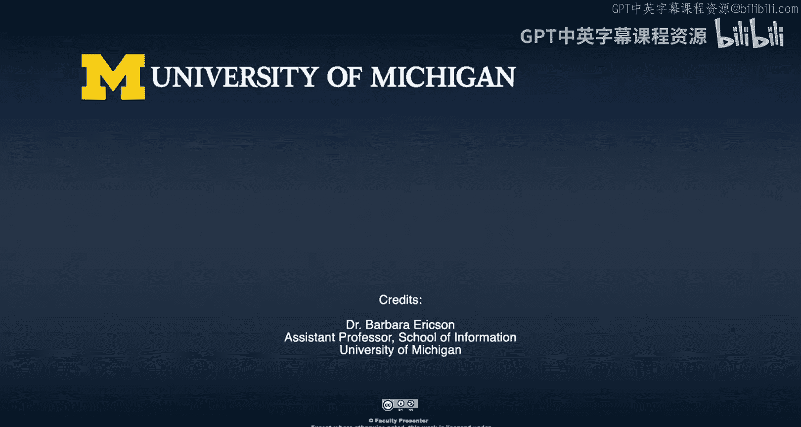

# 3：为何分组协作 👥

在本节课中，我们将探讨在编程学习与实践中采用分组协作模式的原因与价值。我们将分析协作如何提升学习效果、增加动力，并培养对职业生涯至关重要的软技能。

---

上一节我们介绍了课程的基本框架，本节中我们来看看为何鼓励大家进行分组协作。研究表明，小组协作学习既能提升学习动力，也能深化对知识的理解。部分原因在于，当你向他人解释自己的想法时，这个过程本身就能帮助你更好地厘清概念。

此外，与他人协作通常也更有趣，并能帮助你在遇到困难时——尤其是在编程过程中——避免陷入僵局。总体而言，研究显示，多样化的团队表现往往优于个人。团队常常能解决个人无法独立应对的问题。

以下是小组协作带来的具体益处：

*   **提升理解与学习效果**：向他人解释你的思路能巩固自身知识。
*   **增加动力与乐趣**：与他人合作能让学习过程更愉快。
*   **避免陷入困境**：在遇到编程难题时，同伴能提供不同视角和帮助。
*   **解决更复杂问题**：团队集合多元智慧，能应对个人难以独立完成的挑战。例如，在密室逃脱游戏中，与他人的协作通常是成功的关键。

同样重要的是，团队协作能力——包括沟通、团队合作、自我管理与协调他人——对雇主而言至关重要。因此，掌握这类技能在未来的职场中也极具价值。

---

本节课中我们一起学习了分组协作在编程学习中的多重优势。从深化个人理解、提升学习乐趣，到培养解决复杂问题的能力及职场必备的软技能，协作都是推动个人与团队共同成长的有效方式。