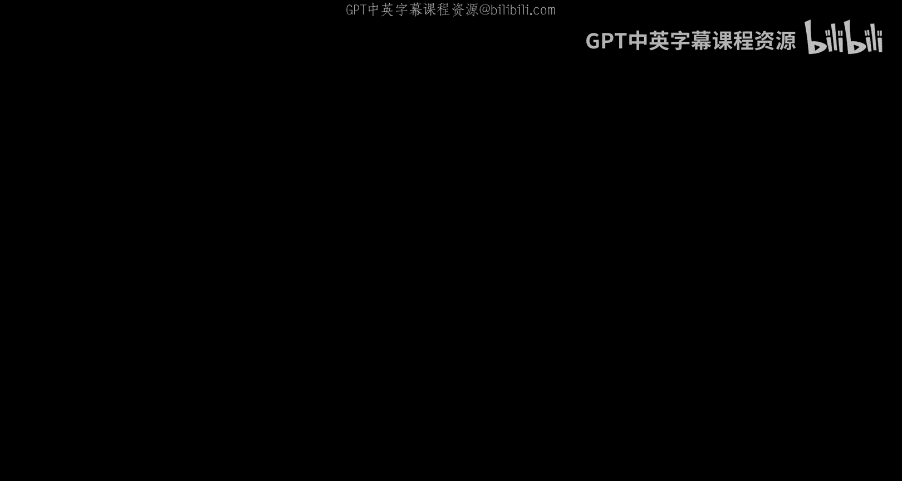
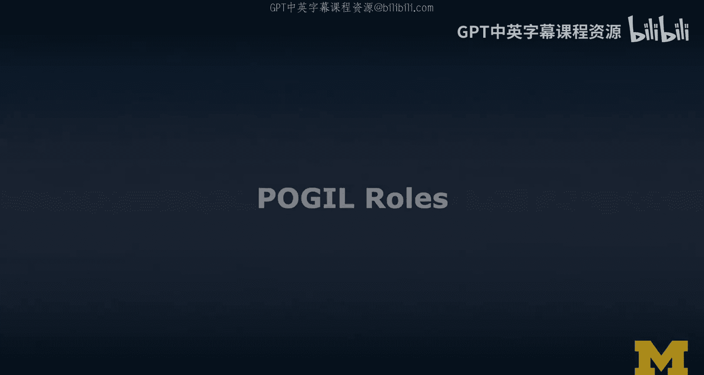
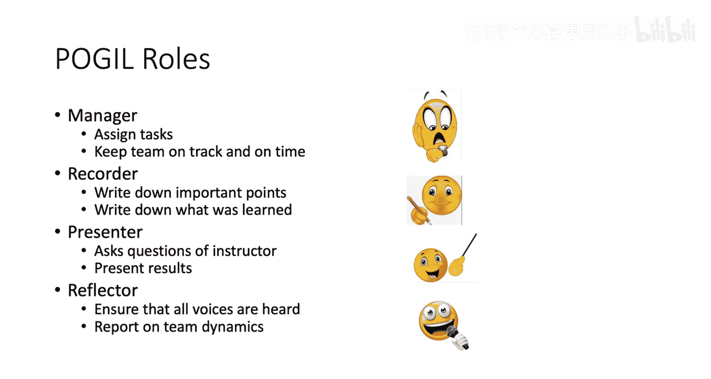
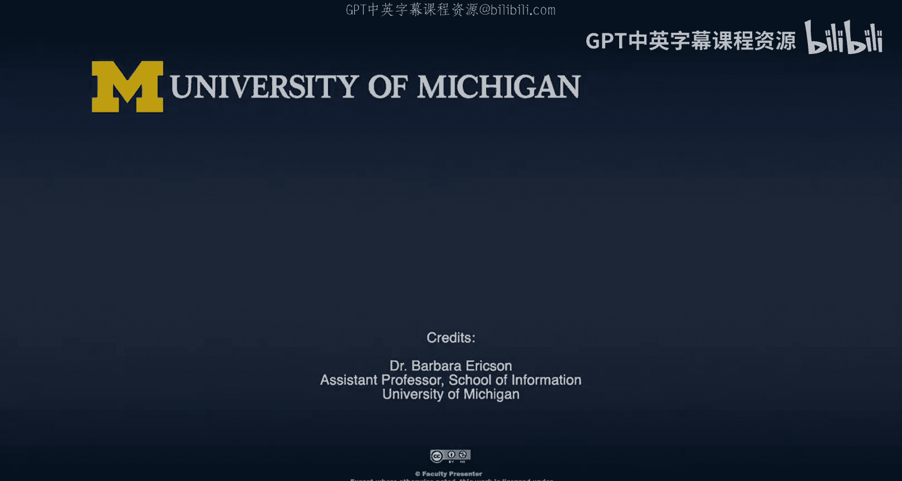

# 4：POGIL角色解析 🧩

在本节课中，我们将学习一种名为POGIL的协作学习方法，并详细解析其团队中的四个核心角色。掌握这些角色有助于提升团队协作效率，确保每个成员都能有效参与并贡献。

---

## 概述

POGIL代表“过程导向的引导式探究学习”。在这种学习模式中，团队成员以小组形式协作，但每个成员都被赋予一个明确的角色。这些角色共同确保团队任务能够高效、有序地完成，并促进所有成员的参与。

## POGIL的四个核心角色

上一节我们介绍了POGIL的基本概念，本节中我们来看看其具体的四个角色。以下是每个角色的定义和职责：

*   **管理者**
    *   为团队成员分配任务。
    *   确保整个团队按计划推进，并按时完成任务。
    *   在团队遇到困难时，鼓励成员继续前进或调整策略。

*   **记录员**
    *   负责记录讨论中的要点和关键发现。
    *   写下团队学习到的内容或达成的共识。

*   **汇报者**
    *   当任务说明不够清晰时，负责向指导者提问。
    *   负责向全班或指导者展示团队的最终成果或结论。

*   **反思者**
    *   确保团队中每个人的声音都被听到，避免只有少数人主导讨论。
    *   观察并反馈团队的协作动态，评估团队合作是否良好，并提出可以改进的地方。

---

## 总结

本节课中我们一起学习了POGIL协作学习法中的四个关键角色：**管理者**、**记录员**、**汇报者**和**反思者**。每个角色都有其独特的职责，共同构成了一个高效、平衡的团队协作框架。理解并实践这些角色，将帮助你在未来的小组项目中更好地与他人合作。