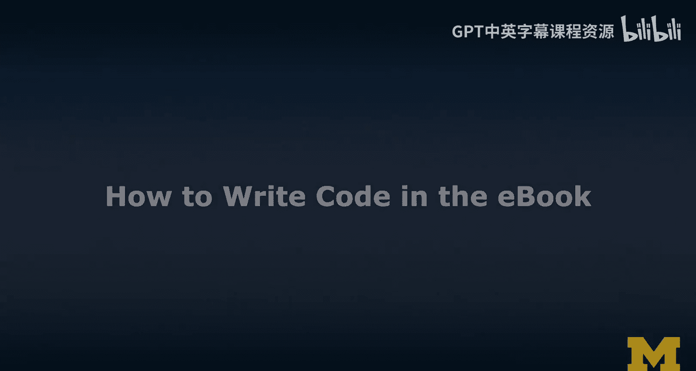
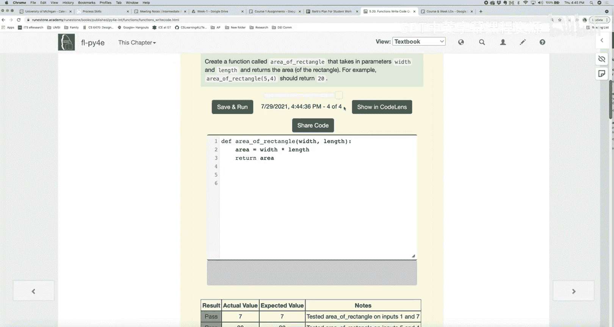

# 5：电子书中编写代码的方法 📖




在本节课中，我们将学习如何在电子书中直接编写、运行和调试Python代码。这是一种便捷的学习方式，允许你即时实践并查看结果。

---

## 概述

电子书的一个显著优点是允许你直接在书中编写代码。我们将通过一个计算矩形面积的函数示例，来演示如何完成这一过程。

## 编写与运行代码

上一节我们了解了电子书的交互特性，本节中我们来看看如何具体编写代码。

假设我们需要创建一个名为 `area_of_rectangle` 的函数，它接收宽度和长度作为参数，并返回矩形的面积。例如，`area_of_rectangle(5, 4)` 应返回 `20`。

以下是创建此函数的步骤：

1.  首先，在电子书提供的代码编辑区域，定义一个函数并计算面积。
    ```python
    def area_of_rectangle(width, length):
        area = width * length
    ```
2.  运行这段初始代码后，你可能会发现测试用例未通过，因为函数没有返回任何值。
3.  因此，我们需要修改代码，使其返回计算出的面积。
    ```python
    def area_of_rectangle(width, length):
        area = width * length
        return area
    ```
4.  再次运行代码，现在测试用例应该通过了。你可以通过“代码透镜”功能查看运行结果。

## 使用辅助工具

除了直接编辑，电子书还提供了其他有用的工具来辅助编程。

如果你不确定乘法运算符 `*` 是否正确工作，可以点击右上角的铅笔图标，打开一个Python代码输入窗口进行测试。

例如，你可以输入 `print(5 * 4)` 来验证结果是否为 `20`。测试完成后，可以关闭这个窗口。

## 查看代码历史

另一个重要的功能是代码历史记录。请确保你在学习时已登录账户，这样你就能使用界面上的滑块工具。

通过拖动滑块，你可以回溯查看代码的各个历史版本，例如最初的样子、第二次修改后的状态等。这有助于你回顾自己的解题思路和修改过程。

---




## 总结


本节课中我们一起学习了在电子书中编写代码的方法。我们实践了如何定义一个函数、运行代码并通过测试，还了解了如何使用临时代码窗口进行测试，以及如何利用历史记录功能回顾代码的演变过程。这些工具能有效提升你的编程学习效率。