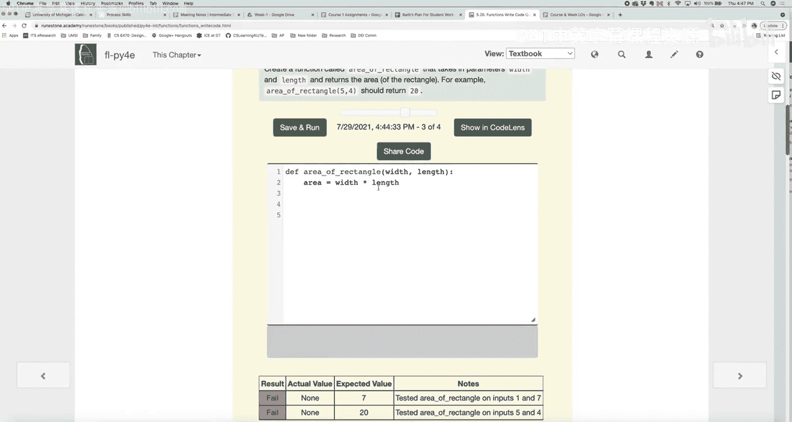

# 6：重载代码历史记录 🔄

在本节课中，我们将学习如何在编程环境中找回之前保存的代码。这对于中断工作后返回项目，或希望回顾之前版本代码的情况非常有用。

如果你在编程环境中工作过，然后离开并再次返回，可能会惊讶地发现代码编辑器似乎是空的。但请放心，只要你之前是登录状态，你的代码就已经被保存了。接下来，我将向你展示如何找回这些代码。

## 如何找回已保存的代码

当你重新进入编程环境并发现之前的代码不见了时，无需惊慌。请按照以下步骤操作：

以下是找回代码的具体步骤：

1.  在编程环境的界面上，找到一个名为 **“Load History”**（加载历史记录）的按钮。
2.  点击这个按钮。
3.  系统会自动加载你上次登录并运行代码时的所有历史记录。

点击“Load History”按钮后，你将能看到上次运行的确切代码。此外，你还可以查看更早的版本，回顾之前的修改过程。

## 重要注意事项

请记住一个关键点：**只有在你登录状态下进行的操作才会被自动保存**。因此，为了确保你的工作进度不会丢失，请务必在开始编程前登录你的账户。

本节课中我们一起学习了如何使用“Load History”功能找回已保存的代码历史。关键在于两点：首先，确保在编程时处于登录状态；其次，返回项目后记得点击“加载历史记录”按钮。这样，你的所有工作成果都能得到妥善保存和恢复。