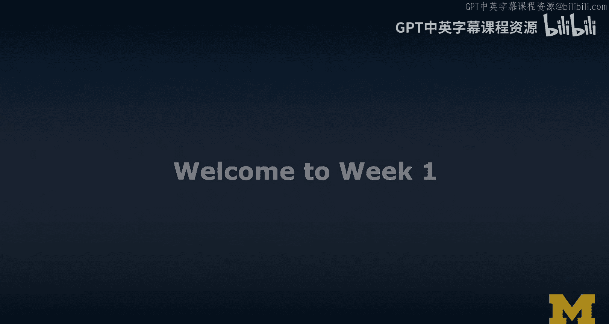
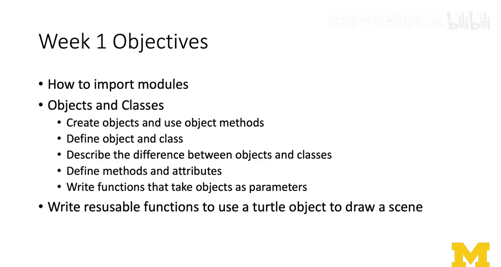
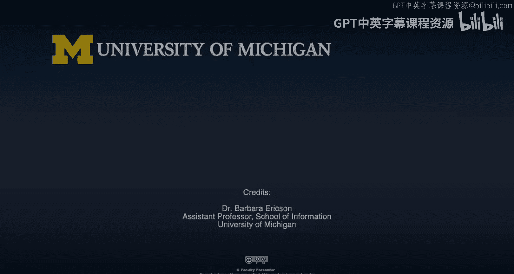

# 7：课程概述 🎨

在本节课中，我们将要学习第一周课程的核心内容。本周我们将重点探索如何通过导入模块来扩展Python的功能，并初步接触面向对象编程中“对象”与“类”的核心概念。最后，我们将运用所学知识，使用`turtle`对象绘制一个图形场景。

## 导入模块 📦

Python语言本身相当精炼，但其强大之处在于拥有大量可导入并使用的模块或库。学习如何导入模块是本周你将掌握的首要技能。

## 对象与类初探 🧱

上一节我们介绍了模块的导入，本节中我们来看看编程中一个非常重要的思想：对象与类。我们将学习如何将代码组织成对象和类。

以下是本周关于对象与类的具体学习目标：
*   学习如何创建对象并使用对象的方法。
*   学习如何定义对象和类。
*   理解对象和类之间的区别。
*   学习如何定义对象的方法、属性（或特性）和行为。

## 函数与对象结合应用 ⚙️

在掌握了对象的基本概念后，你将进一步学习编写以对象作为参数的函数，这能让你的代码更加灵活和强大。

## 实践项目：使用Turtle绘图 🐢

在本周的最后，你将综合运用所学的关于可重用函数和对象的知识，使用`turtle`图形对象绘制一个场景。这是一个有趣的实践，能帮助你巩固本周的所有概念。

本节课中我们一起学习了第一周的课程安排，包括导入Python模块、理解面向对象编程中对象与类的基础知识，以及如何编写操作对象的函数。最终，我们将通过`turtle`绘图项目来实践这些概念。祝你学习愉快！