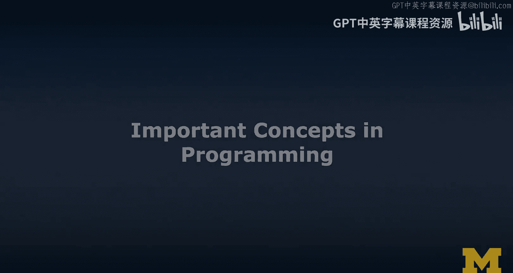
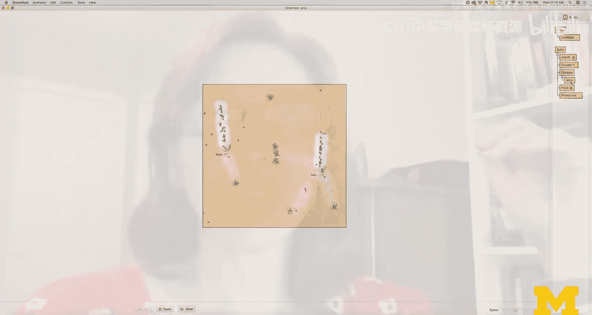
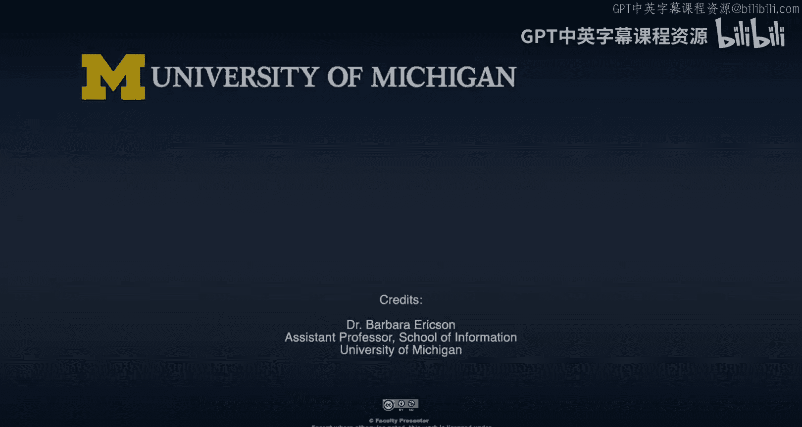

# 8：编程核心概念解析 🧠

在本节课中，我们将要学习编程中的一个强大思想：面向对象编程。我们将通过一个生动的蚂蚁觅食模拟程序来理解其核心概念，包括类、对象以及它们如何协同工作。

## 面向对象编程简介

面向对象编程是一种编程范式，其核心思想是：你可以编写程序来定义事物的**类**或分类，然后从这些类中创建**对象**，最后由这些对象在程序中执行具体的工作。

## 蚂蚁觅食模拟程序示例

为了具体说明，让我们来看一个蚂蚁觅食的模拟程序。当我运行这个程序时，会出现一个场景：其中有蚁丘，红色的小蚂蚁从蚁丘中出来。它们相当随机地四处游荡，寻找食物。当它们找到食物时，会留下信息素，然后返回蚁丘。其他蚂蚁可以跟随这些信息素找到食物。

这是一个很好的多对象示例。程序中定义了多个类，例如 `World`、`Actor`、`AntHill`、`Calendar`、`Creature` 和 `Ant`。因此，这是一个面向对象的程序。它将程序分解为多个类，然后我们创建这些类的对象，由这些对象在程序中实际执行工作。

## 核心概念解析

上一节我们通过示例看到了面向对象程序的实际运行效果。本节中，我们来详细看看构成这个程序的核心概念。

以下是构成面向对象程序的关键元素：

*   **类**：类是对象的蓝图或模板。它定义了某一类事物共有的**属性**（数据）和**方法**（行为）。例如，`Ant` 类定义了所有蚂蚁共有的属性（如位置、携带的食物量）和方法（如移动、寻找食物、返回蚁巢）。
    *   **公式/代码表示**：`class Ant:`
*   **对象**：对象是类的具体实例。根据同一个类可以创建出多个独立的对象。例如，程序运行时，会根据 `Ant` 类创建出成百上千个独立的蚂蚁对象，每个对象都有自己的状态（位置、食物量）。
    *   **公式/代码表示**：`ant1 = Ant()`
*   **属性**：属性是对象内部存储的数据，用于描述对象的状态。例如，一个蚂蚁对象可能有 `x_position`、`y_position`、`food_carried` 等属性。
    *   **公式/代码表示**：`self.x_position = 100`
*   **方法**：方法是定义在类中的函数，用于描述对象可以执行的操作或行为。例如，`Ant` 类可能有 `move()`、`search_food()`、`return_to_hill()` 等方法。
    *   **公式/代码表示**：`def move(self):`

## 程序结构分析

理解了基本概念后，我们来看看这些概念如何组织成一个完整的程序。

在这个蚂蚁模拟程序中，不同的类承担了不同的职责：
*   `World` 类可能负责管理整个模拟环境，如画布大小、食物位置。
*   `Actor` 或 `Creature` 类可能是一个更基础的类，定义了所有生物共有的特性（如位置、移动），`Ant` 类则继承自它。
*   `AntHill` 类代表蚁丘，管理从这里出生的蚂蚁。
*   `Calendar` 类可能用于控制模拟的时间步长或周期。
*   `Ant` 类则具体定义了蚂蚁的觅食行为逻辑。

程序运行时，首先会创建这些类的对象（例如，一个 `World` 对象，几个 `AntHill` 对象）。然后，`AntHill` 对象会不断地创建新的 `Ant` 对象。每个 `Ant` 对象根据其内部方法（如 `move`, `search_food`）自主行动，并通过修改自身属性（如位置）和与环境（其他对象）交互，共同呈现出复杂的群体觅食行为。

## 总结

本节课中，我们一起学习了面向对象编程的核心概念。我们了解到，面向对象编程通过**类**来定义事物的抽象蓝图，通过创建类的**对象**实例来构建程序。对象拥有**属性**来存储状态，并通过**方法**来定义行为。我们通过一个蚂蚁觅食的模拟程序，直观地看到了多个类（如 `World`, `Ant`, `AntHill`）如何被定义，它们的对象又如何被创建并相互作用，从而完成复杂的程序任务。掌握这些概念是理解和构建更大型、更模块化软件的基础。