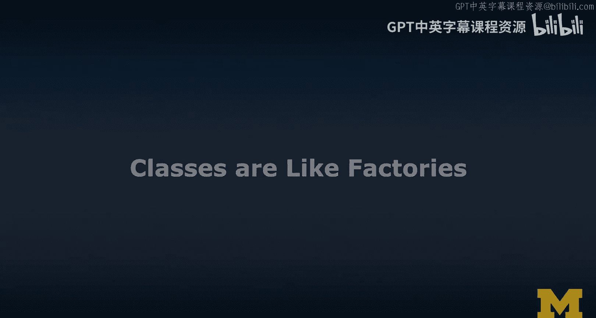
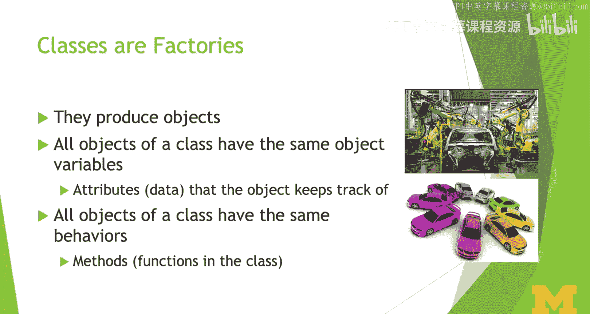
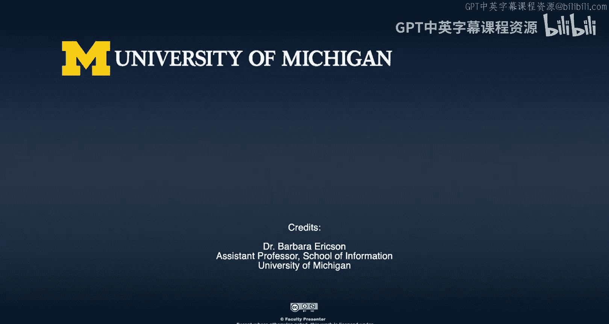

# 创造性编程：09：类如同工厂 🏭


在本节课中，我们将学习面向对象编程中的一个核心概念——**类**。我们将通过一个生动的比喻来理解类是什么，以及它如何帮助我们创建具有特定属性和行为的对象。



---

## 概述

类可以被看作是一个**工厂**。就像汽车工厂可以生产出许多辆汽车一样，一个类可以用来创建多个具有相同基本结构，但具体属性可能不同的对象。这些对象不仅拥有数据（属性），还能执行特定的操作（行为）。理解类与对象的关系，是掌握面向对象编程的关键第一步。

---

## 类如同工厂

上一节我们介绍了编程中的基本概念，本节中我们来看看“类”这个强大的工具。

你可以把一个类想象成一个工厂。通过这个工厂，你可以创建许多属于同一类型的对象。例如，一个汽车工厂可以生产出许多辆汽车，这些汽车都属于“汽车”这个类别，但它们各自拥有不同的属性。

以下是这些汽车对象可能具有的不同属性：
*   它们有不同的颜色。
*   它们可能配备了不同的选项（例如，天窗、真皮座椅）。

当你向工厂订购一辆汽车时，你需要指定你想要的汽车类型、颜色以及其他各种属性。这个过程，就类似于在代码中**实例化**一个类并传入初始参数。

---

## 对象的属性与行为

当我们得到一辆汽车时，我们不仅关心它的外观（属性），更期望它能执行特定的功能（行为）。你会感到不满，如果你得到的汽车不能前进、后退、左转或右转。

这些“能做的事情”就是我们期望汽车具备的**行为**。

因此，当你定义一个类时，你需要明确两件事：
1.  **属性**：我们需要知道的关于这个对象的数据。在代码中，这通常由类的 `__init__` 方法中的变量来定义。
    ```python
    def __init__(self, color, has_sunroof):
        self.color = color          # 属性：颜色
        self.has_sunroof = has_sunroof # 属性：是否有天窗
    ```
2.  **行为**：这个对象可以执行的操作。在代码中，这由类内部定义的**方法**来实现。
    ```python
    def drive_forward(self):
        print(f"The {self.color} car drives forward.") # 行为：前进

    def turn_left(self):
        print("The car turns left.") # 行为：左转
    ```



---


## 总结



本节课中我们一起学习了“类”的概念。我们通过“工厂”的比喻，理解了类是一个用于创建对象的蓝图或模板。每个由类创建的对象（实例）都拥有类所定义的**属性**（数据）和**行为**（方法），但各自的属性值可以不同。掌握类的定义和使用，是构建复杂、模块化程序的基础。