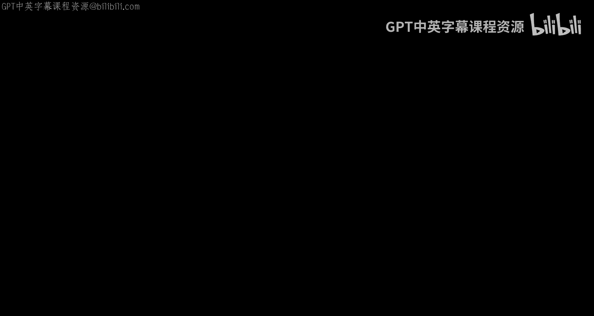
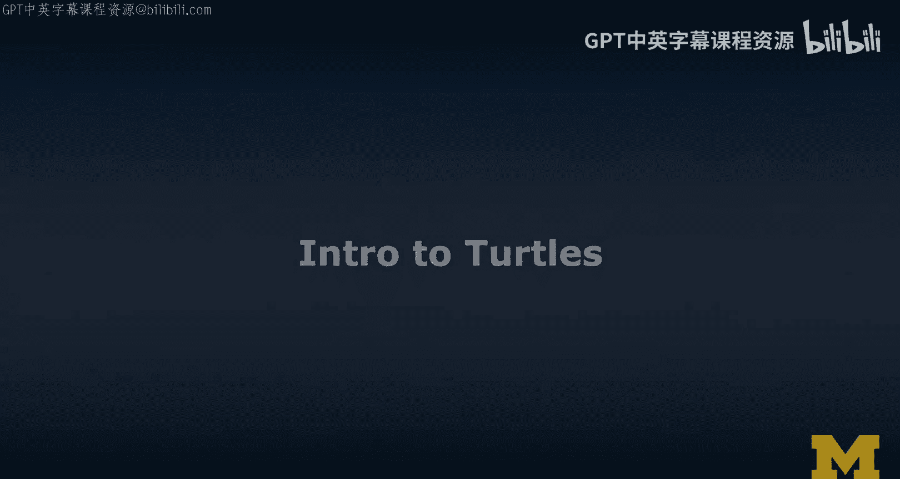
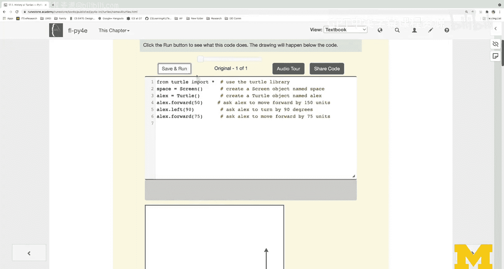
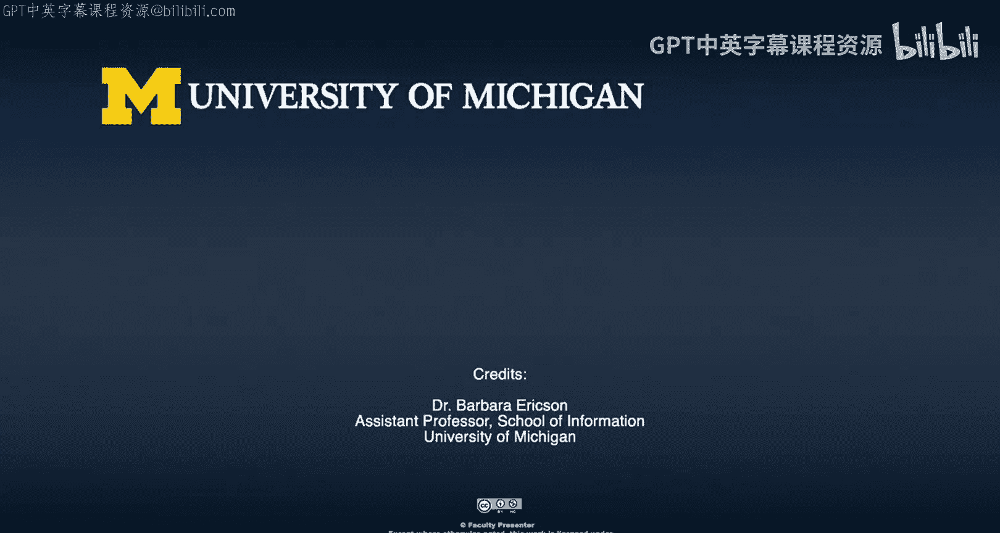
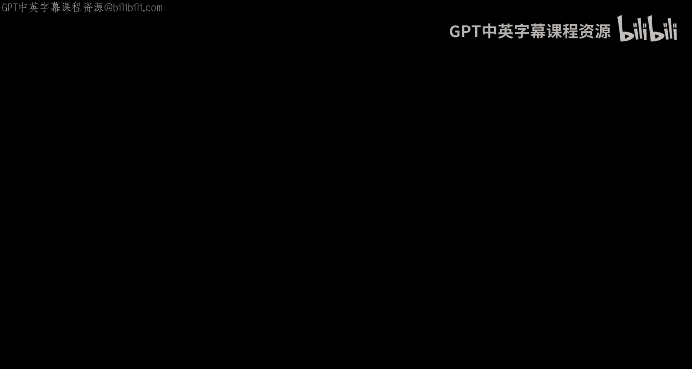

# 10：Turtle绘图入门 🐢





在本节课中，我们将学习如何使用Python的Turtle库进行绘图。Turtle是一个历史悠久的编程教学工具，它通过控制一个虚拟的“海龟”在屏幕上移动并留下轨迹，来帮助我们直观地理解编程概念，特别是对象和类。

## 概述：Turtle的历史与概念

Turtle绘图的概念可以追溯到20世纪60年代。麻省理工学院的教授西摩·派珀特和他的团队创造了Logo编程语言。他们使用一个装有笔的实体机器人海龟，通过编程指令控制它前进、左转和右转，从而绘制图形。派珀特将这种海龟称为“思考的对象”，因为它能帮助学习者利用自身的身体运动知识（如前进、转向）来解决问题。如今，包括Python在内的许多编程语言都支持Turtle库。

## 第一个Turtle程序

上一节我们了解了Turtle的背景，本节中我们来看看如何在Python中编写第一个Turtle程序。

以下是一个简单的Python代码示例。运行这段代码，你将看到一只名为Alex的海龟在屏幕上移动并绘制线条。

```python
import turtle

# 创建一个绘图窗口
space = turtle.Screen()
# 创建一个海龟对象，命名为Alex
alex = turtle.Turtle()

# 控制Alex移动
alex.forward(150)  # 向前移动150像素
alex.left(90)      # 向左转90度
alex.forward(75)   # 再向前移动75像素
```

运行这段代码后，海龟Alex会先向前移动150个单位，然后左转90度，最后再向前移动75个单位，在屏幕上画出一个“L”形的折线。

## 理解代码结构

现在，让我们分解一下上面的代码，理解每一部分的作用。

以下是代码中涉及的核心概念和步骤：

1.  **导入库**：Python本身功能有限，但可以通过`import`语句引入额外的库来扩展功能。这里我们导入了`turtle`库。
2.  **创建画布**：`turtle.Screen()`创建了一个窗口对象，我们将其赋值给变量`space`，作为海龟绘图的画布。
3.  **创建海龟**：`turtle.Turtle()`创建了一个海龟对象，我们将其赋值给变量`alex`。你可以把`alex`想象成一只真实的、可以接受命令的海龟。
4.  **发送指令**：我们使用**点号（.）** 来向海龟对象发送指令。这被称为**点表示法**。例如：
    *   `alex.forward(150)`：命令Alex向前移动150像素。
    *   `alex.left(90)`：命令Alex向左转90度。

## 修改与实验

理解了基本结构后，我们可以通过修改参数来观察不同的绘图效果。

例如，如果我们只让Alex向前移动50像素，代码如下：

```python
alex.forward(50)
alex.left(90)
alex.forward(75)
```

运行修改后的代码，你会发现Alex在移动较短距离后就进行了转弯，从而绘制出形状不同的折线。通过改变`forward()`函数中的数字（距离）和`left()`或`right()`函数中的数字（角度），你可以创造出各种图形。





## 总结



本节课中我们一起学习了Turtle绘图的基础知识。我们了解了Turtle作为“思考对象”的起源，掌握了在Python中导入`turtle`库、创建屏幕和海龟对象的方法，并学会了使用**点表示法**（如`对象.方法(参数)`）向海龟发送前进和转向的指令。通过修改指令中的参数，你可以开始探索和创造属于自己的简单图形。