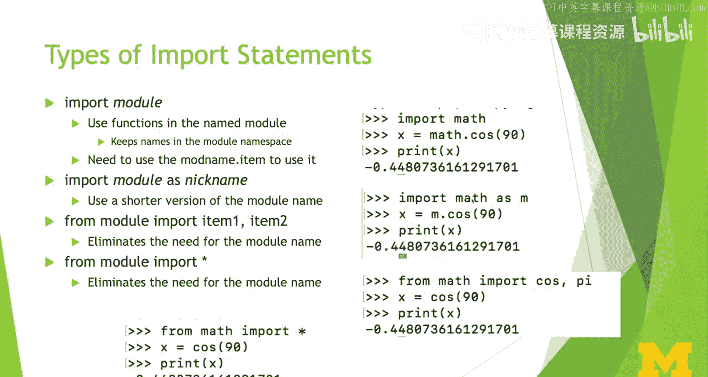
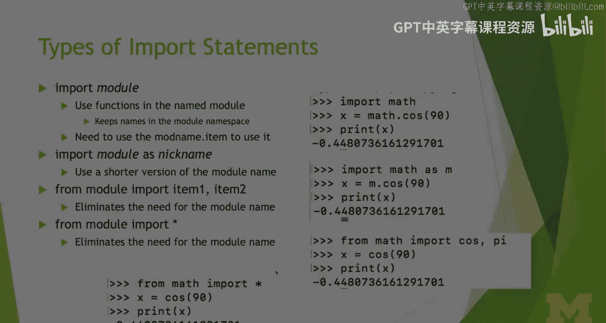

# Python编程：模块导入方法详解 🐢


在本节课中，我们将学习Python中模块导入的不同方法。模块是包含Python代码的文件，通过导入模块，我们可以使用其中定义的函数、类和变量。理解不同的导入方式对于编写清晰、高效的代码至关重要。

## 导入模块的基本方法

上一节我们介绍了模块的概念，本节中我们来看看具体的导入方法。Python提供了多种导入模块的方式，每种方式都有其适用场景。

### 方法一：直接导入模块名

使用`import`关键字后跟模块名，可以直接导入整个模块。这种方式允许你使用模块中的所有功能，但使用时需要在函数或变量名前加上模块名作为前缀。

例如，导入`math`模块并使用其中的`cosine`函数：

```python
import math
result = math.cos(0)
```

### 方法二：使用别名导入模块

有时模块名较长，可以使用`as`关键字为模块设置一个简短的别名。这可以使代码更简洁，同时保持命名空间的清晰。

以下是使用别名导入`math`模块的示例：

```python
import math as m
result = m.cos(0)
```

### 方法三：从模块中导入特定内容

如果你只需要模块中的特定函数或变量，可以使用`from ... import ...`语句。这样可以避免使用模块名前缀，直接使用导入的名称。

以下是从`math`模块中导入`cosine`函数和`pi`常量的示例：

```python
from math import cos, pi
result = cos(pi)
```

### 方法四：导入模块中的所有内容

使用`from ... import *`可以导入模块中的所有名称。这种方式允许你直接使用模块中的函数和变量，无需模块名前缀。然而，这种方式可能导致命名冲突，因此不推荐在大型项目中使用。

以下是导入`turtle`模块中所有内容的示例：

```python
from turtle import *
forward(100)
```

## 不同导入方法的比较

以下是各种导入方法的优缺点总结：

*   **`import module_name`**：保持命名空间清晰，避免命名冲突，但代码稍显冗长。
*   **`import module_name as alias`**：代码简洁，同时保持命名空间清晰，适合模块名较长的情况。
*   **`from module_name import name1, name2`**：直接使用特定名称，代码简洁，但可能引起命名冲突。
*   **`from module_name import *`**：使用最方便，但极易引起命名冲突，不利于代码维护。





## 总结


本节课中我们一起学习了Python中模块导入的四种主要方法。理解这些方法有助于你根据实际需求选择最合适的导入方式，从而编写出既清晰又高效的代码。对于初学者，建议优先使用`import module_name`或`import module_name as alias`的方式，以养成良好的编程习惯。