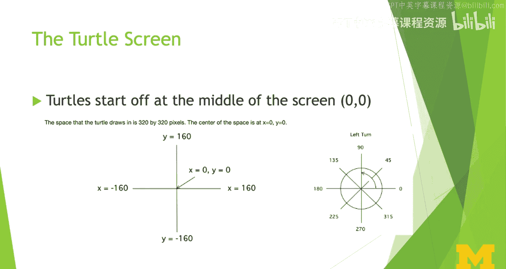

# 12：Turtle基础操作 🐢


在本节课中，我们将学习Python中Turtle图形库的基础操作。我们将从导入库开始，逐步了解如何创建画布、控制海龟移动以及理解其坐标系和方向系统。


---

上一节我们介绍了课程概述，本节中我们来看看Turtle模块的基本使用方法。

首先，你需要导入Python的turtle库。这个库定义了海龟类及其所有功能。

```python
import turtle
```

导入库后，你需要为海龟创建一个绘图屏幕或空间。

```python
screen = turtle.Screen()
```

接着，你需要创建一个海龟对象，并为其命名。创建后，海龟默认位于屏幕中央，面朝东方（即屏幕右侧）。

```python
alex = turtle.Turtle()
```

创建好海龟后，你可以使用点号（.）调用其方法来控制它。例如，让名为`alex`的海龟前进或转向。

以下是控制海龟的基本命令示例：

```python
alex.forward(100)  # 海龟向前移动100个单位
alex.left(90)      # 海龟向左转90度
alex.right(90)     # 海龟向右转90度
```

---

上一节我们学习了如何创建和控制海龟，本节中我们来理解海龟绘图所在的坐标系。

Turtle屏幕的坐标系定义如下：X轴从左边的-160到右边的+160，Y轴从底部的-160到顶部的+160。海龟的初始位置(0,0)位于这个坐标系的中心。

理解海龟的方向至关重要。每个海龟对象都记录着自己当前面对的方向。初始状态下，海龟面朝东方（X轴正方向）。

当你命令海龟左转或右转时，旋转是基于它**当前面对的方向**进行的。例如，如果海龟面朝东，执行`left(90)`会使它面朝北；执行`right(90)`会使它面朝南。



请记住：海龟的每一次移动和转向，都依赖于它当前的方向。


---


本节课中我们一起学习了Python Turtle图形库的基础知识。我们了解了如何导入库、创建屏幕和海龟对象，并使用`forward()`、`left()`和`right()`等基本命令控制海龟移动。同时，我们明确了Turtle的坐标系以及基于当前方向进行转向的核心概念。掌握这些是进行更复杂创意编程绘图的第一步。