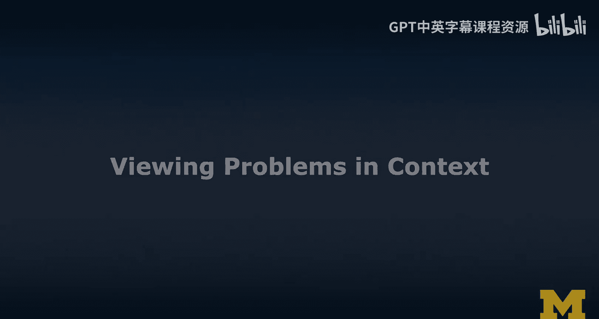
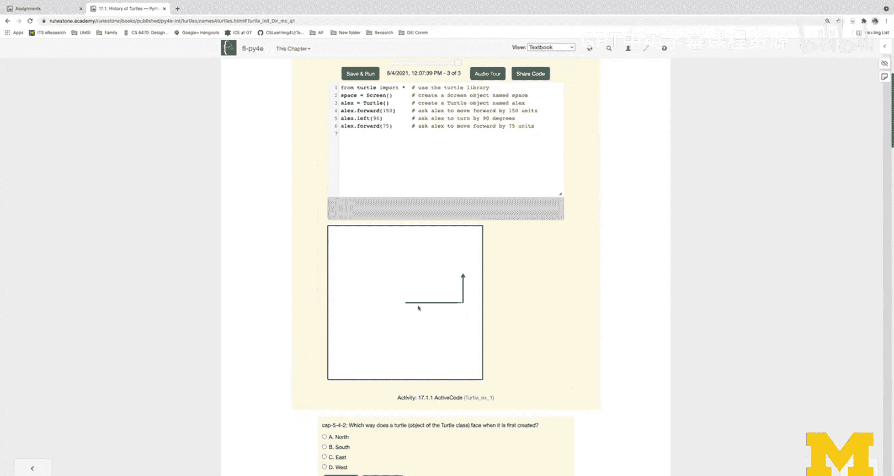

# 创造性编程：13：上下文问题查看 🧭


在本节课中，我们将学习如何通过“在上下文中查看问题”的功能来更好地理解和完成课程作业。这个功能能帮助你看到问题在原始页面中的位置和相关的代码，从而更准确地找到答案。



---

## 如何利用上下文功能

上一节我们介绍了作业中可能遇到的问题。本节中我们来看看一个具体的解决方法。

当你遇到一个难以理解的问题时，直接看问题本身可能不够。作业中的问题通常是基于其上方或周围的代码情境提出的。

以下是操作步骤：

1.  在作业界面中找到你感到困惑的问题。
2.  点击该问题旁边的 **“在上下文中查看”** 按钮或链接。
3.  页面将跳转，并显示该问题在原始学习材料（如课程页面或代码示例）中出现的位置。

## 功能应用示例

为了让你更清楚地理解，我们来看一个具体的例子。

假设你遇到的问题是：“**一个Turtle对象在首次创建时面向哪个方向？**”

如果只看这个问题，你可能需要回忆或猜测。但通过使用“在上下文中查看”功能，你可以看到提出这个问题时所在的完整代码块：

```python
import turtle

# 创建一只新的海龟
my_turtle = turtle.Turtle()
# 让海龟向前移动
my_turtle.forward(100)
```

通过运行或阅读这段上下文代码，你可以直观地观察到海龟被创建后的初始状态和动作，从而更容易推断出正确答案（例如，初始方向通常是**0度**，即正东方向）。



因此，如果你在回答问题时有困难，请记住使用“在上下文中查看”功能。


---


本节课中我们一起学习了如何利用“在上下文中查看”功能来辅助完成编程作业。关键在于不要孤立地看待问题，而是要回到它出现的原始情境中，结合相关的代码和说明来寻找线索。这个方法能帮助你更有效地理解和解决学习过程中遇到的挑战。