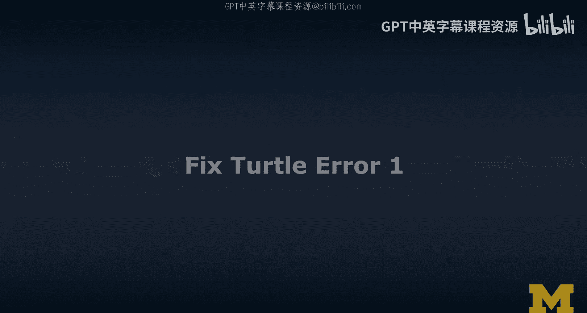
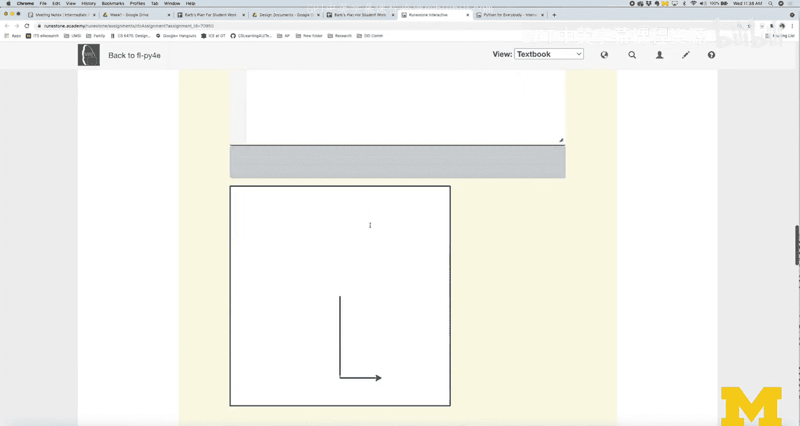

# 创造性编程：14：修复Turtle错误1 🐢




在本节课中，我们将学习如何修复一段涉及海龟绘图（Turtle）的代码。我们将通过识别并修正一系列常见的编程错误，包括命名规范、语法错误和拼写错误，最终让代码正确运行。

## 概述

我们有一段存在错误的代码，目标是使其能够正常运行并绘制出一个大写的“L”形状。我们将逐步分析错误信息，定位问题所在，并进行修正。

## 错误分析与修复

上一节我们概述了任务，本节中我们来看看具体的错误和修复步骤。

首先运行代码时，我们在第二行遇到了第一个错误：“named screen is not defined”。

**问题根源**：在编程惯例中，类名应以大写字母开头。这标志着它是一个重要的类别，而不仅仅是某个事物的名称。这与英语习惯相反：在英语中，我们不会将“turtle”这种类别名称大写，但会将“Alicia”这样的人名大写。在编程中，我们大写类名，而不大写单个对象名。

**修复方法**：将 `screen` 改为 `Screen`。

```python
# 错误示例
screen = turtle.Screen()
# 正确示例
Screen = turtle.Screen()
```

修正后，我们在第四行遇到了第二个错误：“missing one argument”。

**问题根源**：第四行代码 `le do right 90` 看起来似乎正确。此时，我们应该检查它上面的那一行。仔细观察会发现，第三行缺少了闭合括号。

**修复方法**：为第三行代码加上括号。

```python
# 错误示例
turtle = turtle.Turtle
# 正确示例
turtle = turtle.Turtle()
```

现在代码可以编译运行了，但并未产生预期的图形。它本应右转90度，前进，再左转90度。

**问题根源**：前进命令 `forward` 后面缺少了前进距离参数 `150`。同时，在图片下方的错误信息中，第七行提示“There‘s no forward”。我们发现第七行的 `forward` 被错误地写成了大写字母开头的 `Forward`。

**修复方法**：为 `forward` 命令添加参数 `150`，并将 `Forward` 改为全小写的 `forward`。在Python中，除了类名以及 `None`、`True`、`False` 等关键字外，其他都应使用小写。

```python
# 错误示例
turtle.forward
turtle.Forward(75)
# 正确示例
turtle.forward(150)
turtle.forward(75)
```

## 最终效果

完成所有修正后，再次运行代码。海龟初始方向朝东，执行 `right(90)` 后转向南，然后前进150个单位，接着 `left(90)` 转向东，最后前进75个单位，成功绘制出一个大写的“L”形状。



## 总结


本节课中我们一起学习了如何调试海龟绘图代码。我们修复了类名大小写错误、缺少括号的语法错误、函数参数缺失以及函数名拼写错误。关键要点在于：遵循类名大写的惯例，注意语法细节（如括号），并确保函数调用时参数完整且名称拼写正确。掌握这些调试技巧对编程至关重要。