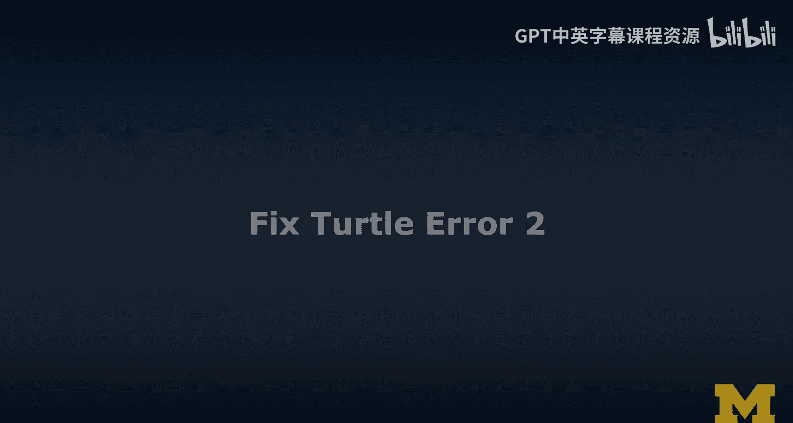
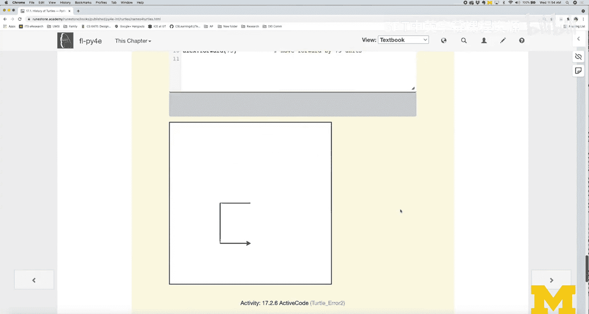
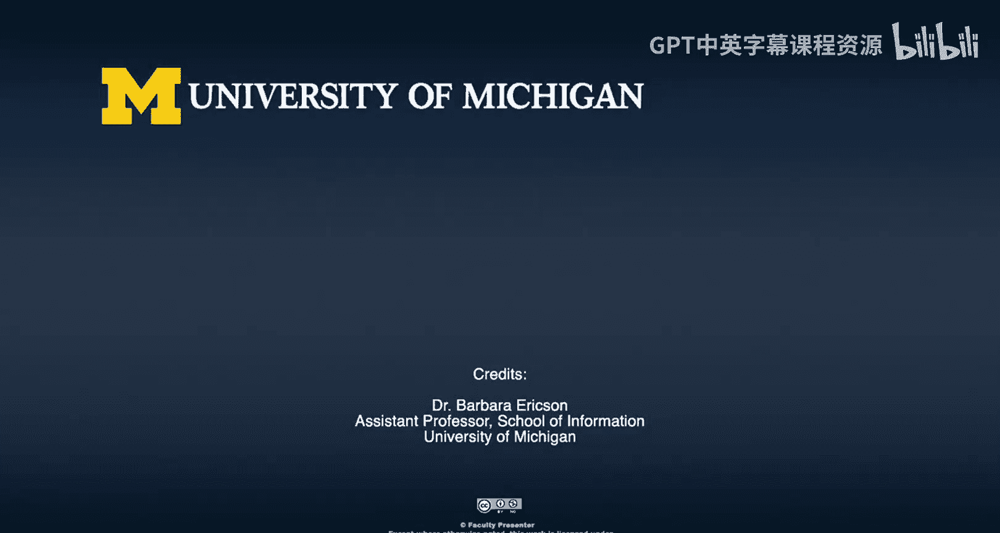

# 创造性编程：15：修复Turtle错误2 🐢

在本节课中，我们将学习如何诊断和修复一段存在多处错误的Python Turtle代码。我们将通过逐行分析错误信息，理解常见的语法和逻辑问题，并最终使程序成功运行。

---

上一节我们介绍了调试的基本思路，本节中我们来看看一个具体的、包含多个错误的Turtle绘图程序案例。

首先，我们尝试保存并运行这段有问题的代码。程序立即报错，提示在第二行有“bad input”。

以下是错误分析的第一步：
*   问题在于第二行的 `Import` 使用了首字母大写。在Python中，除了 `None`、`True`、`False` 等少数特例外，所有关键字都应使用小写。正确的写法是 `import`。

修正这个错误后，我们再次运行程序。此时，错误信息变为：第5行缺少一个必需的参数 `angle`。

然而，观察第5行代码 `turtle.left(90)`，`angle` 参数 `90` 明明存在。这是一个重要的调试技巧：**当错误指向某一行，而该行本身看起来没有问题时，请检查它前面的代码**。

于是我们检查第4行，发现 `turtle.forward(100` 缺少了闭合的右括号 `)`。这导致Python解释器在解析语法时产生了混乱，误报了第5行的错误。修正后，代码变为 `turtle.forward(100)`。

再次运行程序，我们遇到了第三个错误：第7行的 `turn` 未被识别。

`turn` 并不是Turtle模块的有效命令。如果我们想让海龟左转，应该使用关键字 `left`。因此，我们将第7行的 `turn` 修改为 `left`。

程序现在可以启动了，但绘图没有完全结束。这是因为最后一条 `forward` 指令没有指定前进的距离。根据图形推断，我们需要前进75个单位。

所以，我们将最后一行修改为 `turtle.forward(75)`。

完成所有修正后，程序终于成功运行，绘制出了预期的正方形图案。

---

本节课中我们一起学习了如何系统地修复一个多错误的程序。我们回顾一下关键步骤：首先，注意Python**关键字**的大小写规则；其次，当错误行本身无误时，要**检查其上方代码**的语法完整性（如括号匹配）；然后，确认所使用的**函数或方法名称**是否正确；最后，检查函数调用是否提供了所有必需的**参数**。通过耐心地逐一排查这些常见问题点，就能有效地完成调试工作。