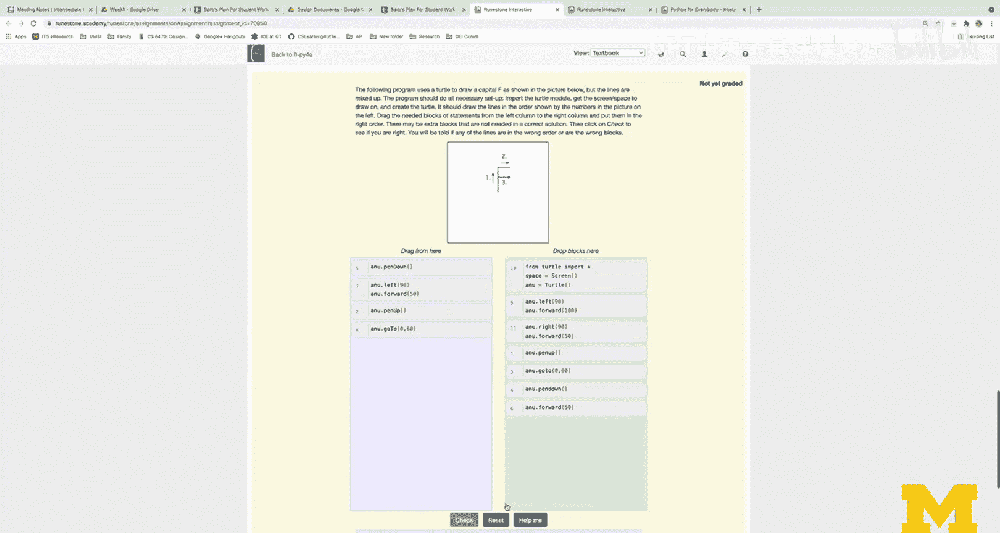

# 创造性编程：16：解决绘制字母F问题 🐢

在本节课中，我们将学习如何使用Python的Turtle库来绘制一个字母“F”。我们将通过分解问题、逐步编写代码并调试，最终完成图形的绘制。


---

## 概述


我们将通过一个具体的编程问题——绘制字母“F”——来学习如何将复杂任务分解为简单的步骤。我们将使用Turtle图形库，它允许我们通过控制一个“海龟”光标来绘制图形。课程将涵盖初始化环境、控制海龟移动、抬笔落笔操作以及调试代码。

---

## 导入库与创建海龟

首先，我们需要导入必要的库并设置绘图环境。以下是第一步的代码：

```python
import turtle
```

导入Turtle库后，我们创建一个绘图窗口和一只海龟，并为其命名。

```python
# 创建绘图窗口和海龟
screen = turtle.Screen()
t = turtle.Turtle()
```

现在，我们有了一个名为 `t` 的海龟，它默认面向东方（屏幕右侧）。

---

## 绘制F的第一笔（长竖线）

上一节我们创建了海龟，本节中我们来看看如何绘制字母“F”的第一笔，即长竖线。

海龟默认朝东。要向上（北）画线，需要先左转90度。然后，我们让海龟向前移动一段距离，例如100像素，以画出长竖线。

以下是实现此步骤的代码：

```python
t.left(90)      # 向左转90度，使海龟朝北
t.forward(100)  # 向前移动100像素，画出长竖线
```

执行后，海龟将位于画布顶部，面朝北方。

---

## 绘制F的顶部横线

绘制完竖线后，海龟位于顶部且朝北。要绘制顶部的短横线，需要让海龟向右转90度，使其朝东，然后向前移动一段较短的距离，例如50像素。

以下是实现此步骤的代码：

```python
t.right(90)     # 向右转90度，使海龟朝东
t.forward(50)   # 向前移动50像素，画出顶部横线
```

现在，字母“F”的顶部结构已经完成。

---

## 移动海龟并绘制中间横线

接下来，我们需要在不画线的情况下，将海龟移动到竖线的中间位置，以绘制中间的横线。这需要用到“抬笔”和“落笔”操作。

首先，我们抬起笔，这样移动时就不会留下痕迹。然后，将海龟移动到目标坐标 `(0, 60)`。最后，落下笔并向前移动，画出中间的横线。

以下是实现此步骤的代码：

```python
t.penup()           # 抬起笔，移动时不画线
t.goto(0, 60)       # 移动到坐标 (0, 60)
t.pendown()         # 落下笔，准备画线
t.forward(50)       # 向前移动50像素，画出中间横线
```

**注意**：在Python的Turtle库中，所有方法名都是小写，例如 `penup()` 和 `pendown()`。

---

## 代码整合与检查

我们已经完成了各个步骤的代码。现在，将它们整合在一起，并检查是否有错误。

以下是完整的代码：

```python
import turtle

# 创建海龟
t = turtle.Turtle()

# 绘制长竖线
t.left(90)
t.forward(100)

# 绘制顶部横线
t.right(90)
t.forward(50)

# 移动并绘制中间横线
t.penup()
t.goto(0, 60)
t.pendown()
t.forward(50)

# 保持窗口打开
turtle.done()
```



运行此代码，你应该能看到一个完整的字母“F”被绘制出来。


---


## 总结

本节课中，我们一起学习了如何使用Python的Turtle库绘制字母“F”。我们分解了绘制过程，逐步实现了初始化、方向控制、移动和抬笔/落笔操作。记住，编程中常有多种方法解决同一问题，关键是理解每一步的逻辑。通过这个练习，你掌握了将图形任务转化为代码的基本技能。