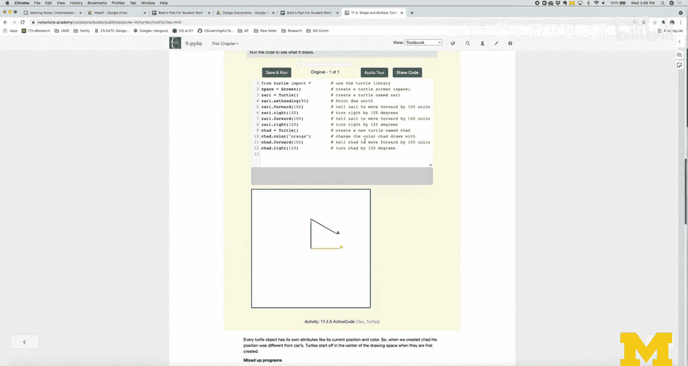

# 17：多Turtle协同 🐢


在本节课中，我们将学习如何创建和使用多个Turtle对象。通过理解每个Turtle如何独立地管理自己的属性和行为，你将能够编写更复杂、更有趣的图形程序。

## 概述

当我们从类创建对象时，可以根据需要创建任意数量的对象。每个对象都会维护自己的数据（即属性），并拥有相同的行为能力。例如，所有的Turtle对象都知道如何前进、左转和右转。接下来，我们将深入探讨这一概念。

## 深入理解Turtle对象

使用Turtle类，你可以创建任意数量的Turtle。每个Turtle在创建时都位于画布中心，面朝东方。它会跟踪自己的数据，例如颜色、朝向和位置。所有Turtle都能执行相同的动作，如前进、左转、右转、抬笔和落笔。每个Turtle的初始状态都是在窗口中心面朝东方，默认颜色为黑色。

让我们通过一个例子来具体看看。在以下代码中，我们创建了一个名为Zri的Turtle，并让它执行一系列动作：

```python
# 创建Turtle对象Zri
Zri = Turtle()
# 设置朝向为90度（面朝北）
Zri.setheading(90)
# 前进100个单位
Zri.forward(100)
# 右转120度
Zri.right(120)
Zri.forward(100)
Zri.right(120)
Zri.forward(100)
Zri.right(120)
```

这段代码让Zri面朝北，前进100个单位，然后右转120度并重复三次，最终回到初始朝向。

## 使用多个Turtle

现在，如果我们创建两个不同的Turtle对象，例如Zri和Chad，情况会有所不同。Zri会执行上述动作，但当我们创建Chad时，它同样会在画布中心被创建，面朝东方。因此，Chad会执行另一套指令。

以下是使用两个Turtle的示例：

```python
# 创建第一个Turtle对象Zri
Zri = Turtle()
Zri.setheading(90)
Zri.forward(100)
Zri.right(120)
Zri.forward(100)
Zri.right(120)
Zri.forward(100)
Zri.right(120)

# 创建第二个Turtle对象Chad
Chad = Turtle()
# Chad从中心开始，面朝东方，执行不同的动作
Chad.left(45)
Chad.forward(150)
```

在这个例子中，Zri绘制了一个三角形，而Chad则从中心出发，左转45度后前进150个单位。

## 注意事项



在使用多个Turtle时，请记住每个Turtle都有自己的朝向和位置。这意味着你需要分别管理每个Turtle的状态，以确保它们按照预期的方式行动。

## 总结


本节课中，我们一起学习了如何创建和使用多个Turtle对象。我们了解到，每个Turtle都是独立的，拥有自己的属性和行为。通过分别控制它们，我们可以创建出更复杂和有趣的图形。记住，关键在于理解每个Turtle的独立性和如何管理它们的状态。