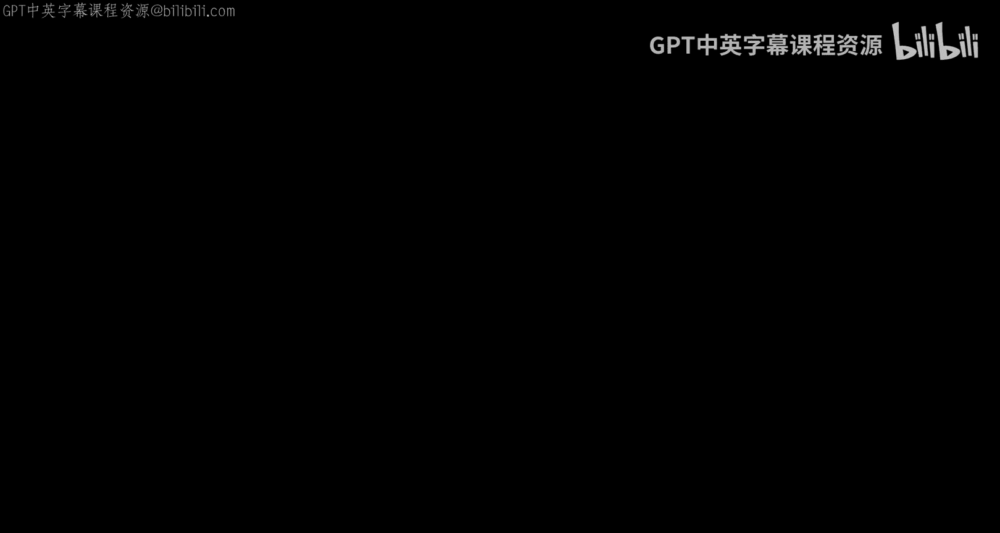
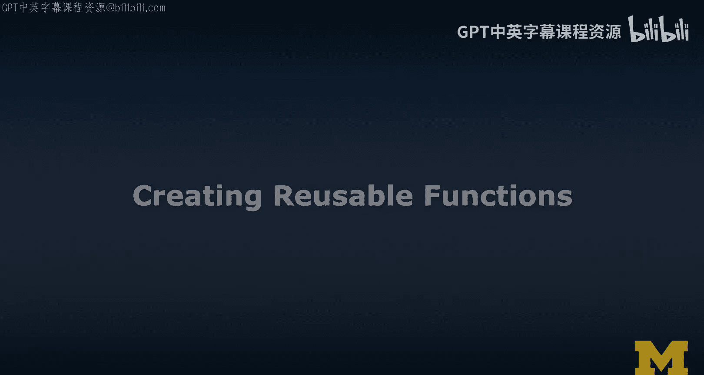
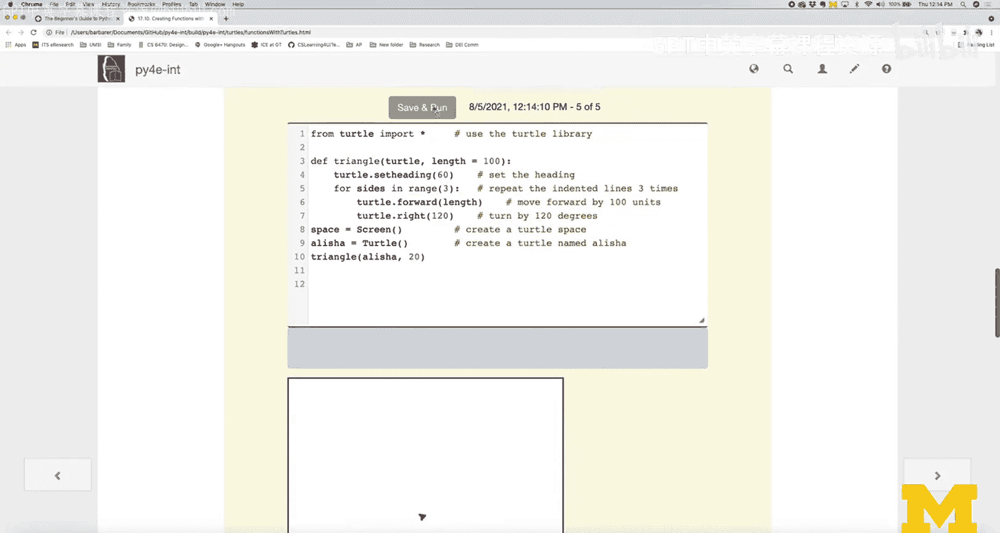
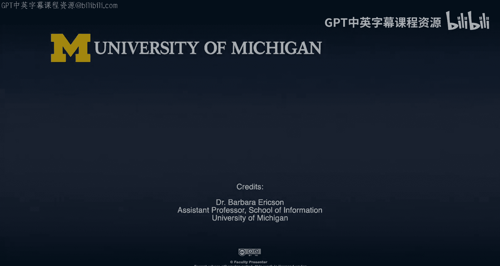

# 18：创建实用函数 🛠️



在本节课中，我们将学习如何将一段绘制等边三角形的代码封装成一个可复用的函数。我们将从分析现有代码开始，逐步将其转换为一个函数，并探讨如何设置参数、默认值以及如何调用它。



## 分析现有代码

首先，我们来看一段绘制等边三角形的代码。这段代码使用 `turtle` 图形库，绘制一个底边水平的等边三角形。这种形状非常适合后续用来构建像房子屋顶这样的图形。

```python
import turtle

# 初始化turtle
alicia = turtle.Turtle()

# 绘制等边三角形的代码
for _ in range(3):
    alicia.forward(100)  # 假设边长为100
    alicia.left(120)
```

如果保存并运行这段代码，屏幕上将显示一个每条边长度相同、底边水平的等边三角形。

## 将代码转换为函数

上一节我们分析了绘制三角形的代码，本节中我们来看看如何将其封装成一个函数。函数化的目的是提高代码的复用性。

以下是创建 `triangle` 函数的关键步骤：

1.  **定义函数**：使用 `def` 关键字定义函数，并为其命名。
2.  **设置参数**：确定函数需要哪些输入。这里我们需要 `turtle` 对象和三角形的 `length`。
3.  **设置默认值**：为参数设置默认值，使函数调用更灵活。
4.  **替换局部变量**：将函数内部对特定 `turtle` 对象（如 `alicia`）的引用，替换为参数名。
5.  **调用函数**：定义函数后，必须调用它才能执行。

让我们开始实践。首先，在导入语句后定义函数。

```python
import turtle

def triangle(turtle_obj, length=100):
    """
    绘制一个等边三角形。
    :param turtle_obj: turtle对象，用于绘图
    :param length: 三角形的边长，默认为100
    """
    for _ in range(3):
        turtle_obj.forward(length)  # 使用传入的length参数
        turtle_obj.left(120)
```

注意，我们将函数内的 `alicia` 全部替换为参数名 `turtle_obj`，并且 `forward` 的距离使用了参数 `length`。

## 调用函数并调试

函数定义完成后，我们需要创建 `turtle` 对象并调用这个函数。

```python
# 创建turtle对象
alicia = turtle.Turtle()

# 调用函数，传入turtle对象和边长
triangle(alicia, length=20)
```

如果运行代码后三角形大小没有变化，请检查是否在函数内部正确使用了 `length` 参数，而不是一个固定的数值。

## 扩展应用：绘制多个三角形

现在我们已经有了一个可用的三角形绘制函数，可以轻松地扩展代码来绘制多个三角形。例如，我们可以在每个三角形之间抬起画笔，移动位置，然后绘制下一个。

以下是绘制一系列三角形的示例：

```python
import turtle

def triangle(turtle_obj, length=100):
    for _ in range(3):
        turtle_obj.forward(length)
        turtle_obj.left(120)

alicia = turtle.Turtle()

# 绘制第一个三角形
triangle(alicia, 50)



# 抬起画笔，移动到新位置
alicia.penup()
alicia.forward(80)
alicia.pendown()

# 绘制第二个三角形
triangle(alicia, 30)
```

通过这种方式，我们可以用同一个函数高效地创建复杂的图案。


## 总结



本节课中我们一起学习了如何将具体的绘图代码抽象成一个通用的函数。我们掌握了定义函数、设置参数与默认值、在函数内部使用参数以及正确调用函数的方法。将代码函数化是编程中的一项核心技能，它能极大地提升代码的清晰度、可维护性和复用性。