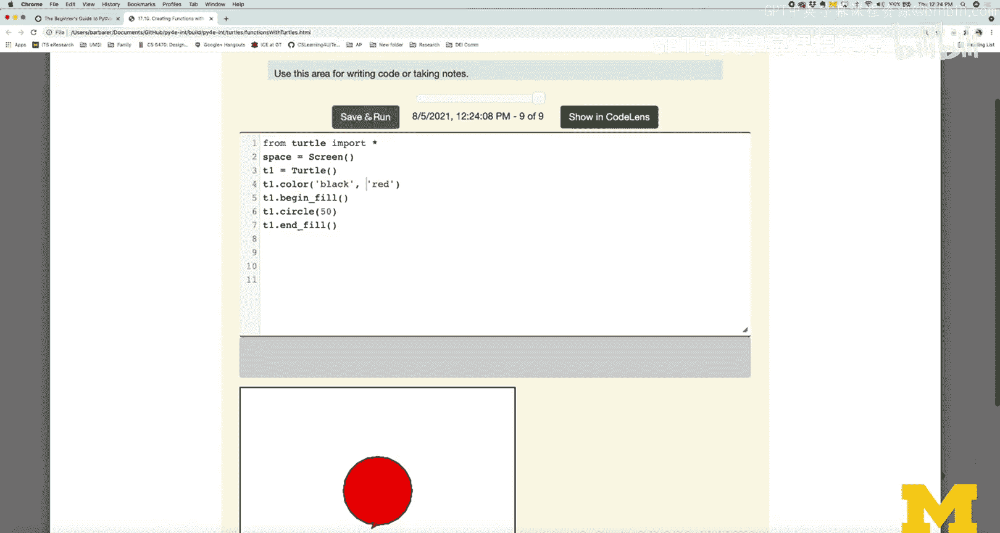

# 19：图形颜色填充技巧 🎨

在本节课中，我们将学习如何在Python的Turtle图形库中为绘制的形状填充颜色。我们将了解如何设置填充颜色、画笔颜色，以及如何正确地开始和结束填充操作。


---


上一节我们介绍了如何绘制基本图形，本节中我们来看看如何为这些图形填充颜色。

## 填充形状的基本方法

要为形状填充颜色，我们需要在绘制形状之前开始填充，并在绘制完成后结束填充。以下是实现这一过程的基本步骤。

以下是填充一个圆形的基本代码示例：

```python
import turtle

# 创建屏幕和乌龟对象
space = turtle.Screen()
t1 = turtle.Turtle()

# 设置颜色（同时设置画笔和填充色）
t1.color("red")

# 开始填充
t1.begin_fill()
# 绘制一个半径为50的圆
t1.circle(50)
# 结束填充
t1.end_fill()

space.mainloop()
```

运行此代码将创建一个填充为红色的圆形。

## 单独设置填充颜色

我们也可以只设置填充颜色，而不改变画笔颜色。此时，图形的轮廓将使用默认的画笔颜色（黑色）绘制。

以下是仅设置填充颜色的代码示例：

```python
import turtle

space = turtle.Screen()
t1 = turtle.Turtle()

# 仅设置填充颜色
t1.fillcolor("blue")

t1.begin_fill()
t1.circle(50)
t1.end_fill()

space.mainloop()
```

运行此代码将创建一个填充为蓝色、轮廓为黑色的圆形。

## 同时设置画笔和填充颜色

`color` 方法可以接受两个参数，分别用于设置画笔颜色和填充颜色。第一个颜色是画笔颜色，第二个颜色是填充颜色。

以下是同时设置两种颜色的代码示例：

```python
import turtle

space = turtle.Screen()
t1 = turtle.Turtle()

# 同时设置画笔颜色和填充颜色
# 一个参数是画笔颜色，第二个是填充颜色
t1.color("green", "yellow")

t1.begin_fill()
t1.circle(50)
t1.end_fill()



space.mainloop()
```


运行此代码将创建一个轮廓为绿色、填充为黄色的圆形。


---

本节课中我们一起学习了在Turtle图形中填充颜色的技巧。我们掌握了三种方法：使用 `color()` 同时设置画笔和填充色，使用 `fillcolor()` 仅设置填充色，以及通过 `color()` 的双参数形式分别指定两种颜色。关键在于使用 `begin_fill()` 和 `end_fill()` 来包裹需要填充的绘图指令。