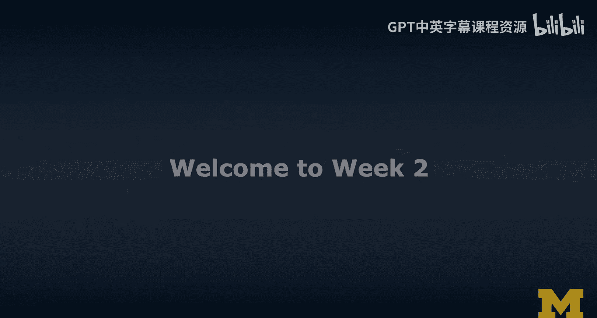
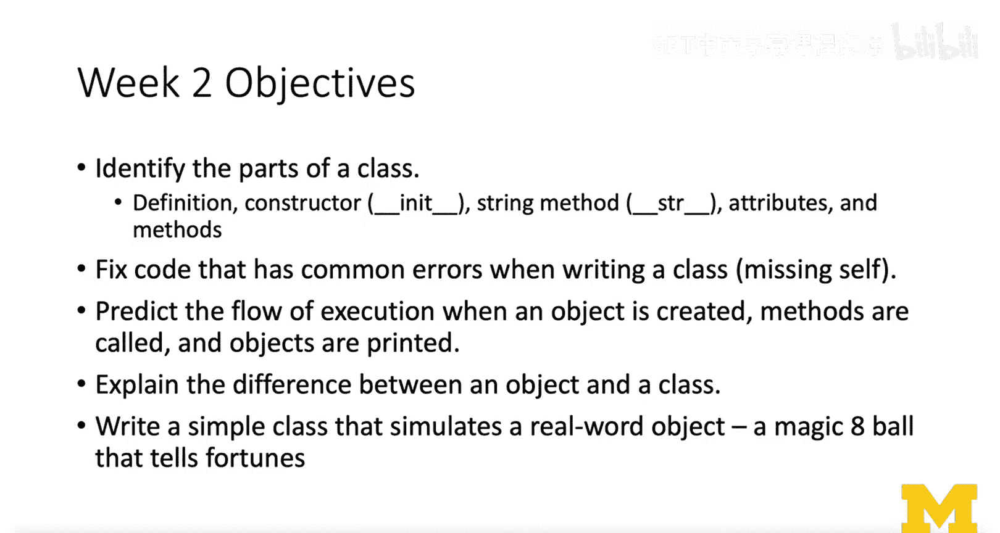
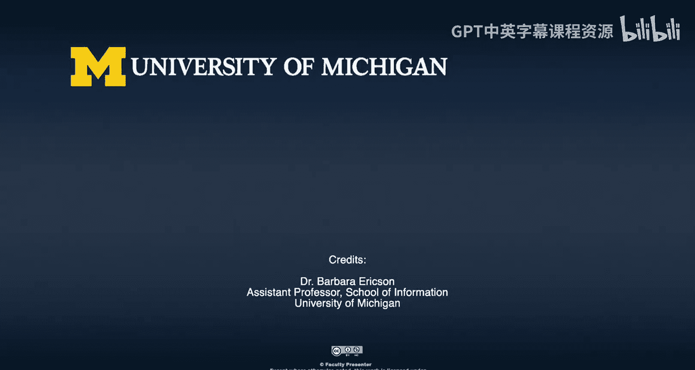
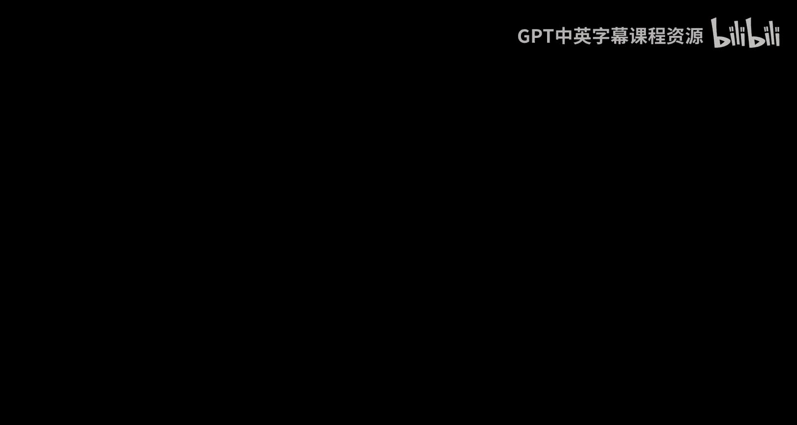

# 20：欢迎进入第二周 🎉

在本节课中，我们将要学习如何编写简单的类。我们将了解类的各个组成部分，识别并修复创建类时常见的错误，并最终编写一个模拟现实世界对象的简单类。

## 本周学习目标

上一节我们介绍了本周的总体安排，本节中我们来看看具体的学习目标。以下是本周我们将要掌握的内容：

*   学习如何编写简单的类。
*   学习如何识别类的所有组成部分，包括：类的定义、构造函数（`__init__`方法）、`__str__`方法、属性和方法。
*   修复在开始创建类时常见的代码错误，例如在将`self`作为参数传递时忘记写入。
*   预测对象创建、方法调用和对象打印时的执行流程。
*   解释对象和类之间的区别。
*   编写一个模拟现实世界对象的简单类，例如一个可以摇晃并获取答案的“神奇八号球”。

## 关于实践项目

上一节我们明确了学习目标，本节中我们来看看具体的实践项目。我们将编写一个类似“神奇八号球”的类。

但与通常给出“是”、“否”或“也许”等答案的神奇八号球不同，我们编写的类可以告诉你一个“运势”，例如“你将在考试中取得优异成绩”。

祝你好运。😊

---

本节课中我们一起学习了第二周的学习目标和实践项目。我们明确了本周将聚焦于理解并编写简单的类，识别其结构，并最终完成一个模拟“神奇八号球”的编程实践。