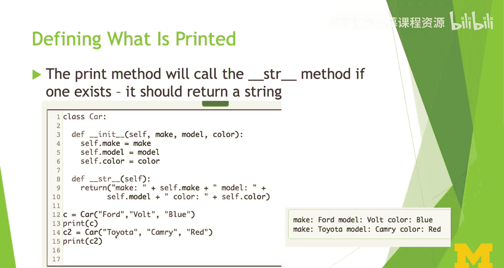

# 创造性编程：21：Python类编写指南 🚗


在本节课中，我们将学习如何在Python中定义自己的类。类是面向对象编程的核心，它允许我们将数据（属性）和功能（方法）捆绑在一起，创建自定义的数据类型。我们将从创建一个简单的`Car`类开始，逐步为其添加属性和方法。

## 定义类的基本结构

在Python中，我们使用`class`关键字来定义一个类。类名通常以大写字母开头。

```python
class Car:
    pass
```

`pass`是一个占位符关键字，它允许代码在结构不完整的情况下通过编译。这在你需要先搭建框架，稍后再填充具体实现时非常有用。

使用这个类，我们可以创建一个对象：

```python
c = Car()
print(type(c))
```

运行上述代码，输出会显示`<class '__main__.Car'>`，这表示我们已经成功定义了一个类并创建了它的一个实例对象。不过，这个对象目前还没有任何实际信息。

## 初始化对象属性：`__init__`方法

上一节我们创建了一个空的类。为了让对象包含有意义的数据，我们需要一个特殊的方法来初始化对象的属性。这个方法叫做`__init__`。

`__init__`方法在创建新对象时自动调用。它的第一个参数必须是`self`，它代表当前正在创建的对象实例。我们可以通过`self`来设置对象的属性。

以下是定义`Car`类并初始化其`make`（品牌）、`model`（型号）和`color`（颜色）属性的方法：

```python
class Car:
    def __init__(self, make, model, color):
        self.make = make
        self.model = model
        self.color = color
```

请注意，`self.make`、`self.model`和`self.color`是对象的属性，而`make`、`model`和`color`是传递给方法的局部变量。虽然它们名称相同，但代表的是两个不同的事物。

现在，我们可以这样创建并打印一个`Car`对象：

```python
c = Car("Ford", "Volt", "blue")
print(c)
```

然而，直接打印对象`c`仍然只会输出类似`<__main__.Car object at 0x...>`的信息，这并不直观。

## 美化对象输出：`__str__`方法

为了让打印对象时显示更有用的信息，我们需要定义另一个特殊方法：`__str__`。当使用`print()`函数打印一个对象时，Python会自动调用这个对象的`__str__`方法，并打印其返回的字符串。

这个过程被称为“方法重写”。`Car`类默认继承了一个基础的`__str__`方法，它只返回类名。我们需要重写它以提供自定义信息。

以下是添加`__str__`方法的`Car`类：

```python
class Car:
    def __init__(self, make, model, color):
        self.make = make
        self.model = model
        self.color = color

    def __str__(self):
        return "Make: " + self.make + ", Model: " + self.model + ", Color: " + self.color
```

现在，当我们创建并打印对象时：

```python
c1 = Car("Ford", "Volt", "blue")
print(c1)  # 输出：Make: Ford, Model: Volt, Color: blue

c2 = Car("Toyota", "Camry", "red")
print(c2)  # 输出：Make: Toyota, Model: Camry, Color: red
```

这样，我们就得到了清晰、易读的对象信息。

## 核心要点总结

本节课中我们一起学习了Python类的基础编写指南。以下是创建类时需要掌握的核心步骤：



1.  **定义类**：使用`class`关键字，类名首字母大写。
2.  **初始化属性**：定义`__init__(self, ...)`方法来设置对象的初始状态。记住，所有实例方法的第一个参数都必须是`self`。
3.  **定义字符串表示**：重写`__str__(self)`方法，返回一个描述对象的字符串，以便使用`print()`时能输出友好的信息。


掌握`__init__`和`__str__`这两个方法是开始创建自定义类的关键。它们让你的对象既能存储数据，又能清晰地展示自己。