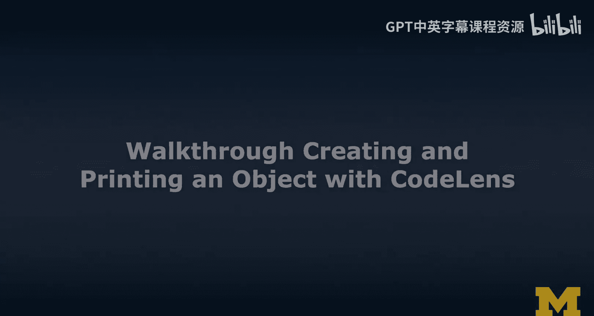
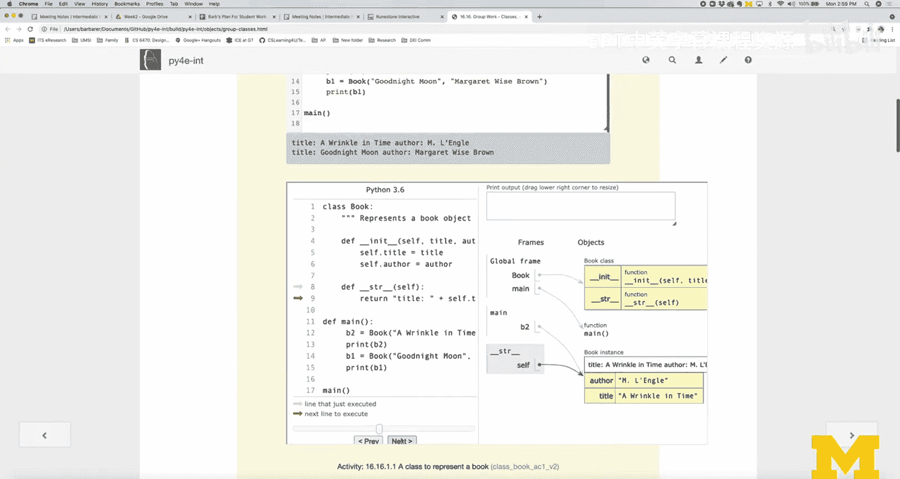
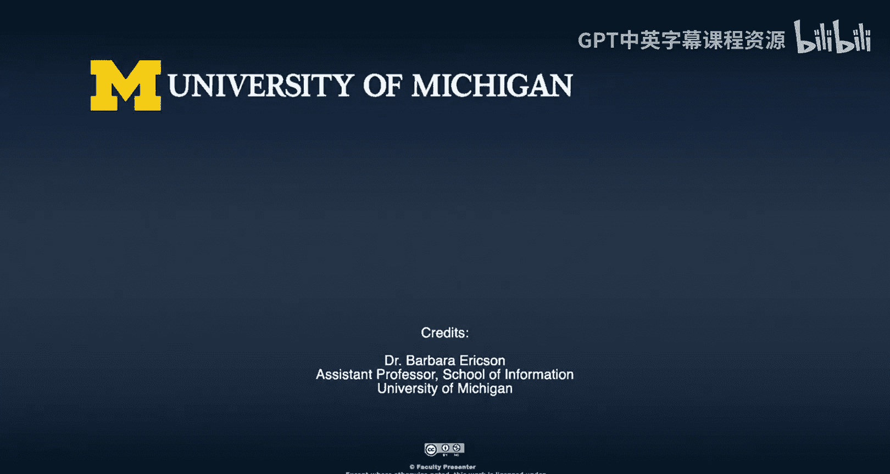

# 22：使用CodeLens调试对象创建过程 🐛




在本节课中，我们将学习如何使用CodeLens工具，一步步地观察和理解在Python中创建一个类对象并打印它时，程序内部究竟发生了什么。

上一节我们介绍了类和对象的基本概念，本节中我们来看看对象创建和打印的具体执行流程。

## 代码示例与执行流程

我们有一个`Book`类，当我们运行程序时，它会打印出类似“title: a wrinkle in time, author: Madeleine L'Engle”的信息。这个过程是如何发生的呢？

以下是使用CodeLens逐步调试的步骤：

1.  **定义类**：程序首先会定义`Book`类。
2.  **定义主方法**：接着，它会定义`main`函数。
3.  **执行主方法**：然后，程序跳转到第11行开始执行`main`函数。
4.  **创建对象**：在第12行，我们创建`Book`对象并初始化其属性（或变量）。这一步会自动调用`__init__`函数。
5.  **调用`__init__`**：`__init__`方法接收`self`（指向当前对象实例的引用）、`title`和`author`参数，并将这些信息设置到对象中。
6.  **打印对象**：当我们尝试打印这个对象时，Python会自动寻找并调用该对象的`__str__`方法。
7.  **调用`__str__`**：`__str__`方法返回一个字符串。
8.  **输出结果**：最后，这个返回的字符串被打印到屏幕上。

## 核心概念解析

在创建对象时，有两个特殊方法被自动调用：

*   **`__init__`方法**：这是对象的构造器或初始化器。它的作用是初始化对象的属性。
    ```python
    def __init__(self, title, author):
        self.title = title
        self.author = author
    ```
*   **`__str__`方法**：当使用`print()`函数打印对象时，Python会调用此方法来获取对象的字符串表示形式。
    ```python
    def __str__(self):
        return f"title: {self.title}, author: {self.author}"
    ```

通过使用CodeLens逐步执行代码，我们可以清晰地看到程序控制流如何跳转，以及这些特殊方法是如何在对象生命周期中被调用的。这有助于我们精确理解从类定义到对象创建和使用的完整过程。






本节课中我们一起学习了如何使用CodeLens调试工具来跟踪对象创建和打印的详细步骤。我们看到了`__init__`和`__str__`这两个特殊方法在何时以及如何被自动调用，从而加深了对Python面向对象编程内部机制的理解。