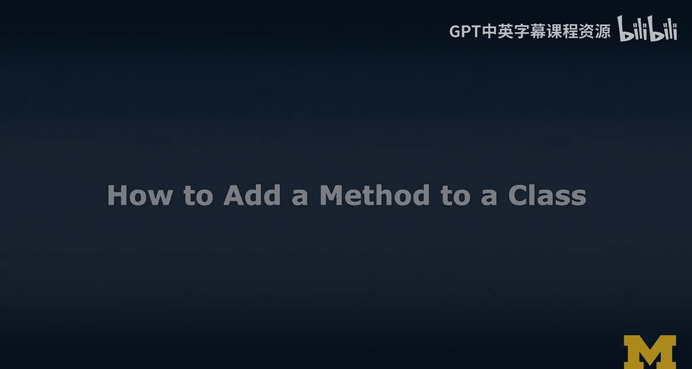
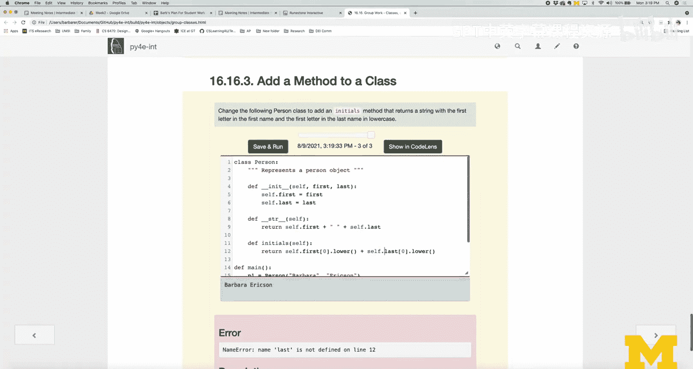
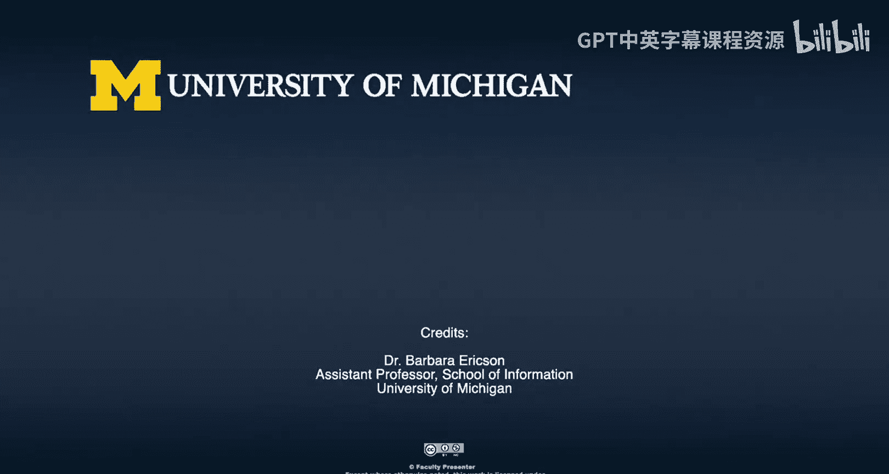

# 面向对象编程：23：为类添加方法教程 🧩




在本节课中，我们将学习如何为Python类添加新的方法。我们将通过一个具体的例子，演示如何为一个表示“人”的类添加一个用于生成姓名首字母缩写的方法。

---

上一节我们介绍了类的初始化方法和字符串表示方法。本节中我们来看看如何为类添加一个全新的、具有特定功能的方法。

假设我们有一个`Person`类，它包含`first_name`（名）和`last_name`（姓）两个属性。现在，我们希望为这个类添加一个方法，用于生成并返回此人姓名的小写首字母缩写。

为类添加方法的过程非常简单。就像定义 `__init__` 或 `__str__` 方法一样，我们在类内部定义一个函数即可。这个新方法必须将 `self` 作为第一个参数，以便在方法内部访问当前对象的属性。

以下是添加 `initials` 方法的步骤：

1.  在类定义内部，使用 `def` 关键字定义新方法。
2.  方法名可以自定义，这里我们使用 `initials`。
3.  方法的第一个参数必须是 `self`。
4.  在方法体内，通过 `self.first_name` 和 `self.last_name` 访问对象的属性。
5.  使用字符串索引 `[0]` 获取名字和姓氏的第一个字符。
6.  使用 `.lower()` 方法将字符转换为小写。
7.  将两个小写首字母拼接起来，并使用 `return` 语句返回结果。

以下是实现此功能的代码示例：

```python
class Person:
    def __init__(self, first_name, last_name):
        self.first_name = first_name
        self.last_name = last_name

    def __str__(self):
        return f"{self.first_name} {self.last_name}"

    # 这是我们新添加的方法
    def initials(self):
        # 获取名字的首字母并转为小写
        first_initial = self.first_name[0].lower()
        # 获取姓氏的首字母并转为小写
        last_initial = self.last_name[0].lower()
        # 返回拼接后的首字母缩写
        return first_initial + last_initial

# 创建Person对象并测试新方法
person1 = Person("John", "Doe")
print(person1.initials())  # 输出：jd
```

运行上述代码，将会成功打印出 “jd”。这表明我们成功地为 `Person` 类添加并调用了一个新方法。

在编写类方法时，有两个关键点必须牢记：
*   方法定义时，第一个参数必须是 `self`。
*   在方法内部访问对象的属性时，必须通过 `self.属性名` 的形式（例如 `self.last_name`）。如果忘记添加 `self.` 前缀，Python解释器将无法识别该变量，并会报错提示“未定义”。



---



本节课中我们一起学习了如何为Python类添加新的方法。我们了解了定义方法的语法，明确了 `self` 参数的关键作用，并通过一个生成姓名首字母的实例掌握了从访问属性到返回结果的完整流程。为类添加方法是扩展其功能、封装相关操作的基本方式。