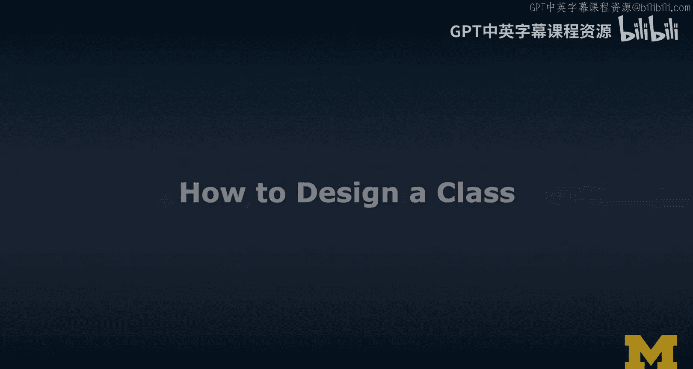
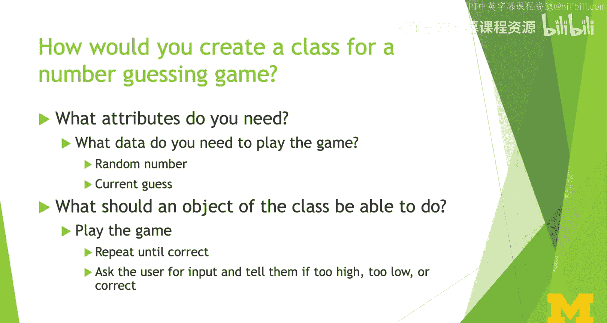

# 创造性编程：24：类设计方法论 🎯




在本节课中，我们将学习如何为一个简单的猜数字游戏设计一个类。我们将从分析游戏需求开始，识别出类所需的属性和方法，并最终用代码实现它。

---

## 从需求到设计

上一节我们讨论了类的基本概念。本节中，我们来看看如何为一个具体的问题设计类。以猜数字游戏为例：游戏主持人心中想一个1到100之间的随机数，玩家进行猜测，主持人会告知猜测是“太高”、“太低”还是“正确”。

为了将这个游戏转化为代码，我们需要思考这个类需要什么。

## 识别类的属性

设计类时，首先要考虑的是**属性**，即这个类的对象需要跟踪哪些数据。

以下是猜数字游戏对象需要跟踪的数据：
*   **`number`**：主持人心中所想的随机数。
*   **`guess`**：玩家当前猜测的数字。

## 定义类的方法

接下来，我们需要定义类的**方法**，即对象能够执行的行为。对于这个游戏，核心行为就是“玩游戏”。

因此，我们需要一个 `play` 方法。这个方法将包含一个 `while` 循环，直到玩家猜对为止。在每次循环中，如果猜测不正确，程序会要求用户输入一个数字，并告知其猜测结果是太高、太低还是正确。

---

## 代码实现

现在，让我们尝试为这个设计编写代码。

```python
import random

class GuessingGame:
    def __init__(self):
        # 属性：随机数和当前猜测
        self.number = random.randint(1, 100)
        self.guess = None

    def play(self):
        # 方法：执行游戏逻辑
        while self.guess != self.number:
            # 获取用户输入
            self.guess = int(input("请猜一个1到100之间的数字："))

            # 判断猜测结果
            if self.guess < self.number:
                print("太低了！")
            elif self.guess > self.number:
                print("太高了！")
            else:
                print("恭喜你，猜对了！")

# 创建游戏对象并开始游戏
game = GuessingGame()
game.play()
```




---


本节课中我们一起学习了面向对象编程中的类设计方法论。我们通过一个猜数字游戏的例子，实践了如何从需求中识别出类的属性（如 `number` 和 `guess`）和方法（如 `play`），并最终将其转化为可运行的代码。掌握这种“需求分析 -> 识别属性与方法 -> 代码实现”的设计流程，是进行创造性编程和构建复杂程序的基础。