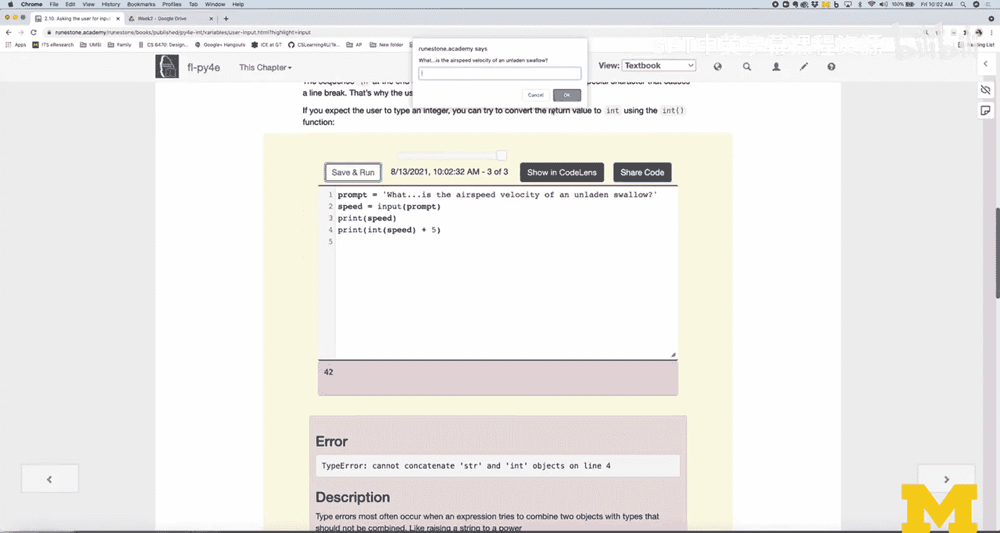

# 创造性编程：25：用户输入获取 🎮


在本节课中，我们将要学习如何在Python程序中获取用户的输入。这是创建交互式程序（如游戏或工具）的基础。我们将了解`input()`函数的工作原理，以及如何处理用户输入的数据类型。

## 概述

当你在玩游戏时，通常需要从用户那里获取输入。Python提供了一个内置函数`input()`来实现这个功能。本节将介绍如何使用`input()`函数，并重点说明其返回的数据类型始终是字符串。如果你需要对输入进行数学运算，必须将其转换为整数或其他数字类型。

## `input()`函数的基本用法

`input()`函数用于从用户那里获取输入。你可以包含一条消息，作为提示显示给用户。该函数会返回用户输入的内容，你需要将其存储在一个变量中以便后续使用。

以下是使用`input()`函数的基本语法：

```python
user_input = input("提示信息：")
```

例如，你可以询问用户的名字并打印出来：

```python
name = input("What is your name? ")
print("Hello, " + name)
```

运行这段代码时，会弹出一个窗口询问“What is your name?”，用户输入名字后，程序会打印问候语。

## 处理数字输入

`input()`函数总是返回字符串。如果你期望用户输入一个数字并打算对其进行算术运算，就必须先将字符串转换为整数。

转换需要使用内置的`int()`函数：

```python
number_string = input("Enter a number: ")
number_int = int(number_string)
result = number_int + 10
print("Your number plus 10 is:", result)
```

如果你忘记转换而直接进行数学运算，Python会报错。例如，尝试将字符串与整数相加会导致类型错误。

```python
# 这会导致错误
age = input("How old are you? ")
next_year_age = age + 1  # 错误：无法将字符串与整数相加
```

正确的做法是先转换：



```python
age = input("How old are you? ")
age_int = int(age)
next_year_age = age_int + 1
print("Next year you will be:", next_year_age)
```

## 关键要点总结

本节课我们一起学习了如何获取和处理用户输入。


*   `input()`函数用于获取用户输入，并可以附带提示信息。
*   该函数**总是返回一个字符串**。
*   如果你计划对输入进行数学运算，**必须使用`int()`函数**将其转换为整数。
*   忽略类型转换会导致程序错误。


记住这些要点，你就能在程序中有效地与用户进行交互了。