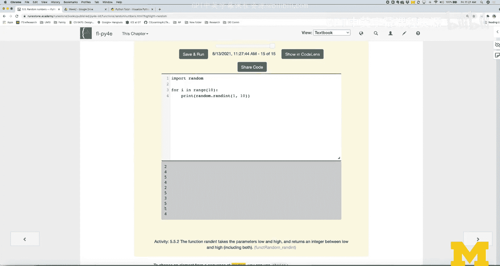

# 26：随机数生成实践 🎲


在本节课中，我们将学习如何在Python中生成随机数，这是开发猜数字游戏等程序的关键步骤。我们将重点介绍`random`模块的两个核心函数。

## 概述

我们将探索Python内置的`random`模块，学习如何生成随机浮点数和指定范围内的随机整数。这些技能对于创建需要随机元素的程序至关重要。

## 生成随机浮点数

首先，我们需要导入`random`模块。该模块包含一个名为`random()`的函数，它可以生成一个介于0.0（包含）和1.0（不包含）之间的随机浮点数。

以下是使用`random()`函数生成10个随机数的示例代码：

```python
import random
for i in range(10):
    print(random.random())
```

运行这段代码，你会看到类似`0.94`这样的输出。这些数字非常接近0，但永远不会正好是1。这个函数适用于需要小数随机值的情况。

## 生成指定范围的随机整数

上一节我们介绍了生成随机小数的方法，但在猜数字游戏中，我们通常需要的是整数。本节中我们来看看如何生成指定范围内的随机整数。

`random`模块提供了`randint()`函数来解决这个问题。它接受两个参数：一个下限值和一个上限值，并返回一个介于这两者之间（包含上下限）的随机整数。

以下是使用`randint()`函数生成10个1到10之间随机整数的示例：

```python
import random
for i in range(10):
    print(random.randint(1, 10))
```

运行这段代码，你可能会看到`1`，也可能看到`10`。多次运行可以验证，`randint(1, 10)`确实会等概率地生成1到10之间的所有整数，包括1和10。这个函数非常适合用于我们的猜数字游戏。



## 总结


本节课中我们一起学习了Python中生成随机数的基本方法。我们首先使用`random.random()`生成0到1之间的随机小数，然后使用`random.randint(low, high)`生成指定范围内的随机整数。掌握这两个函数，你就能为各种程序（如猜数字游戏）注入随机性了。